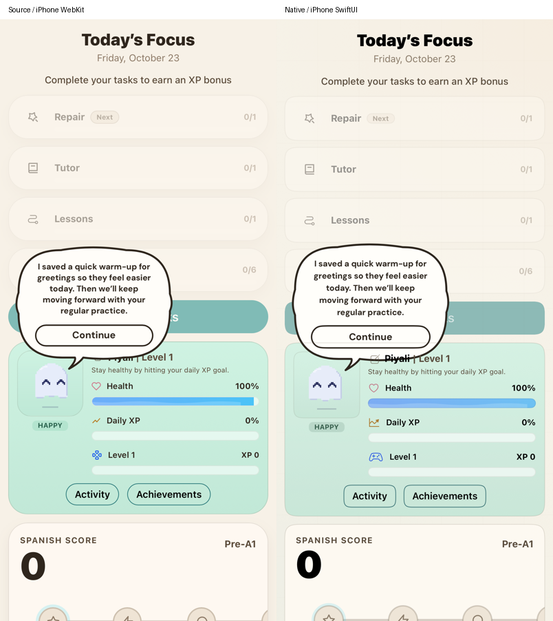
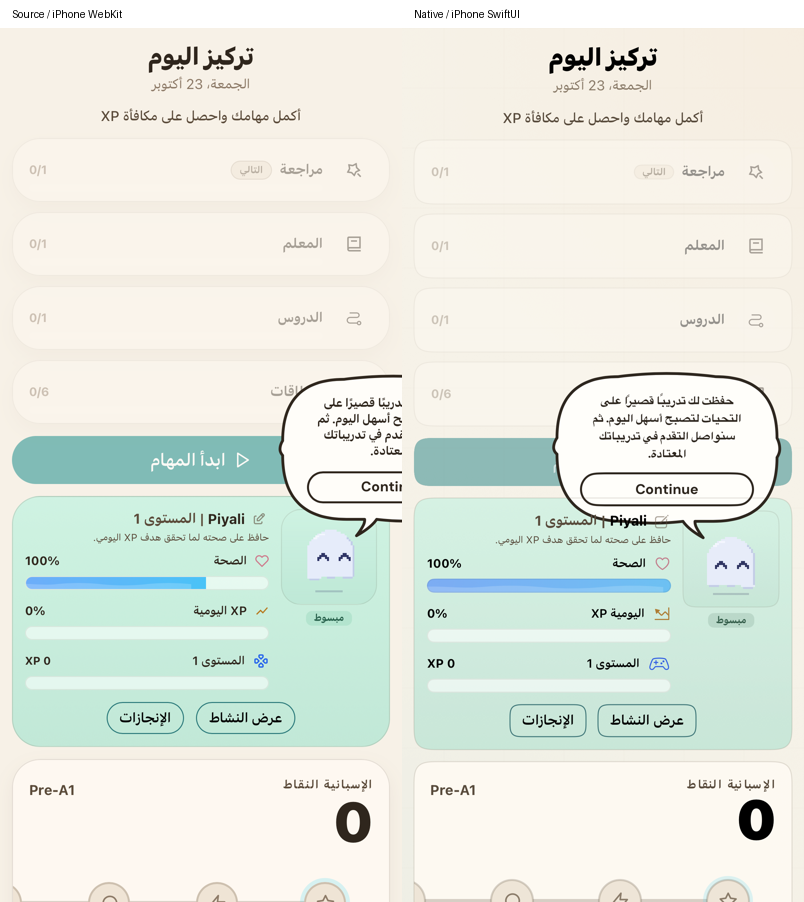

# Returning-day companion and repair checkpoint

This restores part of the main `/` product. Full functional and design parity remains in progress.

The earlier native home built its messages and repair list directly from currently active notes. That included today's notes, ignored the web's saved AI plan, and could remove the repair task as soon as a note was reinforced. It also exposed a generic “Complete repair (+20 XP)” action.

The native app now reads a saved per-language/day blueprint, repair plan and explanation. It prepares tomorrow after a quest clears, including on Day 1, and has the source's returning-open fallback. The source rules rank and deduplicate yesterday's memory, cap repair at three items, include the learner's active goal, durable learning evidence and actual performance, validate model-selected memory IDs, choose varied activity modes, and supply the original deterministic fallback. First-quest welcome, ready AI message preference, dismissal and cleared-repair bubble conditions follow the active source logic.

`export-companion-quest.mjs` extracts a dependency closure of pure declarations from the reference. It does not import the web app, React stores, Firebase or provider modules. A plain input snapshot replaces the one store read, an explicit clock makes source execution reproducible, and the authored phonics selector reads the already exported source deck. The recall prompt and parser are split at the original network call. See the declaration hashes and adapters in [the source manifest](reference/companion-quest-source-manifest.json). The generated bundle runs in JavaScriptCore; UI, storage, provider requests and audio stay native Swift.

## Storage and activities

- Shared authority is `users/{npub}/questDays/{language_day}`: `blueprint`, `repair`, `explanation`, and the source's `practice_flashcards_repairN` / `practice_phonics_repairN_authored-v1` artifacts. These maps are excluded from `iosStateJSON` as a second authority.
- Firebase transactions reserve generation before the provider request. Ready plans survive competing or late responses. The source ten-minute stale-generation window remains. Account, language, goal, day, memory and cancellation fences reject stale work. Current/tomorrow hydration must finish before a production batch can run.
- Offline outboxes retain local plans, outcomes, reinforcement and evidence until acknowledgment. Artifact creation keeps the first saved deck; outcomes and XP retries cannot grant the same card or repair step twice. Sibling quest fields, other languages, membership and unrelated profile fields survive merges.
- A saved repair has a stable `0/N` course counter. Its next step comes from the original mode-selection policy. Reinforcement does not remove that task or change its target.
- Recall uses the original small generated deck with a deterministic floor card. Successful recall awards **2 XP**, records a daily practice outcome, and does **not** write ordinary SRS or advance Review. Hard/reveal/unsuccessful attempts do not complete it. All required recall cards finish one repair step.
- Pronunciation uses exact authored material, including the original and transfer roles. Only those roles are required to finish; the source pronunciation judge grants **1–2 XP per successful attempt**, including repeats, and does not advance the ordinary phonics task. Changing support language reloads authored copy while keeping the saved focused IDs/outcomes. Missing authored material routes to Tutor with the same objective.
- Mixed lessons use the original ephemeral lesson payload, five native engines, level guard and **10-XP practice threshold**. Finishing adds one repair increment and reinforces its memory; it does not grant another completion XP reward or add a curriculum lesson.
- Tutor repair supplies the saved concept to native text/live voice tools and checks actual learner attempts. Completed steps write the original bounded repair evidence reducer into `learningIntelligence[language].repairSummary` through an idempotent transaction.

Active handlers matter here: older comments in `companionMemory.js` and `FlashcardSkillTree.jsx` say repair cards join ordinary SRS. The current `App.jsx` explicitly skips ephemeral cards in `persistFlashcardReview`; the active focused handler writes separate practice outcomes and 2-XP rewards. This implementation follows those handlers.

## Verification and limits

The Core suite executes **198 source-derived fixtures**, covering eleven-language bubbles, memory selection, stale guards, source prompts, model-result validation, step selection, ephemeral lessons, recall cards, authored pronunciation selection and repair evidence. Native integration tests cover first-quest exclusion, tomorrow preparation, stable task keys, relaunch, wrong/repeated recall, source XP thresholds, original/transfer pronunciation, translation refresh and once-only completion. Firebase emulator checks exercise concurrent generation, first saved artifacts, canonical mirrors, idempotent card/step rewards, durable evidence, existing memory retries and paid-field/XP preservation.

The same public ready-blueprint fixture is rendered in iPhone WebKit and native SwiftUI. These are component comparisons, not proof of the whole signed-in journey or pixel parity. The source preview uses an anonymous fixture and the native test a device-scoped identity, so the source’s account-seeded Review target may differ. Animated pet frames also differ by capture time. The native balloon stays within the Arabic viewport; the current source balloon clips at its right edge. The original captures retained native superellipse corners. The later [home panel correction](COMPANION_PANEL.md) follows the actual rounded corners rendered by iPhone WebKit for the companion panel; wider task-card and balloon differences retain their own scope. Icon, corner and typography details still need wider comparison. The source fixture has no account and cached headline, so it cannot write learner data or generate a private AI request.

| English | Arabic |
|---|---|
|  |  |

The latest checks passed: 56 affected Core tests (including the 198-fixture policy test), followed by a five-test check covering invalid/fractional repair counters, 8 native integration/emulator/source-render tests, the onboarding/menu UI regression, and a live Responses check of English/Arabic blueprints plus three-card recall generation. The live check used public fixtures and made no learner progress writes.

The focused flashcard deck/dialog now uses the source controls, semantic grading, separate 2-XP save and acknowledged completion ordering; see [flashcard evidence and remaining limits](FLASHCARDS.md). Focused phonics now uses the source stack, judge, receive-only Realtime narration, separate per-attempt rewards and acknowledged completion; see [phonics evidence and limits](PHONICS.md). Focused Tutor presentation and full modal sequencing remain open. Live repair pronunciation and physical microphone/audio-route behavior need end-to-end checks; simulator word recognition is not proof of pronunciation quality. The diary/explanation browser and memory drawer design remain separate work. Broader landing, onboarding, goal, mode, payment and account parity remain open in [the parity audit](PARITY_AUDIT.md).
