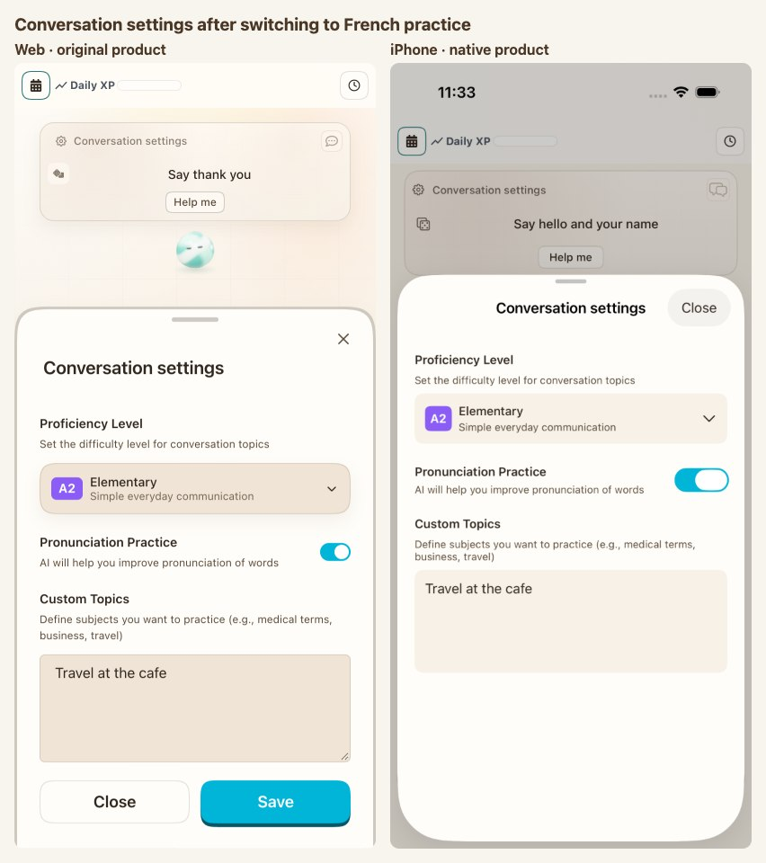
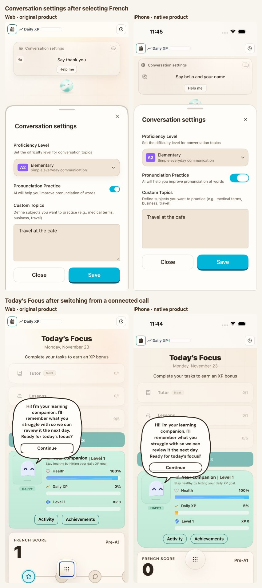
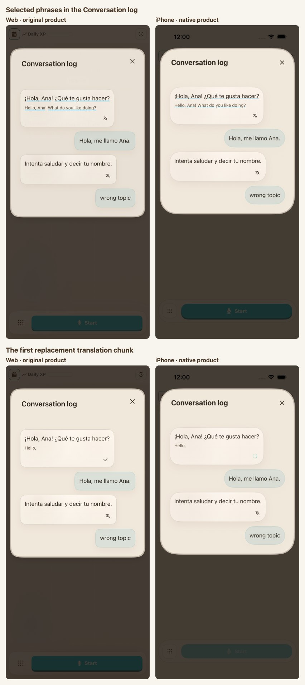

# Conversations correction

The generic conversation form has been replaced by the source voice-first screen: a compact settings/goal/chat-log card, foundation help, a small orb area, the latest assistant reply, and the shared fixed action bar. The screen begins with Start, then shows separate mute, pause/resume and end controls. There is no typed-reply form and no automatically generated opening message. Starting listens for the learner, as the reference does.

Settings use the actual source proficiency descriptions, pronunciation switch and custom-topic copy. Closing after a level/topic edit regenerates the topic; shuffling preserves the private conversation, progression and rewards. The source uses observed rating for generated challenge even when the saved proficiency preference changes; native topic selection, instructions and difficulty quotes now follow that policy. Curriculum context samples up to 15 unit/lesson titles from all levels through the observed level, excluding tutorials and quizzes.

The actual `Conversations.jsx` initial-topic, contextual-goal, judge and voice instruction expressions run in the existing pure policy interpreter. The original starter prompt/parser supplies a target phrase, at most one personal blank and its support-language translation. Network, audio, private state and UI remain native. Initial topics use the configured Firebase text path; contextual goals/judges use Responses; separate source difficulty assessment produces the saved quote. Source hashes are in the policy and UI manifests.

## Speech and learning behavior

Learner transcription now has its own callback, so saving/grading starts before the assistant finishes speaking. Completed assistant replies are saved separately. Provider IDs deduplicate messages and let a delayed learner transcript be inserted before its already-saved reply. Older private drafts decode without those optional IDs. Scope checks still reject callbacks after account/language/view replacement.

New connections do not treat the old chat log as fresh speech. Pause/resume retains mute and supplies a frozen private history snapshot; later instruction updates do not repeatedly append the current connection's messages. Starter playback ducks the microphone, server VAD and remote track without changing the user's mute setting or re-enabling input during assistant speech. Native narration keeps the existing voice-chat audio session while connected.

A successful goal remains visible briefly before the next goal, matching the source's 1.5-second transition. The purple completion summary shows this connection's XP, goals and speaking turns, plus per-language XP progress. Its totals survive pause/resume and do not award again when reviewed. The chat log preserves separate learner/tutor bubbles, translation and saving to private notes.

## Language changes and overlapping requests

Changing support language now regenerates the goal and starter while preserving the private session, message log, turn receipts, XP and rating. Goals record their requested support language; translations record theirs and are only displayed for that language. Unknown older translations remain stored but can be translated again. Older goals are adopted only when a single matching language key proves their language; the source sometimes aliases a localized goal under `en`, so multiple untagged keys trigger regeneration. Optional fields keep older drafts decodable.

Account, practice-language and support-language changes close the old connection and clear temporary voice text. Every pending goal, starter, translation and grade fences both its result and error against that context. An old request cannot overwrite the current goal or clear another request's busy state. Speech still gets assessed while a translation is pending; only another pending grade causes neutral practice. Continued speech during the source's delayed successor-goal transition shares one goal request. Returning to an already completed saved goal advances without another completion reward.

## Native orb and centered completion dialog

Conversations now uses a native SceneKit/Metal sphere rather than the static app artwork. Its 72×48 deformed body, curved face, eight exported eye outlines, critically damped morph, blinking, default tutor moods, mint/blue palettes, pigment flow, thinking dots and five reactions follow the original orb. Correct goals produce the source joyful moods and reactions; misses produce curious/tender moods; an inactive call rests with sleepy eyes. The source's `getRealtimeOrbVisualState` intentionally swaps listening and speaking visual patterns; the native view now applies that same mapping while retaining the actual state in accessibility text and audio metering. Explicit reactions expire even when Reduce Motion stops the frame loop. Scene resources stop animating offscreen or behind the conversation sheets/dialog.

The original default pigment and Three ACES tone-mapping expressions are converted to Metal shader modifiers. The original RoomEnvironment is captured as linear RGBE for native image-based lighting; Three's MIT notice is bundled. Native transparent-ink blending has a gamma adapter. This preserves the source artwork and movement, while the SceneKit lighting model, reflections, shadow filtering and final compositing still require further visual calibration. The [public demo](LANDING_DEMO.md) now uses the display personalities and pet/drag behavior too; other orb surfaces remain to be migrated.

WebRTC input/receiver statistics supply normalized audio amplitude at 100-ms intervals. The native visual envelope follows the executed source noise-floor, onset/hold and attack/release policy. Muting input, starter playback ducking, disconnect and stale connection samples cannot keep the orb reacting to old audio. Statistics do not alter microphone recording, server VAD or reward decisions. The real receive-only WebRTC check also passes (6.4s), including positive receiver amplitude from incoming RTP. Microphone amplitude, audible response and physical-device behavior remain unverified.

The completion summary is now a centered, rounded purple dialog with the original character-34 portrait mapping, mobile inset/spacing, XP badge, green progress colors and Done button. The page behind it is dimmed and cannot be operated. Done, outside-tap and accessibility escape close the dialog without modifying rewards. The card can scroll on smaller displays. Fine geometry, wave decoration, all locales, dynamic text sizes and transitions remain visual-comparison work.

## Verified

- **25 affected Core checks pass** (0.54s), including 120 reaction poses and 16 eye-morph trajectories executed by the original source, the original voice-envelope trajectory, conversation/language compatibility and realtime policies. The previous complete Core baseline is 221 passing tests (164.8s); the three visual-policy tests were added after that baseline.
- **17 native checks pass**: seven language/service races; eight voice-controller checks, including audio envelope mute/duck/stale-sample handling; and two actual renderer checks covering both palettes, transparent corners, non-white pigment and reaction expiry with Reduce Motion. Renderer snapshots exercise Metal shaders, not replacement artwork. Their scope does not prove complete pixel parity.
- The three conversation simulator journeys pass together: settings/theme persistence, English → French → Spanish support refresh/relaunch, and the complete voice/reward/history journey. They retain the original five XP, one goal/two-turn summary, private history/note and unchanged account XP after relaunch. The final full voice journey also verifies outside-tap dismissal, a second zero-turn/+0-XP call and Done dismissal (78.6s). The latest complete run and durations are in [VALIDATION.md](VALIDATION.md).
- The earlier real provider check passes (30.0s): initial/contextual goals, communication-success/wrong-language/premise-rejection judging, starter, translation and legacy text/reply/Gemini audio paths. It deletes its disposable authentication. This visual correction does not change those prompts or endpoints. OpenAI WebRTC's separately verified network scope is in [VOICE_TRANSPORT.md](VOICE_TRANSPORT.md).

The simulator voice journeys send scripted protocol events through the production controller and learning service. They do not capture microphone audio or add extra learner controls. A failed container-type assertion was replaced with checks of the visible dialog position and blocked underlying controls. Screenshot review also corrected the portrait-map offset before the final captures.

## Source/native captures

The reference renderer uses the unmodified goal/orb, summary and call-control JSX, original styles/copy and original 3D renderer with fixed QA state. It inherits the actual Chakra/theme/index fonts; the earlier comparison fixture's forced DM Sans override was removed. It omits account/model/microphone effects. Its footer host reserves the global menu slot; it is not the full web app header/portal. Reference frames are 402×874; native captures include the iOS status bar and current product shell at simulator resolution. They support comparison of this component, not a claim of complete screen pixel parity.

| State | Source | Native |
|---|---|---|
| Initial light | [Original goal/orb/control panel](reference/conversation-light.png) | [Native initial screen](native/conversation-light.png) |
| Dark | [Original connected controls](reference/conversation-dark-controls.png) | [Native initial dark](native/conversation-dark.png), [settings](native/conversation-settings-dark.png) |
| Completion | [Original centered dialog](reference/conversation-summary.png) | [Native centered dialog](native/conversation-summary.png) |
| Other native states | Source behavior inspected in `Conversations.jsx` | [Paused controls](native/conversation-paused.png), [reply](native/conversation-reply.png), [summary](native/conversation-summary.png), [private history](native/conversation-history.png) |

Fixed sleepy-pose comparisons: [source mint](reference/orb-mint-sleepy.png), [native mint](native/orb-mint-sleepy.png), [source blue](reference/orb-blue-sleepy.png), [native blue](native/orb-blue-sleepy.png). Source orbs are 256×256 on the page background; native renderer snapshots retain transparency and display scale. Source hashes and the HDR asset are recorded in [orb manifest](reference/orb-visuals-manifest.json).

The dark images show different call states; they are labeled accordingly. `scripts/render-conversation-reference.mjs --serve` recreates the isolated source fixture, and `scripts/export-conversation-ui.mjs` refreshes the source UI copy/manifests. The reference repo remains read-only.

Language-state captures from that successful run: [French support](native/conversation-support-fr.png) and [Spanish support restored](native/conversation-support-es-restored.png).

## Remaining differences

This is a scoped correction, not completed Conversations parity. Orb lighting/reflections/compositing need further comparison, and other screens still retain static display artwork. Live text still lacks archival animation and some streaming behavior; aligned replies and translation are described below. Exact recorded-audio replay/cache, source Realtime narration, advanced global voice/personality/pause preferences and cross-device web draft compatibility remain open; interrupted-speech continuation is described below. The centered summary still needs all locale/dynamic-text and fine geometry/wave-animation comparisons.

Physical microphone capture, audible playback, starter ducking, interruptions/routes and device background behavior still require iPhone audio interaction. Passing scripted events, model calls and received RTP packets does not establish those behaviors or full functional/design parity across the app.

## Interrupted reply pause and resume

Pause now saves the current partial assistant reply in private history with an interrupted marker, freezes the conversation context and closes the old connection. Resume invokes the original `resumeRealtimeSpeech` helper's WebRTC path: it asks the assistant to restate and finish the interrupted reply without grading or awarding again. The microphone and VAD remain locked until resumed audio stops, including when the reply had not yet produced text. User mute persists. Pause/reconnect work is fenced by account, languages and conversation identity; an in-flight grade can finish while the user resumes. WebRTC does not expose a reliable unplayed audio offset, so this is a new continuation rather than exact audio replay.

The original helper is exported in the [Tutor source policy](reference/tutor-source-manifest.json) and its source-executed fixture set. Twenty-two relevant Core tests and ten native Realtime controller checks passed, including the frozen context, empty partial, microphone lock, mute and no extra input/grade. The isolated simulator journey paused a partial response and verified the continuation, zero extra XP and both messages after relaunch (57.8s). A second run held the previous grade open and verified immediate Resume, eventual feedback and private-history relaunch (54.8s); the existing mute/pause/summary/relaunch journey also passed (74.9s). The first attempt at the new journey failed during initial product-menu navigation before entering Conversation, and the rerun passed. [Native paused state](native/conversation-interrupted-resume.png) is a fixture capture, not a matched full-source viewport comparison.

A live Piyali WebRTC check passed in 11.1s: the source-derived continuation request returned a completed transcript and audio-stop event without another learner turn. Its microphone was disabled; physical microphone, speaker, interruption/route behavior and exact audio replay remain unverified.

## Conversation translation and alignment

Completed assistant replies now use the original direct-translation prompt. Gemini output updates the visible reply incrementally; if it produces no text, the authenticated Responses fallback returns the complete translation. Partial text is held in memory and only the final translation is saved. A pending request is fenced by account, target/support language, conversation identity and message text; a support change cannot publish its late chunks. Translating one message no longer blocks a separate grade. The source’s global `showTranslations` setting controls both translated text and its action. The action remains available for retranslation.

Saved native messages can carry phrase pairs, and the latest reply and history use the source-derived alignment/highlight renderer when those pairs match the current support language. The current web translation path returns empty pairs, so native does not invent them. The original Conversation alignment functions were executed over 40 multilingual, repeated and overlapping phrase cases; native produced the same plans. Eleven source-executed direct-translation prompt cases passed. The shared renderer also passed its existing source Tutor component comparisons at two phone widths in English and Arabic (28.9s); that is not a full Conversation viewport comparison.

Eight native service race checks passed, as did the isolated streaming-translation/relaunch journey (56.6s) and support-language/relaunch journey (81.6s). The first live translation check returned complete results on both providers, but its short Gemini sample arrived in one effective chunk and failed the partial-output assertion; a longer-sample rerun is recorded separately below. Complete web-shaped draft import and actual Conversation phrase-selection interaction comparisons remain open; live-reply translation is described below.

The longer live sample passed: configured Gemini delivered four non-empty partial snapshots before the final translation, while Responses returned one complete fallback response (4.7s total). The earlier short-sample partial assertion remains an inconclusive failed run, not a failed final translation. The [native in-progress translation capture](native/conversation-translation-stream.png) shows the fixture state; it is not a matched web viewport.

The global translation preference is wired to both the latest reply and history rendering, but its off-state has not yet been exercised in an end-to-end Conversation settings journey. The renderer comparison used the original Tutor reply component, whose alignment helpers matched the original Conversation helpers; it does not prove Conversation-specific geometry or token-tap behavior on device.

## Translating a reply in flight

A Realtime response now receives a stable, memory-only message identity when it begins. The learner can translate the text received so far; the translated snapshot stays attached while the source reply grows. Once the response completes, the same identity and any completed translation move into private history. A translation still in flight follows that identity after completion, Pause, provider cancellation or End. Ending early archives the interrupted text without an extra learner turn or XP. Account, language and conversation fences continue to reject stale callbacks. The source also translates the text available when the learner taps, so later words do not retroactively change that translation.

Eleven Core checks, nine Conversation service checks and ten Realtime controller checks passed. The isolated product journey translated a partial reply, observed the reply complete while translation was pending and confirmed both after relaunch (61.5s). The existing paused-reply/relaunch journey passed (53.7s); a second journey ended during an in-flight translation and restored the interrupted reply and translation after relaunch (54.2s). Provider cancellation and stable identity were also checked. [Native in-flight fixture capture](native/conversation-live-reply-translation.png) is not a matched source viewport. Physical microphone/audio routes, actual Conversation phrase taps and complete web-draft interoperability remain open.

A combined live check passed in 10.2s: an actual native Realtime transcript delta initiated translation through the configured service, and the result remained attached to the completed message with zero XP. The test used a disposable Piyali identity and no microphone input; it does not establish physical audio behavior or a source/native viewport match.

## Conversation reply surface and phrase taps — 2026-11-04

The latest reply and private history now use the Conversation-specific paper/matrix treatment and the original Material translate icon from the reference package. The translate control has the source's 24-point action area, and aligned translation phrases retain the secondary text color. Tutor keeps its separate surface. The read-only preview extracts the actual Conversation `AlignedBubble` and its helpers from `Conversations.jsx`; its [source manifest](reference/conversation-reply-source-manifest.json) records the input hash.

The initial source comparison failed eight translated-height assertions: native was 4.4 points shorter. After correction, twelve Conversation cases passed at 375 and 402 points, covering short, wrapped and hidden translations in light English and dark Arabic, including source translate callbacks and source phrase taps. The existing Tutor component comparison also passed. The isolated native journey injected a saved web-shaped message with pairs, selected and deselected a phrase, ended the conversation, and restored the message and translation after relaunch (53.5 seconds on the final rerun). This is a fixture of the data shape, not a test of importing an actual web draft. Current source translation returns empty pairs; native does not generate pairs.

Matched 402-point component captures: [English web](reference/conversation-reply-en-source.png) / [English native](native/conversation-reply-en-native.png), [Arabic web](reference/conversation-reply-ar-source.png) / [Arabic native](native/conversation-reply-ar-native.png). The [native selected phrase](native/conversation-phrase-selected.png) is an app fixture capture, not a matched full-screen web state. Capture SHA-256 hashes, in that order: `63b86ee5ae5780a1bb9a0760a51b7b1634a5dc187e5a973bb49f00a60fdb1fce`, `f22ecfcd7d1ed4966966f8055a9cb02f75f47cecce1fe338696a4bc989d33108`, `a4d034930bacf4a33ce9b8c8d24842d316c1b48fa8f2505390f75091d65f95b3`, `a8514f72d8166c60a3bbd424c58b82415c4e2e4032e8c1d671035e9f92e44195`, `60b5d8dd2a4614381c3552590fd2dfa41d14ce8e4211c7a35cfe365d6c669cec`.

Checks used the isolated simulator and `scripts/test-ios.sh` with `PIYALI_OFFLINE_TESTS`, `PIYALI_REFERENCE_PREVIEW_TESTS` and a unique test identity passed via `TEST_RUNNER_` variables; selected tests were `PiyaliTests/TutorReplyReferenceTests` and `PiyaliUITests/ConversationPlayTests/testSavedAlignedReplyCanBeSelectedAndRestored`. The first component run failed in `/tmp/PiyaliConversationSourceReply20261104a.xcresult`; the component and initial journey passed in `/tmp/PiyaliConversationSourceReply20261104c.xcresult` (under the earlier test name). The renamed journey passed in `/tmp/PiyaliConversationPhrase20261104d.xcresult`. Local result bundles are transient. The fixture does not prove full viewport parity, native/web selected-highlight appearance (native uses a text underline; web uses a 2px inset underline), preference-off end-to-end wiring, actual web-draft import, or physical microphone/audio behavior.

## Conversation history and translation preference — 2026-11-05

The source Conversation log sorts its in-memory message timeline by descending timestamp. Native had shown oldest first; it now displays the newest saved entries first, with source-sized learner bubbles and a compact rounded modal. The learner bubble has no speaker heading, matching source `UserBubble`. The existing native transcript-to-Notes action remains available by long-pressing the history title; the reference modal has no corresponding button.

The read-only fixture executes the original `timeline` sort, transcript modal, rows and bubbles from `Conversations.jsx`. For the same four public fixture messages with `showTranslations=false`, the [source modal](reference/conversation-history-hidden.png) and [native app modal](native/conversation-history-hidden.png) show the same newest-first order. SHA-256: source `a2ccaacfb92c5d754600d610adde00924f27218c1dfc7b0a4d3b7ce8eb847aa5`, native `61d16263bd5a436aed0ec6268ba3d3522ac26b66d042f536bc4113327b520b23`. The source capture uses an isolated fixture behind the original modal; the native capture comes from an offline app journey, so the dimmed backgrounds differ. Source learner bubbles also passed short/long Spanish/light and Arabic/dark geometry checks at 375 and 402 points.

The isolated app journey starts with a web-shaped saved translation and a fixture-supplied persisted `progress.showTranslations=false`; it verifies that translation text and actions are absent from the latest reply and history before and after relaunch (53.6 seconds). The voice/mute/pause/summary/history/Notes action/relaunch journey also passed (71.3 seconds). The source modal ordering and hidden state passed, as did eight source learner-bubble comparisons. Run via `scripts/test-ios.sh` on isolated simulator `CE8248B6-7171-4FD4-97DE-89E499107F82`, with unique test identity and the read-only reference preview; selected tests were `TutorReplyReferenceTests/testOriginalConversationHistoryModalOrderAndHiddenTranslations`, `TutorReplyReferenceTests/testOriginalConversationUserBubbleAcrossPhoneSizes`, `ConversationPlayTests/testHistoryNewestFirstAndSavedTranslationPreferenceOffAfterRelaunch`, and `ConversationPlayTests/testVoiceFirstScreenHelpMutePauseResumeSummaryLogAndRelaunch`. Final transient result: `/tmp/PiyaliConversationHistory20261105d.xcresult`. The earlier full-modal capture attempt `/tmp/PiyaliConversationHistorySource20261105b.xcresult` failed to compile because an async call was placed inside an assertion; it was corrected before the passing run.

The current web `Conversations.jsx` initializes `messages` in component state, keeps it mounted across applicable mode switches, and uses it for the transcript; inspection found no persisted Conversation message draft or import path there. Its separate settings/XP Firestore operations do not establish a web transcript to import. Native persists its own `conversationDrafts` through `iosStateJSON`; this is an iOS extension, not a verified shared web-draft contract. Avoid inventing a cross-device web import without evidence of a source. Long transcripts, dark/RTL full-modal screenshots, selected-phrase visual details, the source archive animation and physical microphone/audio behavior remain open. The preference test supplies stored state directly; the current web source does not expose the passed bottom-bar translation-toggle props as a visible control, so this is not a settings-toggle journey.

## Conversation reply archive transition — 2026-11-05

When a new assistant message replaces a previous reply, native now snapshots the previous text's position, streams its words along the source's curved paths toward the history button, briefly holds the incoming content, and pulses the button. The visual state is transient and keyed to reply identity; additional chunks of the same reply do not start another archive. The path uses a sampled arc-length table to follow WebKit's offset-distance behavior. Timing follows the source's 170 ms incoming hold, 680–830 ms word durations, stagger and 1,350 ms history highlight. A Reduce Motion preference bypasses this effect. The native glow and pulse are approximations, and source coordinates are captured from the actual laid-out views.

The [reference fixture manifest](reference/conversation-reply-source-manifest.json) records the original `ArchiveTextAnimation`, layout and noise helpers. In a fixed 300 ms English fixture, six word centers matched the source within 12 points, durations within 5 ms and stagger within 2 ms. [Source frame](reference/conversation-archive-300ms.png) / [native frame](native/conversation-archive-300ms.png) show the same isolated geometry; these are not full product screens. SHA-256: source `662de7b0d9fdd00b59d661e234f2f1c0940f1f1d08b030f7ef4b696b9b4f6915`, native `219b4ef28fe21e802f3ff773384f88a581d381715df584d18cbc52525e406735`. The [native product capture](native/conversation-archive-pulse.png) shows the history pulse during the fixture journey, not a matched web viewport; SHA-256 `b65b23cb26d912941d7072de3651c2ef47205e903c44434c2ff99ddfaf8a48b6`.

The isolated simulator run `/tmp/PiyaliConversationArchive20261105e.xcresult` passed the source fixed-frame comparison, trajectory endpoint/timing and wrapped CJK text check, a two-turn archive/history journey (39.2 seconds), and a growing single-reply/translation/relaunch journey with no false archive (61.7 seconds). `scripts/test-ios.sh` used simulator `CE8248B6-7171-4FD4-97DE-89E499107F82`, the read-only reference preview, unique offline identity and selected tests `TutorReplyReferenceTests/testOriginalConversationArchiveMotionAtFixedTime`, `TutorReplyReferenceTests/testConversationArchiveWordsFollowSourceEndpointsAndTiming`, `ConversationPlayTests/testNewLiveReplyArchivesPreviousIntoHistory`, and `ConversationPlayTests/testLiveReplyTranslationSurvivesGrowingReplyAndPrivateRelaunch`. The earlier `b` run failed because the fixture counted an unrelated Chakra span; the `c` run exposed incorrect WebKit word anchoring, and the anchor was corrected before the passing run.

These checks do not prove motion parity across full viewports, RTL or all wrapping/font combinations, long-message performance, physical devices, screen readers or Reduce Motion settings. The CJK check verifies that wrapped native text is retained; it is not a source/native CJK trajectory comparison. Source and native screenshots behind the motion are isolated fixtures. Conversation audio, history and wider product acceptance gaps remain open.

## Recorded reply replay, November 19

Conversation now shows Replay on the latest reply and in history when the original audio is in its local cache. Playback uses the shared native audio player and keeps the original recording. Choosing an older clip replaces the current playback and replay leaves the conversation’s transcript and XP intact. The cache is private to the account and practice language. The learner’s replies and clips remain available after a private native relaunch.

The Realtime WebRTC path captures the decoded remote audio supplied to the iPhone’s voice-processing audio unit. It associates the PCM with the response ID and waits for a quiet tail before saving. A paused or closed conversation can retain the played portion of a reply. Microphone input has its own path to WebRTC and stays out of the reply cache. The existing Tutor synthesis fallback still applies to Tutor. Conversation follows its source's saved-clip behavior on a cache miss.

The read-only browser comparison mounted the original Conversation log and replay control, ran the original `playSavedClip` with a fixture cache, and played the older clip. A reply without a clip had no Replay control. The captured source and native log views both show playback feedback in the speaker’s position next to the reply. The native journey uses the full app shell. Actual provider streaming, decode, PCM capture and player completion were verified separately with a disposable Piyali account, microphone input disabled and replay volume muted. Physical microphone, speaker, Bluetooth and route changes remain open.

Seventeen selected iOS checks passed in `/tmp/PiyaliReplyReplayFinal-1b679b43-3863-4fa8-8675-6ac16a1a6d8f.xcresult`. These cover the live clip capture and replay, protocol controller behavior, explicit pause and resume, history playback, disk restore and unchanged XP. The live check also passed on the final audio-device synchronization change in `/tmp/PiyaliConversationCaptureFinal-7C69342D-71C2-4BE3-BF08-73FE2E1F927D.xcresult`.

For the light Conversation log with both clips present and the older reply playing, the source capture SHA-256 is `09c89b8b9f9b7de4e371e5012e0e458984799127de5e8799dbf61b31cccdd7ab` and the native capture is `cb6b804d34974285f65ef20cce6b7fb3c99dccd0a6dd4e093e9600ba3cc1335c`. The source preview isolates the log and the iPhone capture retains the surrounding shell.

## Conversation voice and starter phrases

The reference uses Shimmer both for the call and for listening to a starter phrase. Conversation reads its speaking style from the global Tutor personality setting and uses the saved speech pause, with a 1,200 ms default in the main product. The selected Tutor voice still applies to Tutor. The native port reads the original persona and turn detection policies and supports the older web `voicePersona` field and older local draft personalities.

The first live test on the iPhone simulator found that the Realtime provider initially reported its default voice and 500 ms pause after SDP negotiation. iOS now sends the configured Conversation session over the data channel before it attaches the microphone or requests continuation. Starting muted or resuming an interrupted reply keeps speech detection off until it is safe to listen.

Starter playback uses the existing receive-only Realtime narration and cache. It ducks both directions of the call and releases that restriction when stopped, completed, replaced, or failed. The first cold playback now sends the requested voice over the data channel, as the prepared connection already did when changing voices. The starter and its translation share one card with the original speaker artwork and a loading indicator.

The final run passed 31 iOS checks in `/tmp/PiyaliConversationParity-df191dfd-0f8d-4352-aa38-e0d14a52dd2f.xcresult`. The live provider acknowledged Shimmer and the saved personality before the paused reply continued. It restored the saved 1,800 ms pause after playback, and a separate receive-only starter request acknowledged Shimmer and played to completion. The full native simulator flow covered Listen, pause, mute, summary, private history, and relaunch with the earned XP intact. Fifteen Core checks, five original web policy checks and six native worker checks also passed.

The mobile source capture used the original Conversation component at 402 points with the starter revealed. The final native capture shows the same phrase and translation layout inside the full app shell at 402 points. Source capture SHA-256 is `f59c949976c95ea5e254bc6120424821142593e76a8d1f7f732599b1f68ce902` and native capture SHA-256 is `c9c7119d259ca3dbea88e691502c3107deb1c9bc7659291cbfda34ea9f8050cc`. The simulator journey used scripted learner input. The live test used the Piyali services with the microphone disabled. Physical audio routes, interruption recovery and audible microphone-to-speaker behavior remain open.

## Shared Conversation settings across practice languages, November 23

The original product's Conversation drawer saved A2, Pronunciation Practice, and “Travel at the cafe” in the learner's `progress` fields. From Settings the same browser changed practice from Spanish to French, returned to Today's Focus, and reopened Conversation from the product menu. All three choices appeared in the French drawer. The browser ran the original main route at phone width with a separate loopback Firestore emulator.

The iPhone baseline reset the selected proficiency on that language switch. iPhone now reads `conversationProficiencyLevel`, `practicePronunciation`, and `conversationSubjects` through the existing account settings sync. Each edit queues the corresponding canonical field. When there is no explicit proficiency, the picker uses the highest unlocked lesson, flashcard, or Tutor level. Existing per-language draft values are the fallback until their account fields exist. The native drafts retain their own messages and credits. Opening a draft whose saved level or topic was superseded prepares a fresh goal and keeps its log.

The iPhone product test reopened the French Conversation drawer with all three settings, then relaunched in dark mode and checked them again without starting a call. The existing support-language journey also passed, preserving its translation ownership, chat log, and five earned XP. Both used the isolated simulator and the production SwiftUI screens.

The final SDK run passed the canonical import and concurrent narrow writes plus nine Conversation service checks in `/tmp/PiyaliConversationSharedSettingsContract-20261123.xcresult`. It checked separate Spanish and French logs, a repeated outbox save, and preserved XP, entitlement, and foreign Firestore values. The first SDK attempt inherited a French target from the general seed. The corrected fixture starts in Spanish and explicitly checks both languages. The two passing UI journeys and the existing concurrent settings regression are in `/tmp/PiyaliConversationSharedSettings-20261123.xcresult`.

This comparison recorded the iPhone's old dimmed system sheet and the previous behavior of staying in Conversation after a practice-language switch. The next checkpoint covers the updated drawer and navigation.

## Conversation drawer and live language switch, November 23

The original main route ran its touch-WebKit branch at iPhone width. Chrome used the iPhone user agent and a local RTC fixture. The learner started a Conversation, opened global Settings, and switched the practice language from Spanish to French. The page returned to Today's Focus and closed the peer, data channel, and microphone track. The original code handled the view change and teardown. Media, the handshake, and Firestore used local fixtures.

The iPhone now returns to Today's Focus through the same mode-change path it uses for menu navigation. The native call checks its connection, signing session, languages, and draft before accepting turns. The same checks run when queued learner work starts and before it updates the connection. The previous language's saved messages and credits remain scoped to that language.

The native Conversation settings use a transparent presentation over the product, a rounded bottom drawer, the source palette, and the source Close and Save labels. Tapping the cross, using Close or Save, or dragging the handle dismisses the drawer. Edits follow the source's immediate persistence, and dismissing after a proficiency or topic edit prepares the next goal.

Nine language-service checks and two iPhone product journeys passed in `/tmp/PiyaliConversationDrawerFocus-20261123.xcresult`. The live fixture earned five XP in Spanish, switched to French while still connected, and returned to Today's Focus. French opened a new call screen with an empty log. Switching back restored the Spanish reply and history with five XP in total. The settings journey exercised the cross, Save and Close, tested that the drawer blocked Start behind it, and verified the settings after dark-mode relaunch. The extended live journey also passed in `/tmp/PiyaliConversationLiveDrawer-20261123.xcresult`. Opening the settings drawer blocked the connected call controls, and Close returned to the same active call before the language switch.

The paired drawers share the content and actions and have different footer spacing and system safe areas. The browser RTC fixture finished without earning XP. The iPhone fixture supplied scripted speech and earned five XP. Physical microphone and speaker behavior, longer or RTL drawer content, and active-call account changes remain open.

## Archived phrase selection and replacement translation, November 23

The original web product opened its actual Chat log with a public transcript fixture containing a saved pair for each of two phrases. Tapping Spanish or English toggled the shared cyan highlight in both lines. The original token grouping selects both phrases in the bubble together. On the first streamed piece of a replacement translation, the links and highlight disappeared and the Translate button stayed disabled until the stream ended. The browser used the original UI and translation handling with an isolated Firestore and a scripted model stream.

The baseline iPhone journey still exposed the Spanish phrase link after the replacement text appeared. iPhone now drops that message's old alignment as soon as a replacement chunk arrives, clears the bubble's selection, and exposes the active selection on both aligned lines for accessibility. Empty provider chunks leave the current text and alignment alone. In the first corrected capture, accessibility reported selection while the UIKit underline attributes produced no visible cyan pixels. The selected phrase now uses SwiftUI's colored inline underline attribute.

The iPhone simulator entered through signup and a finished Conversation, opened Chat log, selected the paired reply from both languages, and translated the archived reply again. The first chunk cleared both phrase links and both selection states. Relaunch recovered the final translation and original five XP. The scripted saved alignment exercises the compatibility path. An ordinary translation generates plain text in both products.

Three product journeys and nine service checks passed in `/tmp/PiyaliConversationArchivePhraseVerified-20261123.xcresult`. The archive and latest-reply journeys then passed with the SwiftUI underline in `/tmp/PiyaliConversationArchiveSelectionVisible-20261123.xcresult`. The final screenshots show two distinct cyan underline bands, one per language, and zero cyan pixels in the caption region on the first replacement chunk. The iPhone uses a thinner typographic underline than the web inset.

