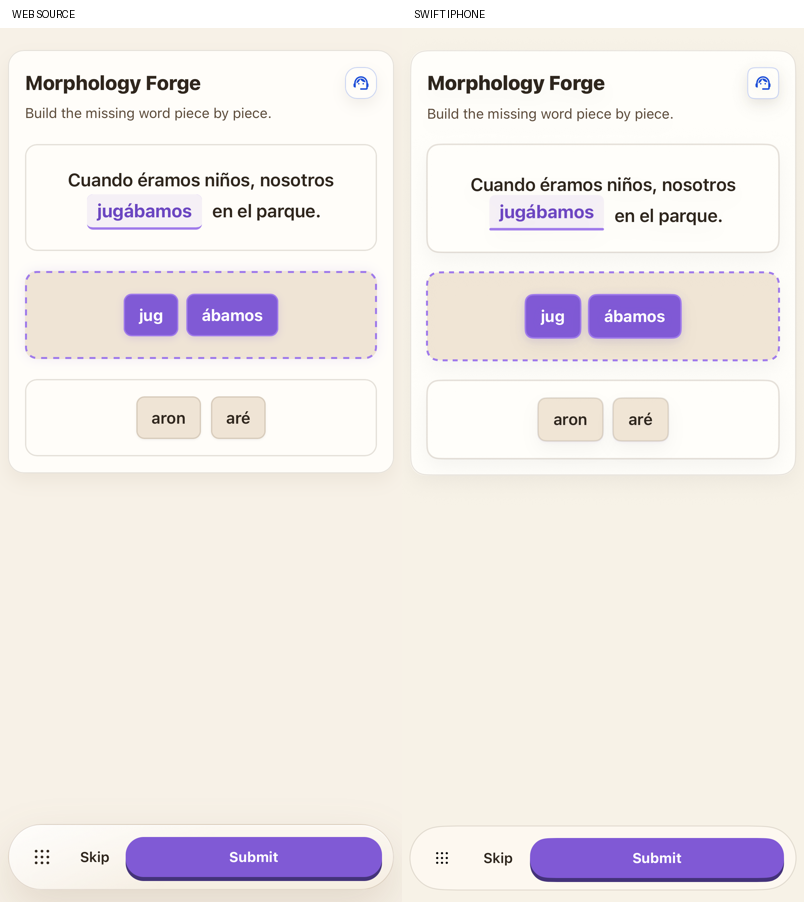
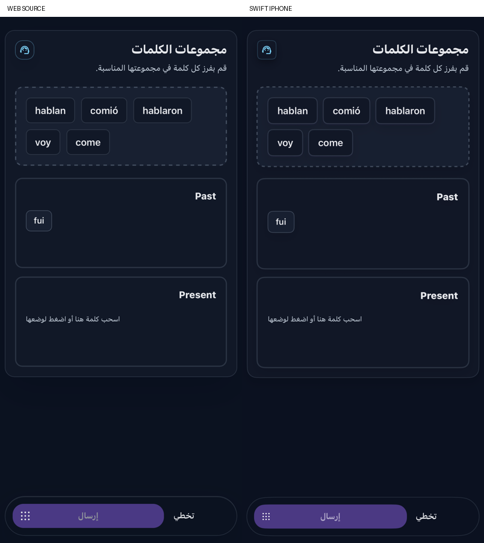

# Native exercise bodies

Five more advanced exercises now render their actual source interaction inside the shared lesson action area. The earlier generic prompt/controls branches for these five formats are removed. The renderer uses SwiftUI and a small UIKit inline text attachment; there is no production WebView.

| Exercise | Restored behavior |
|---|---|
| Sentence Detective | Original two-phase guidance, rejected-token state, disabled tokens after finding the broken word, visible confirmed mark, teal repair choices and live repaired-sentence preview. Tokens and repair choices retain the source pill shape and full color when locked. |
| Word Neighborhoods | Source-stable word order, selectable bank, category buckets, tap-to-place, tap-to-return, native drag/drop in both directions, empty bucket guidance, partial assignments and locked controls. Bucket headings provide an accessible target; tapping a placed word still returns it to the bank, as in the source. |
| Morphology Forge | Live word in the actual sentence blank, ordered selected-piece tray, available-piece bank, tap/drag addition and return, removal by piece identity, used/empty messages and locked controls. The padded underline is an inline text attachment so it wraps with the sentence. |
| Dialogue Fork | Source header/help location, leading audio control and actual dialogue line, followed by original single-choice cards in target-language direction. The invented speaker label is removed. |
| Listen for the Difference | Source header/help location, prominent labeled audio control and target-language choice cards. Listening remains available after grading; answer controls lock after success. |

The word bank uses the source's FNV-1a ordering over Unicode code points, with stable ties. Tap and drop actions update the same saved response consumed by the original judge, XP policy and lesson counter. Selection alone grants no XP. Returning a placed word removes its assignment; moving within the same container leaves the response alone. Native transfer items carry the question UUID and item index through a private content type. Wrong-question, out-of-range, locked and multi-item drops are rejected, and the lesson also fences response callbacks by account/language/question ownership.

The original semantic grading remains in production for all five formats. Generated reference keys are not an exhaustive grading table. The offline gesture journeys explicitly opt into a finite offered-reference judge fixture, independently of their question fixture, and still use the real lesson submission, feedback, counter and persistence code. The fixture requires Debug, offline mode, a UUID test scope, an explicit fixture choice and no live-API flag. It never runs in the normal installed simulator app. Live verification exercises the original prompts and a valid nonreference offered reply separately.

`export-delight-interactions.mjs` executes the unmodified source callback bodies and `stableShuffle` with inert React callbacks/setters. It records 132 handler states and 17 word-order examples, including non-BMP and combining-character input. Native state changes match those outputs. Source JSX, DnD adapter, theme, styles, copy files and the controlled comparison fixture are hashed in `reference/delight-interactions-manifest.json`.

## Verification scope

The read-only preview extracts the actual five source components and their helpers. It renders untouched, partial, filled and locked responses in English/light and Arabic/dark at 402 × 874. Each comparison uses fresh WebKit storage and asserts the requested theme. The native comparison mounts the actual lesson view, saved question and shared footer. Public controlled content fixes the question/portrait; global native/web navigation bars are outside this component comparison. Source geometry includes text/control bounds and computed line-height/corner values.

Actual product journeys enter through named account creation, language selection, first-run setup, valid A1 self-report, the course path and lesson preview. They exercise both tap and real native long-press drag gestures, wrong-answer retry, correct locking, feedback/lesson percentage and fresh question entry after relaunch. The final scope and exact run results are in `VALIDATION.md`.

Body outlines follow the measured circular WebKit fallback; shared tool-icon corners, small font/spacing and motion differences remain. System speech currently supplies these question audio buttons; matching the source TTS transport/voice, selection/submission effects and interruption/replay behavior remains open, as do physical-device audio and broader accessibility/device/locale layouts. Sentence Shapeshifter, Three-Clue Mystery and Three-Word Challenge now have their own source bodies, input, speech and beta keyboards; see [Writing exercises](WRITING_EXERCISES.md). Legacy standard exercise bodies remain. These scoped checks do not complete the full product parity goal.

## Retained examples

The forty paired states use Visual8. [A native sorting drop](native/exercise-product-sorting-drop.png), [the corrected buckets](native/exercise-product-sorting-corrected.png) and [the forged sentence](native/exercise-product-forge-word.png) document Final6's actual product interactions before the final outline-only adjustment.
