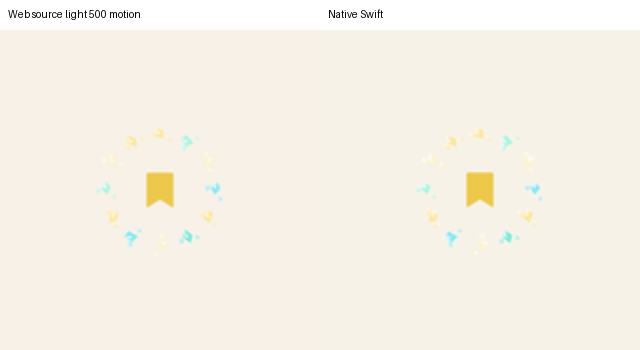
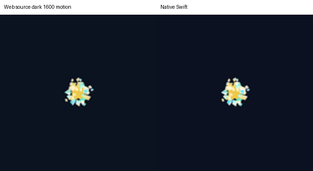

# Exercise notes and shared Memory capture — 2026-11-05

This continues FUNC-06, DES-04/DES-06 and VERIFY-02 against the read-only web revision `b269524ddc578027c549616fc47f5954991d9f6f`. Native baseline was `c15ef9e`, branch `codex/functional-design-parity`. The overall parity goal remains open.

Exercise notes now retain their captured question, answer, verdict and lesson when **Next** replaces the question while generation is pending. The result is merged into the current private learner state without restoring an old question or granting additional XP. A stale initial question cannot launch a note; completion rejects sign-out, account/target/support replacement, cancellation, and signing back in with the same key in a new identity session. Flashcard pending notes use the same identity-session fence. Cancelling an individual signing request does not change this identity session.

The native `StudyNoteContext` follows the actual source handlers rather than the displayed prompt/assessment string: mystery word plus example, morphology pieces, labeled sorting groups, shapeshifter constraint, dialogue response, comma-separated multiple choices/matching and original lesson-title dictionaries. The [exporter](../scripts/export-study-note-contexts.mjs) executes all three original full `handleCreateNote` callbacks with recording provider/in-memory boundaries. Its **32 cases cover 16 note-eligible formats** in Grammar and Vocabulary. The seventeenth lesson format, `LessonFlashcard`, has no Create note action; its unused bookmark import does not establish reachability. The separate SRS Flashcard note flow is documented in [the earlier checkpoint](READING_TRANSLATION_NOTES.md).

New sorting runs retain assignment insertion order, including return/reinsert and integer-key enumeration, through native response updates and private restoration. Older runs without that metadata use deterministic key order; the original order cannot be recovered from those records. Existing grades, banks and historical notes are retained. The source note handler ignores the natural/weird choice and listening-option selection in its default user-answer branch; native preserves that omission. This is a known source limitation, not evidence that the generated note explains those selections.

Shared Memory feedback now uses the original twelve crystal clusters, polygon facets, gradients, glints, gather/catch timing, filled bookmark and button pulse. [Source geometry/timings](reference/memory-capture-source-manifest.json) are exported without executing App, React, stores or providers; Swift renders the effect with native views and source vector artwork. Native interpolation is checked against the actual browser's computed transform/opacity tracks. The source 3.07-second lifetime, full restart on repeated capture, stale-expiry fencing and source reduced-motion appearance are preserved. The animation timeline pauses in inactive scenes and under reduced motion; it is paused when no capture is active. The logical menu button stays mounted and tappable through expiration. Its Memory action icon also follows the temporary source captured state.

Local repair intents and actual shared incorrect-feedback presentation trigger the effect; localization/settings updates do not restart it. Saved exercise and SRS notes trigger it after insertion. Scope changes/sign-out clear it, and saved notes do not replay it on quiet relaunch. This is transient local feedback, not a cloud-acknowledgment indicator. Full navigation/menu geometry and every mode-specific simultaneous presentation remain separate verification work.

## Verification

All simulator work pins isolated QA device `CE8248B6-7171-4FD4-97DE-89E499107F82`; no regular profile, reference file, Firebase/Cloudflare configuration or deployed backend is changed.

- Focused Swift package selection passes **10 tests** (0.150 s), including 32 source note contexts/titles, assignment order/restoration, existing practice reward/quiz/bank semantics, Memory policies and original sorting interactions.
- `/tmp/PiyaliMemoryCaptureStable20261105.xcresult` passes all **eight selected native app tests** and the full pending note → Next → Memory → relaunch product journey (**102.412 s**). Native checks cover no additional reward/old-question overwrite, account and same-key session replacement, target/support/sign-out/cancellation, source lifetime/restart, local capture versus localization and actual footer publication once per wrong result.
- `/tmp/PiyaliMemoryCapturePaint2_20261105.xcresult` passes the ordinary SRS Flashcard note → Memory/relaunch regression (**72.038 s**) and source/component/lifetime checks, but its exercise UI journey fails at menu expiration. It is not an all-green bundle. The stable-control change and passing journey above supersede that interaction failure.
- `/tmp/PiyaliMemoryCaptureFinalPaint20261105.xcresult` passes **eight final component pairs** (**5.766 s**) after matching source glow clipping. They cover 500/1600/2300 ms in light/dark and a controlled reduced-motion frame. Browser/native opacity and matrix values agree within 0.002 (translation within 0.03 point). Final static captures use this run; the passing full journey predates only the final paint-only clipping adjustment.

Earlier attempts are retained: the first focused note-context run fails nine Grammar fallback-title assertions and leads to preserving the source's two-language Delight/four-language standard distinction. `PiyaliExerciseNoteCapture20261105.xcresult` passes four native checks and its first full product journey (100.481 s) but fails bundled animation data loading; that UI run does not prove crystal rendering. `PiyaliMemoryCapturePaint20261105.xcresult` fails compilation because the accessibility environment key is read-only; the comparison now uses explicit rendering overrides. Paint2 exposes the actual menu hit-frame replacement problem described above. These failures are not counted as passing suites.

No new live-provider request or complete regression suite was run for this UI/data change. The prior separate-service note/provider evidence remains scoped in the earlier checkpoint. Public offline fixtures establish controller/UI behavior; they do not prove model note quality for every format, cloud/concurrent-note merge behavior, physical performance/audio or device accessibility. The reduced-motion comparisons apply the source CSS equivalent/native rendering override; they do not verify the operating-system toggle on a phone.

## Captures and remaining scope

The [capture manifest](native/exercise-notes-memory-capture-b269524d/manifest.json) pins all 18 image/metric hashes and result bundles. The pairs isolate original source capture/menu components and a native equivalent, with matched 402×400 canvases; center crops are enlarged for inspection. PNG color profiles are normalized before composition. They omit the surrounding product footer/shell. Original full-product native images retain their own profile and viewport. Fine rasterization/color quantization and native shell differences remain; this is not pixel-perfect whole-navigation approval.

| Gathering, light | Gathering, dark |
| --- | --- |
|  |  |

[Final catch](native/exercise-notes-memory-capture-b269524d/capture-light-2300-motion.png), [reduced motion](native/exercise-notes-memory-capture-b269524d/capture-dark-1600-reduced.png), [native capture after Next](native/exercise-notes-memory-capture-b269524d/pending-note-after-next.png), [retained note in Memory](native/exercise-notes-memory-capture-b269524d/note-in-memory.png).

Remaining: focused/repair-deck handoffs, wider simultaneous modal/footer and account/language interruption journeys, repair-content/source-context differences (including stemless matching), full viewport/menu comparison, Story-specific toasts/generation/fallback, broader locale/text-size/accessibility coverage, concurrent private notes and the other handoff device/payment/release gates. This checkpoint does not complete FUNC-06, any whole-product design gate, or the overall goal.
