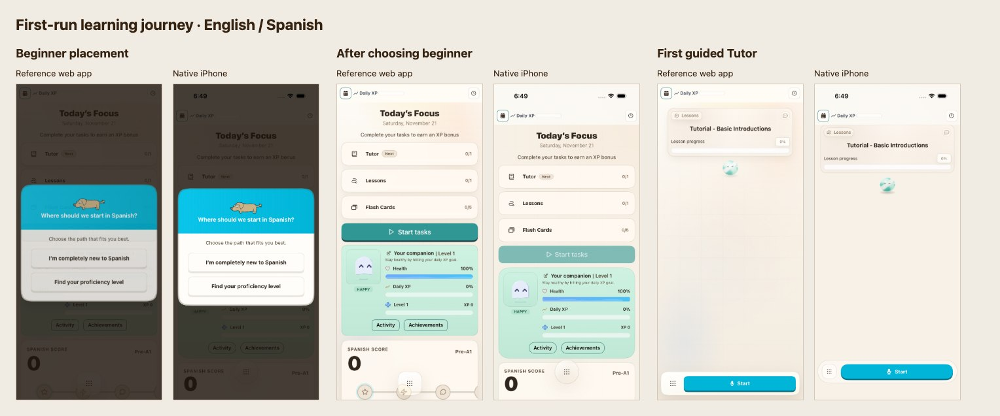

# Companion Continue and account setup

The [Paper & Pencil suggestion](PAPER_PENCIL.md) starts closed. After onboarding, the companion’s Continue action opens Paper & Pencil if its acknowledgment is missing, then the setup guide if its acknowledgment is missing, then starting-level selection when this language needs placement. Understood and Got it acknowledge the first two steps. Tapping outside either step leaves it open. The native overlay stays mounted during the handoff and covers the home and menu controls. The initial placement prompt requires a choice or the web proficiency handoff. The setup guide remains available from Account.

The account-wide `paperPencilModalShown` and `gettingStartedModalShown` flags are saved locally and in the canonical Firebase user document. Stale profile updates cannot reset an acknowledgment. Placement uses the old global guard while the canonical language map is absent, then follows the per-language placement. Separate SDK emulator checks verify the narrow acknowledgment writes and stale-device preservation of XP, membership and placement. Unfinished native setup can be reopened through the companion after termination. After placement, the native app records the companion’s dismissal for that language and day.

## Native installation and key handling

The native app is already installed. Its guide therefore acknowledges that state and offers sign-in-key backup, instead of requiring browser-install actions. The original five browser installation steps remain under an expandable Web app section, using the original translations, numbered cards and icon roles. A plain web-home link lets native users open those instructions’ destination without including a key in the URL. Original character 39, purple header, neutral cards and Got it action are retained. The short native explanation is localized separately in ten languages; it is an intentional platform adaptation.

Copying a locally held key is explicit and requires device-owner authentication, consistent with the existing native Account backup action. The key is written directly to the local-only iOS clipboard with a two-minute expiry; it is never rendered in the guide, stored in view state, passed through a URL or logged. Failed/cancelled authorization copies nothing. Dismissal, backgrounding and account replacement invalidate pending authorization. Remote-signer accounts see a signer explanation and have no secret-key copy action.

Native tests inject authorization outcomes using disposable UUID-scoped identities, and separately exercise the actual simulator clipboard writer. They verify expiry parameters and denied/cancelled/stale results. These checks do not prove Face ID/passcode interaction on a physical phone or an elapsed two-minute clipboard expiration. Physical authentication remains a device check; it does not block Got it or the learning flow.

## Appearance and source comparison

Starting-level choice now follows the original 48-point squircle/frame, header padding, dog crop, body padding, neutral button edges, selected-row palette and result typography/surfaces. Its height follows actual content up to the available screen height. The original light choice measures 378×324.39 CSS pixels at a 402×874 viewport; visible control spacing is compared independently of native status/home chrome. Both self-assessment pages, retained choices, localized result and external proficiency-test link remain native. The separate `/proficiency` route remains a web link.

The target-owned read-only preview renders the unmodified GettingStarted and Proficiency components with inert completion callbacks, sounds disabled and a **fake non-key string** to expose the original copy-key tile. No web identity is created and that copy tile is not clicked. The original document-language helper supplies RTL context. Source hashes and callback scope are in [the manifest](reference/first-run-manifest.json).

| State | Source, top 720 CSS pixels | Native, including iOS chrome |
|---|---|---|
| Setup/install, light | [Original browser guide](reference/first-run-install-light-402.png) | [Native installed/key guide](native/first-run-guide-light.png), [expanded original web steps](native/first-run-web-light.png) |
| Starting-level choice | [Source](reference/first-run-choice-light-402.png) | [Native](native/first-run-choice-light.png) |
| Self-report/result | [Selected source row](reference/first-run-selected-light-402.png), [A1 result](reference/first-run-result-light-402.png) | [Native result](native/first-run-result-light.png) |
| Arabic dark setup | [Original browser guide](reference/first-run-install-ar-dark-402.png) | [Native adaptation](native/first-run-guide-ar-dark.png) |
| Arabic dark choice/result | [Choice](reference/first-run-choice-ar-dark-402.png), [result](reference/first-run-result-ar-dark-402.png) | [Choice](native/first-run-choice-ar-dark.png), [result](native/first-run-result-ar-dark.png) |

Platform icon and font fallback, animation, text geometry and other locales still need broader comparison. The table above uses component previews. The whole-product English comparison below includes the complete Focus and Tutor backgrounds.

## Fresh signup through the first guided Tutor lesson, November 21

The original `/` route at `b269524d` passed named signup, onboarding, companion Continue, Paper & Pencil, the browser installation guide, newcomer placement, and Start tasks into **Tutorial - Basic Introductions**. Reloading returned to Focus with **Continue practice**, which reopened the tutorial and required an explicit Start. Chromium used a 402 × 874 mobile viewport, a disposable identity, and the reference app’s local Firestore emulator. External traffic was blocked. The source checkout’s pre-existing `App.jsx` edits compile to the same JSX output as HEAD.

The iPhone 17 Pro simulator journey follows those same controls from a fresh account with zero XP. The Tutor speech fixture supplies events to the normal session controller. The test observes earned Tutor progress and terminates the app, then verifies **Continue practice**, the same progress, a closed voice session and no replay of the previous private reply. It passes in 72.520 seconds in `/tmp/PiyaliFreshFirstTutorFinal-20261121.xcresult`. The first run stopped at an incorrect assertion that expected **Continue**. Four additional native journeys passed in `/tmp/PiyaliFreshLearner-20261119.xcresult`, covering signup, interrupted setup, the ordinary lesson’s 80-XP threshold and next-node unlock, and guided Tutor → Lesson → Review → Notes. The last uses a saved progress fixture.

The complete shell shows the iOS safe area, different header and footer spacing, and the native Start tasks button dimmed briefly while curriculum data reloads after placement. It becomes enabled in the tested journey. The original browser was checked through Tutor entry and resume with voice disconnected. The native turn uses synthetic speech. Live speech and playback, Arabic full-shell parity and the real release backend still need verification.
