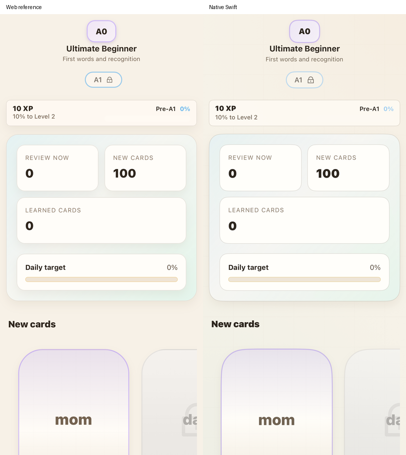
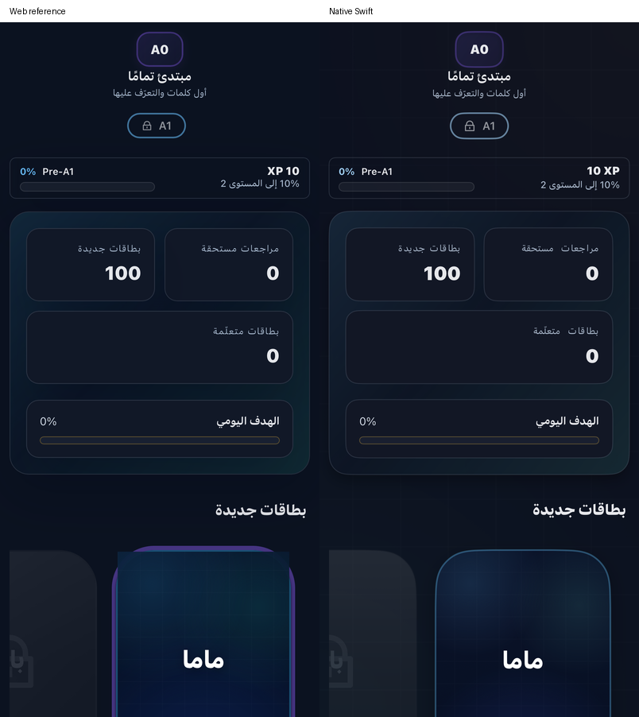
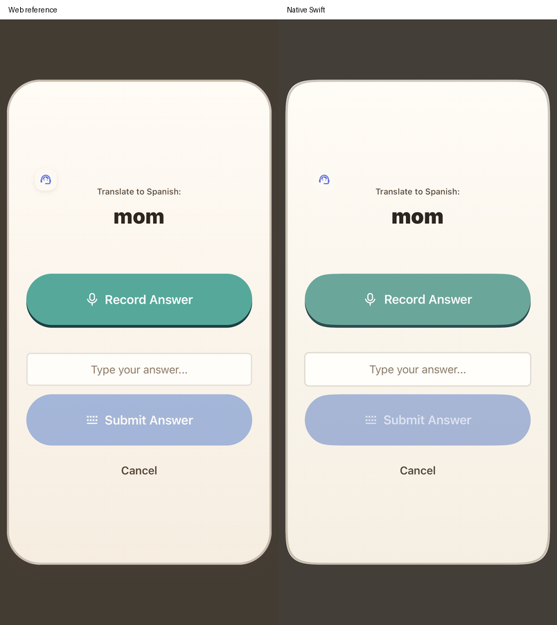
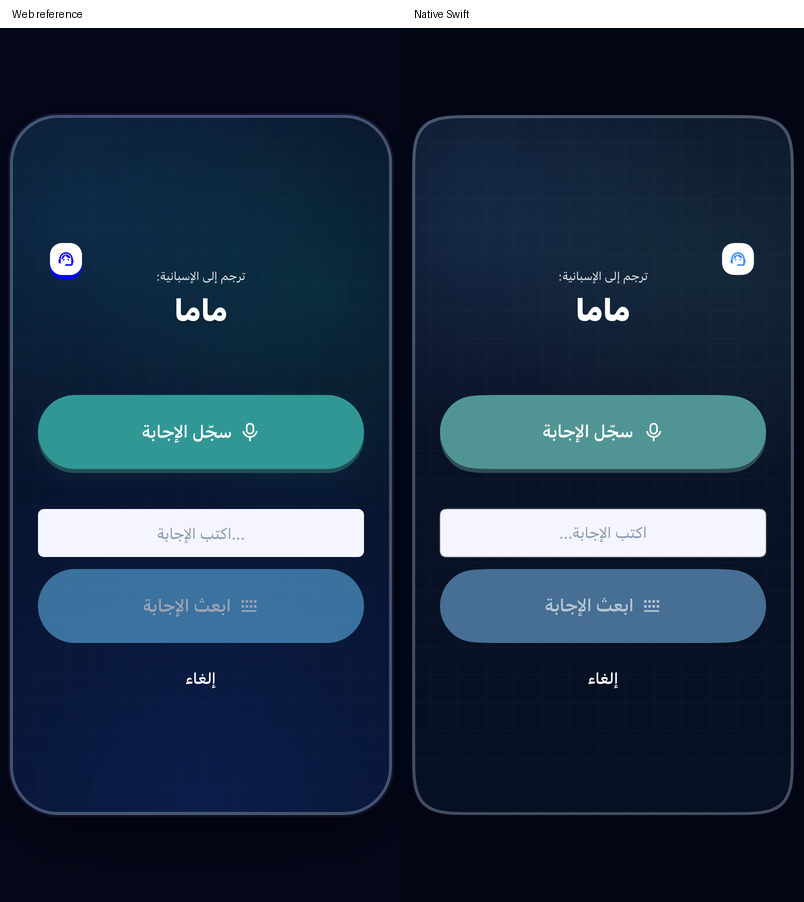
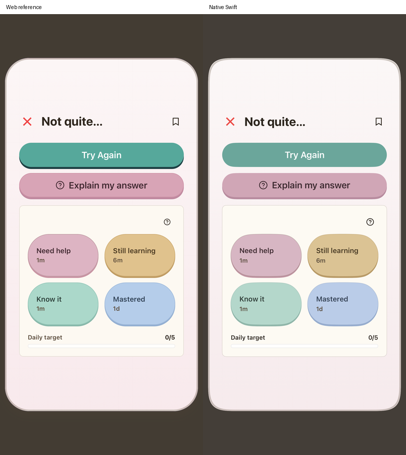
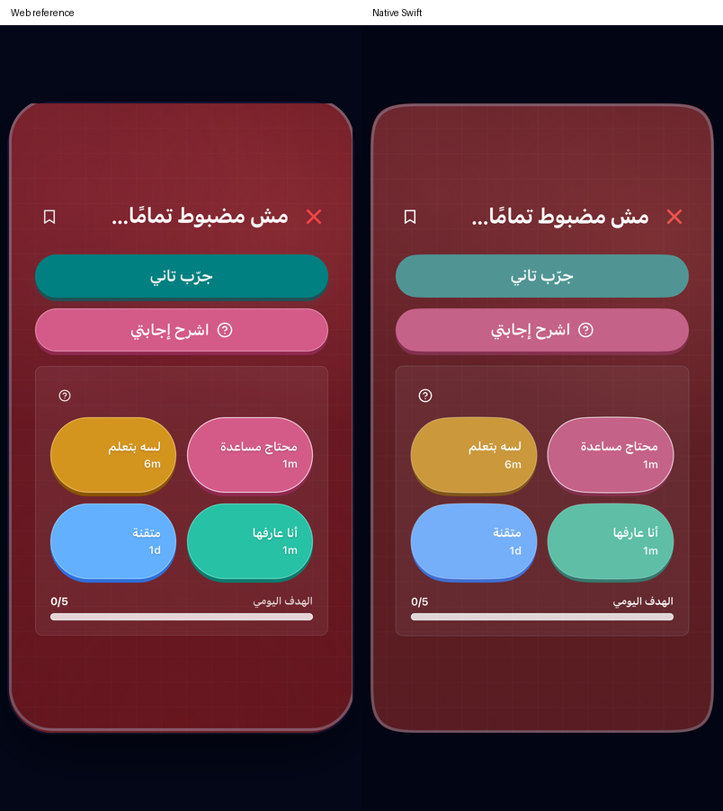
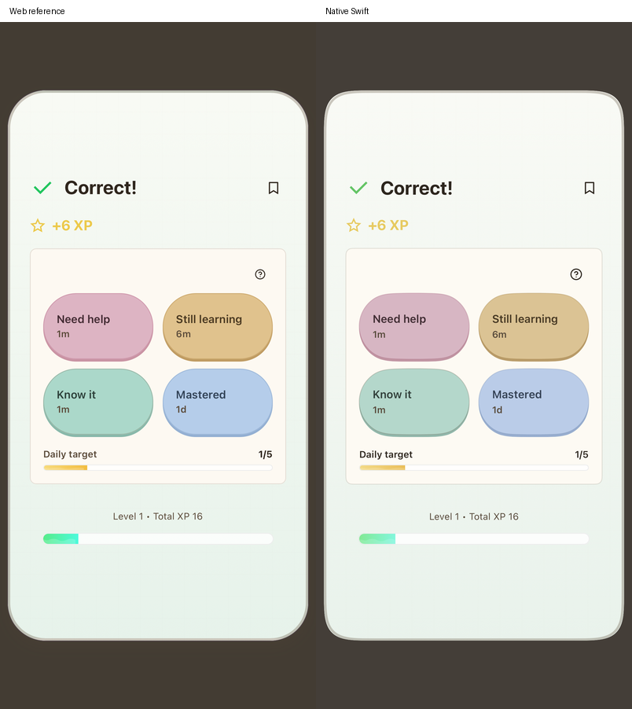
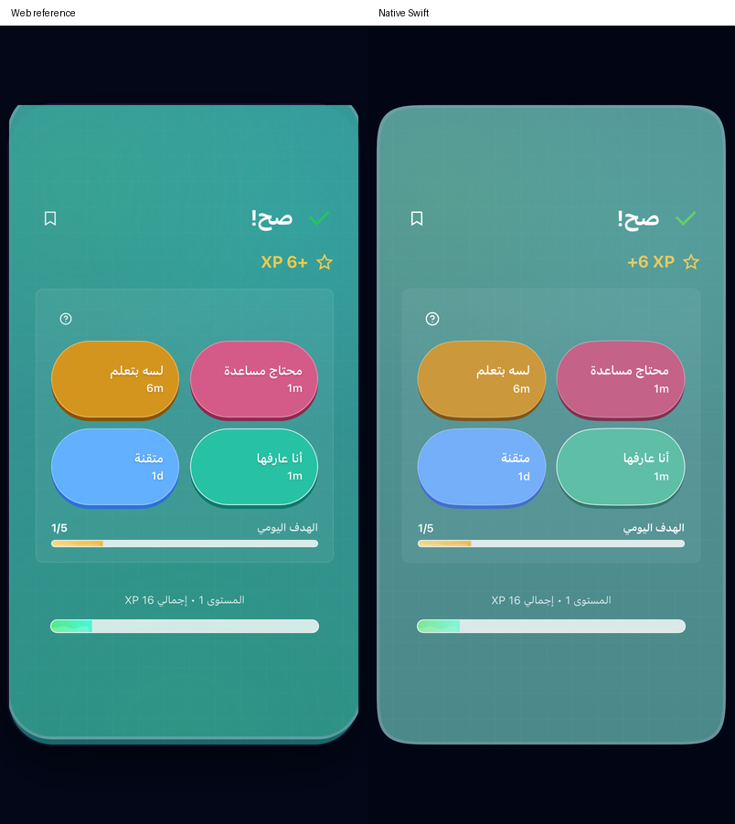

# Native flashcard checkpoint

The main `/` flashcard surface now uses a native deck and practice dialog instead of the former generic list/form. This is one checkpoint in the broader functional and design correction; full app parity remains open.

The ordinary deck has the source CEFR navigator and language-XP/course header, due/new/learned counters, daily Review wave, horizontal 220 × 280 cards, sequential/placement access, due and weak queues, and scheduled/learning cards with source-localized dates. Original React icon paths are exported as template SVG assets. The dialog preserves the source prompt, recording and typed controls, streamed reveal/flip/listen, wrong-answer retry/explanation, note action, four scheduling choices, daily preview and XP display. English/light and Arabic/dark components are compared at a 402 × 874 iPhone viewport.

## Source behavior and persistence

`export-companion-quest.mjs` extracts only pure declarations and expressions from `FlashcardPractice.jsx`, `FlashcardSkillTree.jsx`, the review/activity/target helpers, speech session builder, note generator and active `App.jsx` save handler. Source React, stores, network and Firebase code do not execute in the bundled JavaScriptCore policy. Explicit language/copy/clock snapshots replace environment reads; original provider prompt/parser bodies are split at their network boundaries. The [manifest](reference/companion-quest-source-manifest.json) records declarations, hashes and adapters. Swift handles UI, requests, capture, storage and synchronization.

- The original semantic judge accepts appropriate equivalents and returns the source 4–7 XP grade. Choosing a scheduling rating is a separate action. Reveal alone grants no XP, completion, daily Review or SRS record.
- The active web save handler uses `card.xpReward || 5`. Consequently an ordinary wrong/Again rating that submits zero still persists **5 XP**. Native intentionally retains that active behavior. A successful answer's quoted XP does not become the old native fixed reward for Hard/Good/Easy.
- Scheduler choices are frozen from the progress/clock when the card opens. The chosen patch survives the offline outbox and in-flight rebasing. XP retains its save-day clock; Review activity uses the patch's review day, including an open/rating across midnight. Duplicate Firebase saves use one receipt/review/reward.
- Daily counts merge the canonical activity map and card-record fallback with the source maximum rule. A correct ordinary result previews one review without adding it again after acknowledgment. When Today's Focus has no Review course, the original stable 3–7 target applies.
- Independent graded evidence and captured struggles are separate from scheduling. Wrong/retry/right can record each applicable graded outcome once during that open card; pressing a rating does not grade it again. Empty dismissal captures no struggle; abandoning typed work captures once. Scope changes reject late grades/streams and provider errors.
- Goal and repair cards stay in their canonical focused artifacts. Good/Easy records successful recall and **2 XP**, without ordinary SRS or Review activity. Failed saves retain the modal and its selected retry; they cannot duplicate XP. Repair-step completion waits for the saved artifact/reward acknowledgment before its dependent completion is submitted.
- Generated notes retain the original example/summary and study context in the native note. The app-wide canonical Notes/drawer design remains separate work.

## Evidence

The complete Core baseline passes **265 tests**. The final flashcard policy selection passes four tests, including **117 source-executed cases**, ISO date transport, explicit grade rewards, in-flight patch restoration and the midnight boundary. Existing 116 scheduler comparisons remain in the full baseline.

Native controller and speech tests cover reveal/wrong/retry/rating, once-only assessments/memory, stale support-language responses, empty/typed dismissal, data-channel readiness, late final transcription, cancellation and transport reuse. A dedicated failed-repair-save test verifies the retained modal, deferred repair completion and no repeated XP/Score. The real product-menu UI journey passes through onboarding, locked cards, wrong answer, explanation, retry, reveal/flip, correct answer, note, Hard rating, next-card unlock, relaunch and scheduler restoration.

The isolated Firestore SDK run passes nine selected tests: six controller/component comparisons plus three persistence regressions covering ordinary/Goal flashcards, companion/repair artifacts and final focused lesson ordering. It preserves unrelated membership/profile fields. A real native provider check passes correct/incorrect grading, streamed translation and question-worth generation using public fixtures and disposable authentication; it makes no learner-progress writes.

The read-only source preview mounts the unmodified components. Public provider/store fixtures replace only the flashcard network/evidence boundaries; no source learner identity or private data is used. Source form tests invoke the actual input/submit/retry handlers. These are component comparisons, not a complete authenticated web-to-native journey or proof of pixel parity. The preview includes the original shared navigator/header around the deck. Native deck radii follow the measured iPhone WebKit rendering; the modal retains the intended superellipse where WebKit falls back to rounded corners. Animation capture times and mixed Latin/Arabic token ordering can differ.

| English/light | Arabic/dark |
|---|---|
|  |  |
|  |  |
|  |  |
|  |  |

Regenerate the pure policy with `node scripts/export-companion-quest.mjs` and original icons with `node scripts/export-flashcard-icons.mjs`. Opt-in native/provider verification is `python3 scripts/test-live-api.py --only flashcards`; its wrapper supplies the private App Check token through the runner environment. Export the source-render test's xcresult attachments, then run `scripts/compose-flashcard-reference.py <attachments-directory>` with Pillow to reproduce the labeled comparisons.

## Remaining work

The source's pooled Realtime TTS playback is still represented by native Apple speech for Listen. Physical microphone quality, audible playback/routes, recording wave/flip animations, glow timing, source sounds and pause preferences still need parity work. Broader locale/state checks, focused-deck completion choreography, generated-note/drawer integration, app-wide reward/error presentation and the remaining phonics/Tutor/account/payment designs are open in [the parity audit](PARITY_AUDIT.md).
