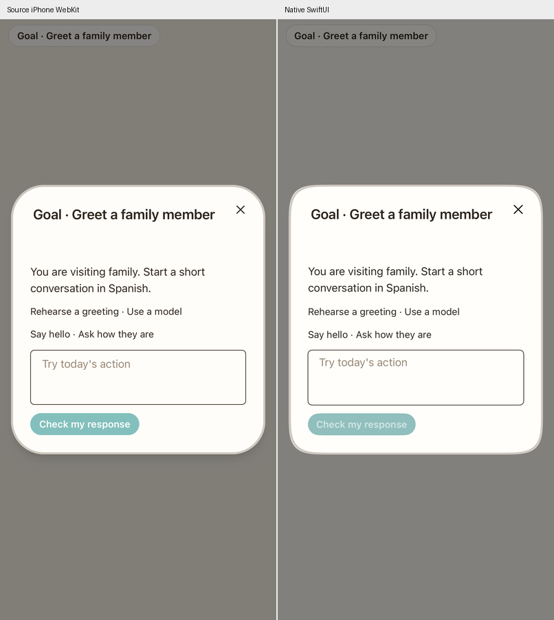
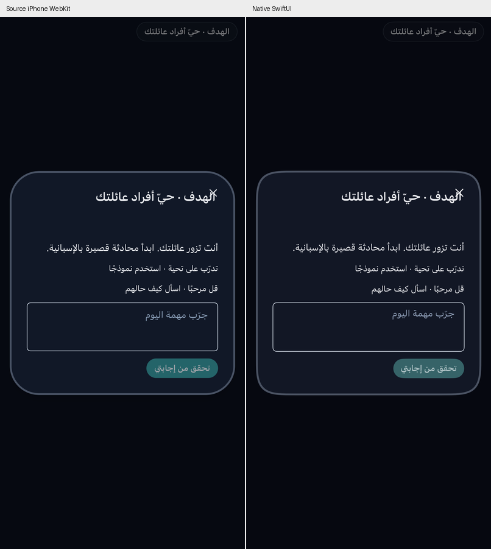
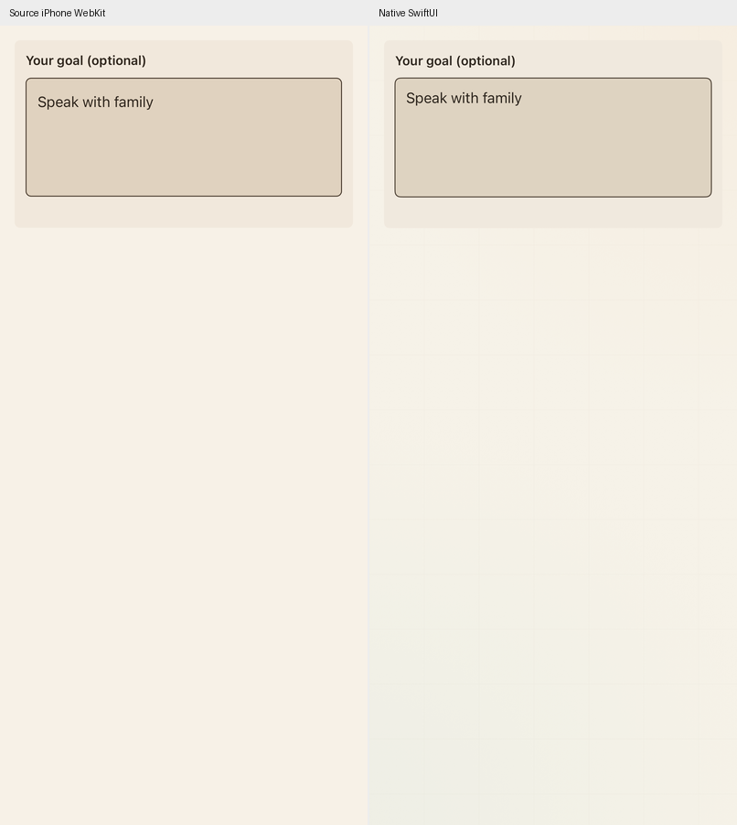
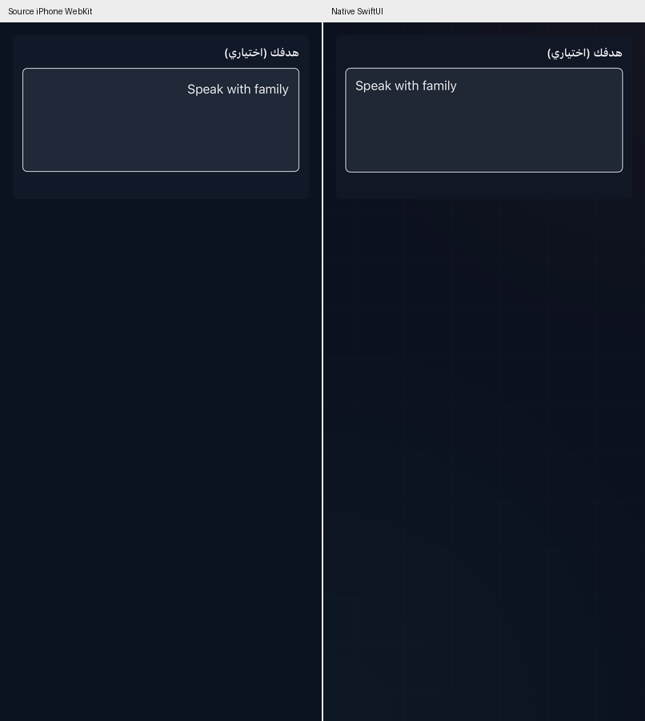

# Focused Goal journey checkpoint

Full functional and design parity remains in progress. This checkpoint corrects the main product’s focused Goal course; it does not establish parity for every learner screen.

Previously, choosing Goal opened a goal editing form and an activity chooser. The active web handler instead prepares the saved daily blueprint, selects its next unfinished activity, and goes directly there. A focused lesson starts automatically and finishes when its own correct practice reaches **20 XP**. It does not require visiting all five skills or award a second completion bonus.

## Source behavior now used by native

The target-owned exporter extracts the original Goal planner prompt, normalizer, ephemeral lesson payload, instructions, written rubric prompt, next-activity rules, completion policy and eleven-language copy. These execute as pure policy in JavaScriptCore. Plain snapshots and explicit dates replace store access; Swift owns UI, requests, persistence and audio. The source code and all source routes remain untouched. See [declaration provenance](reference/companion-quest-source-manifest.json).

- Today’s Focus waits on the Start/Continue button while preparing Goal, then opens the next unfinished mode. Confirmed intermediate completions advance silently. The final activity stays mounted for the single Goal-course celebration. The editing form lives in Settings.
- Lesson uses the original five-engine content and its own goal/day XP counter. Unrelated XP and a previous goal’s late exercises do not fill it. The counter is canonical `learningIntelligence[language].dailyGoal.preparationXp`; ephemeral work does not create an ordinary curriculum lesson.
- Firebase saves a final question’s XP before checking the dependent completion intent. Failed commits retain earned work and one retry intent. Unconfirmed mode completions cannot advance the course or claim the plate bonus. Crossing the free quota on the final answer preserves earned lesson work and the save/retry boundary; new generation still requires access.
- Recall completes after the source’s three successful preparation cards. Pronunciation requires the original and transfer exercises and routes directly to live Tutor when no matching authored material exists. Preparation is evidence of supported practice, not independent communication.
- Each focused activity exposes the small source Goal summary button. Its optional dialog shows scenario, supports and criteria; lesson/recall can also submit a written response. Closing and reopening preserves that activity’s draft. Account, target, goal, day and support changes reject stale judgments. Identical concurrent judgments share one request. The original rubric excludes Elo and displayed Score; saved difficulty quotes and all five assistance levels drive the graded update separately.
- Settings uses the original translated optional field, 600 UTF-16-unit limit, 400-ms autosave, blur/close flush and three-second acknowledged Saved state. Captured target/account scope keeps a draft from leaking into another language or account. Unfinished legacy daily bundles can upgrade without discarding existing per-mode work; finished bundles remain finished.

The centered check dialog and Settings field now use the source’s measured iPhone dimensions, line heights, colors, spacing and copy. Long dialog content scrolls inside the shell. Native uses the intended superellipse; current iPhone WebKit falls back to rounded corners for that CSS. The source preview uses only a public fixture and never submits a rubric check or writes learner data.

## Verification and remaining work

The new policy suite compares **116 source fixtures**, alongside the existing **198 companion fixtures**. The affected Core selection passed 41 tests; the final five-test Goal selection also passed after adding the legacy-upgrade guard. Quoted assessment checks cover 1,680 comparisons with the original reducer across all five support levels. Native tests exercise failed completion/retry, language/account editor boundaries, the 600-unit limit, saved-state timing, automatic routing after acknowledgment, final-surface retention, and quota crossing. A real Firestore emulator test commits the final XP and completion in one flush, repeats it, and checks the canonical counter, absence of a curriculum write, once-only rewards and paid-field preservation. The scoped live check passed the original English/Arabic planner and written rubric against the native Responses endpoint in 16.2 seconds with public examples, without learner progress writes. All 23 backend/auth/rules tests passed without skips. The final five native/emulator/source-render tests pass, along with the real Settings language/edit/close/relaunch journey (54.9 seconds). Seven companion/access regressions and the onboarding/home/menu/setup/placement/Tutor journey also pass.

The screenshots below compare the actual unmodified web components in iPhone WebKit with native components in the same public fixture. Component captures are not proof of the complete signed-in journey or pixel parity.

| English | Arabic |
|---|---|
|  |  |
|  |  |

Focused flashcard and phonics now use their original source controls, copy and separate artifact/reward ordering; see [flashcards](FLASHCARDS.md) and [phonics](PHONICS.md). Their wider complete journeys and live Tutor still need verification. Source Tutor’s turn/XP lifecycle, physical pronunciation/audio behavior, complete modal choreography and cross-device interruption journeys remain open. Broader work remains in [the parity audit](PARITY_AUDIT.md).

The later [flashcard checkpoint](FLASHCARDS.md) replaces the focused recall form with the source deck/dialog and acknowledgment/retry behavior. Phonics and live Tutor parity remain open.
