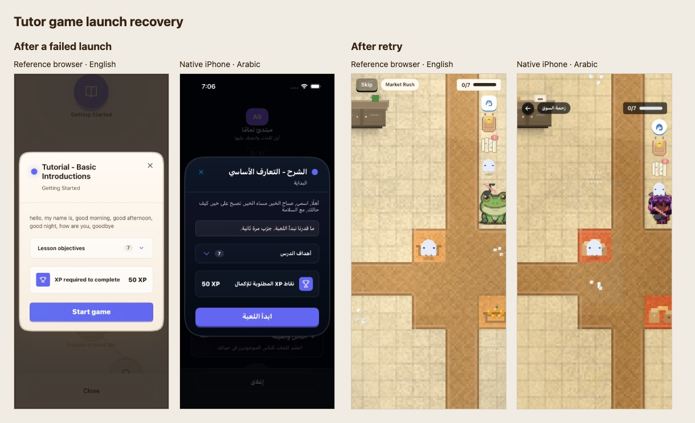

# Introduction and Tutor game handoffs

The initial native introduction opened an RPG spinner at its final step, and Tutor opened the game directly from its preview. The source prepares the introductory scenario while earlier activities run, then starts its 5–8-second exploration window only when the game step is visible. Tutor stops voice before preparation, keeps the playable loader inside the preview, allows Cancel, and selects/starts the Tutor lesson only after successful preparation and exploration.

The native shared preparation controller now separates prepared content, requested reveal, exploration and a committed handoff. The introduction starts a scoped, uncommitted request during its earlier activities. On reaching Game it shows the original interactive map inline, with source rotating copy and a shared-footer Skip action. Reveal and readiness together start the original random exploration delay; early preparation cannot consume that visible window. Skip, leaving the lesson or changing account/language/level/access cancels unfinished work and rejects late results. Preparation and exploration grant no XP or completion credit and do not save an RPG run.

Tutor's preview now retains its dimensions while the original playable map/header and Cancel overlay it. Cancel uses the executed global theme color: dark ink at 92% opacity in light mode and white at 92% in dark mode. Voice is stopped and its draft flushed before generation. Cancellation returns to the path without selecting or starting the previewed lesson. Successful handoff commits the still-owned run, selects the lesson, and queues the existing canonical zero-XP Tutor start receipt and current-lesson field. Tutor's course level stays separate from the ordinary lesson level. Saved matching runs take precedence; staged late progress with the same identity survives handoff. A different newer run produces a retryable error instead of overwriting it or leaving a permanently pending loader.

A staged or saved matching RPG paints directly without a second preparation/loading pass. The view checks its authored level as well as account-scoped learner state, target, support, lesson and Tutor track before reusing it. The introductory Tutor game now uses ordinary Back to return to the Tutor path; the six-part introduction alone uses Skip to advance. Previously the Tutor game inherited the introduction flag and its Back button called a missing tutorial callback, preventing exit.

Finished Tutor games stay mounted while their canonical bonus receipt is pending or saving fails. Retry uses that same receipt, without a skill-tree lesson reward or duplicate Tutor bonus. Replay of a completed Tutor game grants no new completion bonus. Account replacement cannot finish an old game's Tutor session. The subsequent [completion/review checkpoint](TUTOR_COMPLETION.md) keeps the path behind game completion and aligns review, daily-goal release and scholarship/task quiet-window gates.

## Source and comparison boundary

[Source hashes](reference/game-handoffs-source-manifest.json) identify the original App/Tutor loading components, tutorial preparation utility and exploration timing. The existing [playable-loader extraction](reference/game-loader-manifest.json) retains the original generator, controls, drawing, messages, companions and delay function. Swift owns the stage/reveal lifecycle, UI, canvas, audio, networking and persistence; the full RPG remains SpriteKit.

The reference harness executes the original tutorial and Tutor loading components. It supplies an eager map client, fixed public seed/frame, anonymous user/sound stores and disabled external I/O. Suspense fallbacks and the tutorial's absent onSkip branch are unrendered adapters. Component comparisons cover header/map presentation; actual product journeys cover the native Skip and Cancel actions. Public provider fixtures retain the normal native renderer and controller. They are restricted to explicitly isolated QA identities and do not establish live provider quality or physical microphone behavior.

## Native state and source-component verification

`PiyaliGameHandoffsFinal3.xcresult` passes all 32 selected app checks in 156.441 seconds: eight preparation checks (34.153s), all 22 Tutor lifecycle checks (96.986s), and both source comparison checks (25.301s). These include preparation without writes, deferred exploration, skip before an uncooperative provider returns, account/language/level/access fences, late same-run progress, retry after a different newer run, separate Tutor staging, durable zero-XP Tutor selection, completion acknowledgment/retry and replay without duplicate credit. The source checks cover eight existing course states (16.925s) and four introduction/Tutor states (8.376s).

Image inspection then identifies a light-theme Cancel mismatch: global source CSS resolves its declared white color to dark ink. `PiyaliGameHandoffsPaint4.xcresult` passes both comparisons in 24.319s (eight course states in 16.156s and four introduction/Tutor states in 8.164s) using that computed native color; the lifecycle logic is unchanged. [Final paired images and actual source font/color/bounds metrics](reference/game-handoffs-comparison-captures.json) retain the capture provenance. The original fixed-frame map and matched component bounds agree visually. Fine Courier baselines, small panel-border/shadow differences and transient text fade remain calibration work.

## Actual product verification

`PiyaliGameHandoffsFlows2.xcresult` passes all five actual product journeys in 824.515 seconds. The new three-journey group passes in 390.090 seconds: authored seven-task Tutor completion and its own 50-XP bonus without lesson credit (244.703s); introduction warm/inline map/Skip and one 50-XP completion (53.803s); and Arabic Tutor voice shutdown, map movement/Cancel, retry, Back and saved-game resume (91.584s). Existing course preparation/Cancel/retry/relaunch/resume passes in 135.494s, and the complete authored introductory adventure passes in 298.930s without a regular unit reward. After the final theme-color correction, `PiyaliGameHandoffsTutor5.xcresult` repeats and passes the actual Arabic Tutor voice-stop/Cancel/retry/Back/resume journey in 94.556s against the exact Paint4 build. Its two settled loader/resume captures replace the earlier product images.

[Product capture provenance](reference/game-handoffs-product-captures.json) retains six actual screenshots: [inline introduction](native/game-handoff-intro-loader-product.png), [Skip completion](native/game-handoff-intro-skipped-product.png), [Arabic Tutor preparation](native/game-handoff-tutor-loader-ar-product.png), [saved Tutor game](native/game-handoff-tutor-resumed-ar-product.png), [Tutor recap](native/game-handoff-tutor-recap-product.png) and [Tutor's own bonus](native/game-handoff-tutor-bonus-product.png). Recap/handoff captures may intersect UIKit's presentation transition; they are behavioral evidence and do not establish completed-game visual parity. The saved-game capture is settled. The separate controlled loading-component comparisons below use fixed frame/time and matching bounds.

Source/native examples: introduction [source](reference/game-handoff-intro-en.png) / [native](native/game-handoff-intro-en.png), Arabic introduction [source](reference/game-handoff-intro-ar.png) / [native](native/game-handoff-intro-ar.png), Tutor [source](reference/game-handoff-tutor-en.png) / [native](native/game-handoff-tutor-en.png), Arabic Tutor [source](reference/game-handoff-tutor-ar.png) / [native](native/game-handoff-tutor-ar.png).

## Failed and superseded attempts

Core1 passes seven controller checks (32.158s); Core2 passes those seven plus the game acknowledgment/replay check (36.433s), before final selection/retry/Back changes. Flows1 passes 21 Tutor checks and the introductory Skip journey, then exposes Tutor's missing Back callback. Both Flows1 and Flows2 source comparisons fail because an earlier preview plugin's global sound-store stub requires a selector, while the original mini-game validly calls it without one. The stub now supports Zustand's optional selector and disabled warmup/sound I/O. Flows2 also exposes a test oracle that assumes the Tutor start receipt must be the last queued change; persistence legitimately queues a separate daily quest event afterward. The corrected assertion finds the exact lesson's Tutor start receipt and verifies its zero amount. No production behavior is changed to satisfy that assertion. Flows2's complete UI group passes despite its failing source/assertion group; those failures are not reported as an all-green containing run.

## Export reproducibility

An isolated export executes 569 original loader cases and reproduces all six outputs byte for byte after refreshing the provenance-only App.jsx hash to the current clean reference revision. Runtime policy, fixture, messages and synthesized sounds are unchanged. Policy SHA-256 is `ce04e3399b15e6c4a2be3529f216de564c19709a9cda7343056f93e222ff2229`.

## Remaining

[Completion-time next-review preparation](UPCOMING_GAME_REVIEWS.md) and [authored recap/ordinary prepared replay](RPG_COMPLETION.md) have subsequent checkpoints. Wider interruption/modal combinations, complete prepared Tutor replay/celebration designs, exact transient text/transition motion, other locales/device/text sizes and physical audio/accessibility remain open. The subsequent [completion checkpoint](TUTOR_COMPLETION.md) corrects the path return, review/reward ordering and durable completed-game replay handling; wider modal combinations and fine presentation remain open. Legacy exploration/generation/search remains separate. This checkpoint does not complete the broader [functional/design parity goal](PARITY_AUDIT.md). The reference checkout and deployed Firebase/Cloudflare services remain unchanged.

## Hard launch failure and legacy routing, November 23

The original `/` game entry points at `b269524d` have three paths:

- **Introduction.** A prepared authored scenario launches after the visible mini-map window. If the outer warm-up rejects and the game client loads, the Game tab mounts `GameRouter` without an authored scenario. The tutorial falls through to the legacy renderer, which automatically requests the configured tutorial scene, defaulting to `tutorialPlaza`. It retains Skip and advances the introduction on actual completion.
- **Course Game Review.** The router selects authored content for a non-tutorial game lesson, including a launch without a pre-generated scenario. The outer preview failure clears its loading state and retains the preview. A rejected or malformed provider response inside the authored builder returns the original authored deck.
- **Tutor.** The preview stops voice before preparing. A hard failure clears the loading phase, retains the selected preview and records a localized error. A subsequent Start game can retry the same lesson. The browser query override is explicitly a development harness.

The source predicate was executed for the prepared introduction, ordinary Game Review, unprepared tutorial and query override. The source Tutor callback was executed with a failing scenario builder and successful retry in English and Arabic. It kept the same preview after failure, selected the lesson once after success and never restarted voice behind the preview.

The unmodified web `/` route reached the Tutor preview, then crashed as the loading overlay rendered. `TutorGameReviewLoadingExperience` uses `Flex` without importing it. A second browser run supplied that import in the served module response and injected one hard scenario-builder failure, preserving the checkout. In that controlled run, the same preview returned with Start game enabled. The source error was mounted behind the preview. A second Start game opened the playable world with Inventory and cleared the error. This exercise used a disposable identity, the reference Firestore emulator and blocked external traffic.

iPhone clears the failed preparation and leaves Start game available on the selected preview. It uses the original localized Tutor error. The native preview also shows that error next to its existing controls so it is readable while the background Tutor surface is covered. The legacy introduction handoff and its generated world and dialogue policies remain open.

The final `/tmp/PiyaliTutorGameRecovery-20261123.xcresult` passed 11 tests, including eight preparation and ownership checks and three full simulator journeys. The new Arabic journey triggers one bundled library read failure from the normal Tutor preview, then uses Start game to open the world at 0/7 and returns to the path. The existing journeys verify Tutor voice stops, Cancel and saved-world resume, and the introduction’s inline loader and Skip.

The browser capture is English and light. The iPhone capture is Arabic and dark. The iPhone shows an inline error and uses the Back arrow in the started game. The browser displays a Skip label for that exit. A browser follow-up reached Tutor’s Lessons and Start controls after Skip and timed out waiting for the path modal. The native test returned to the path. Exit treatment and route ownership still need reconciliation, alongside comparison in the same locale and theme.

## Course introduction fallback to Greeting Plaza, November 23

The native Game step now opens the same legacy tutorial scene if the outer authored warm-up fails. A rejected authored story response still keeps the existing authored deck. The legacy scene uses the original generator for the lesson’s terms, performance context, map, quest and fallback. The existing SwiftUI/SpriteKit renderer owns the run, movement, dialogue, inventory and exit. The separate Piyali worker performs the provider requests. The tutorial stores its own world, position and assigned cast through relaunch and uses the existing introduction progression for Skip or completion.

The original web `GameRouter` and legacy renderer were exercised at `b269524d` with the Course introduction lesson after the hard-failure handoff, without an initial authored scenario. The isolated preview replaced provider responses with `{}` to reach the source's malformed-map fallback. It opened Greeting Plaza at `(3,3)`, moved to `(4,3)`, and invoked the supplied Skip callback once. This browser check mounted the original game component directly. The native UI test enters through the full sign-up and Course Path, injects a bundled-library read failure, moves in the scene, relaunches and resumes at the saved location, then reaches the introduction’s +50 bonus on Skip. The final artwork run in `/tmp/PiyaliTutorialPlazaArtwork-20261123.xcresult` passed all 11 checks, including the existing inline-loader Skip journey. A follow-up after adjusting the Skip button and HUD borders passed the native fallback journey in `/tmp/PiyaliTutorialPlazaVisualFinal-20261123.xcresult`.

The first native comparison used an approximate floor texture. The final renderer runs the original source tile-art functions and composites their terrain and walls into a SpriteKit texture. At the same art seed, a direct browser Canvas comparison matched every RGBA channel for both the 18×14 source fallback and a valid 20×14 generated test map. The simulator policy check also exercises the valid map with different NPC names. Rebuild the source policy and art adapter with `node scripts/export-tutorial-plaza-policy.mjs`.

Generated dialogue choices, cross-chapter lines, decorative prop sprites and motion, live provider completion, full quest completion from the Course Path and the complete browser route through the forced warm-up failure still need coverage or implementation. The web component and iPhone shell use different surrounding frames. Both production services and the read-only reference checkout were preserved.

## Live dialogue in the course introduction’s legacy game, November 23

Opening a choice node now shows the source Thinking state, then renders the generated options with the original lettering and option styling. A failed or malformed response restores that node’s existing choices. Generated options use the authored first choice’s next node, and the selected response’s stage direction and spoken reply retain their separate styles. Reopening the dialogue requests fresh options.

Completing a chapter starts the next player bridge and the next NPC greeting in order. The new chapter stays playable while they generate. If the lines arrive before the learner opens the next conversation, the player bridge replaces the existing player line and the greeting replaces the NPC’s opening line. A reply that arrives after the character is already talking cannot replace the current opening. The native run keeps the most recent speaker turns and any finished chapter preparation through relaunch. The subsequent speech response uses the source’s in-character prompt and follows the existing quest graph with its original fallback. Skipping and finishing still reach the introduction’s existing progression path.

The read-only browser replay mounted the original GameRouter and legacy game component at `b269524d`, with the introduction lesson, the original generator at a fixed random seed, and controlled model output. It walked up to the first NPC, waited for a malformed choice response, reopened the NPC dialogue, chose a generated option, and observed the generated player line and next greeting. It delivered a scripted ASR result to the original speech callback, continued, and observed one completion callback. The browser replay made nine modeled provider calls. It exercised the game component directly with the same handoff inputs used by the introduction. A second browser replay also used the original `App.jsx` fullscreen predicate and reveal effect. In that replay the browser moved the player from (9,5) to (8,5) when the fullscreen renderer mounted, then completed both chapters. iPhone uses the same reveal delay and keeps the existing player position and quest state through the handoff.

The native QA journey used the normal sign-up and Course Path. Its controlled provider replies checked that the chapter prompt contained the selected option and NPC response, that the greeting prompt contained the returned player line, and that the speech prompt contained the learner’s typed answer and the current NPC line. The device simulator reached the +50 introduction bonus by finishing both chapters. In the earlier iterations, one test sampled the thinking state too close to response delivery. Simulator footage then exposed a Close button with a small hit target and a microphone covered by the inline menu. The native Close target now covers 44 points, and the inline sheet keeps controls above the menu during the reveal delay.

The final `/tmp/PiyaliTutorialDialogueAcceptance-20261123.xcresult` passed both Course Path journeys. One completes both chapters for +50. The other verifies the saved player position across the inline-to-fullscreen transition and relaunch before skipping to +50. The preceding `/tmp/PiyaliTutorialDialogueFullScreen-20261123.xcresult` passed the nine preparation checks and the authored loader journey. The earlier fullscreen assertion counted the underlying menu in the accessibility tree and has been replaced by a viewport measurement.

The captures show the same lesson text, option order, chapter controls and source artwork, with different random cast assignments, camera positions and native safe-area offsets. Live provider outages and timing variations, generated choice translations, decorative prop sprites and motion, and the complete web `/` journey through the forced warm-up failure remain open. Physical recording and playback remain separate release checks. The reference checkout and the Piyali services were preserved.
