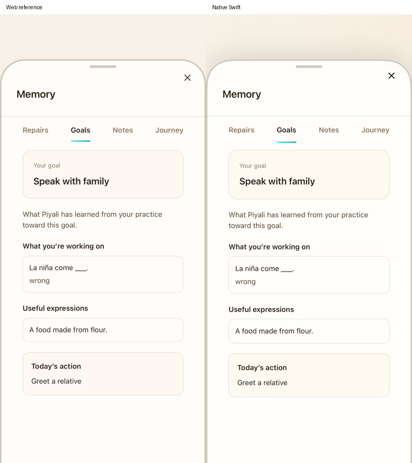
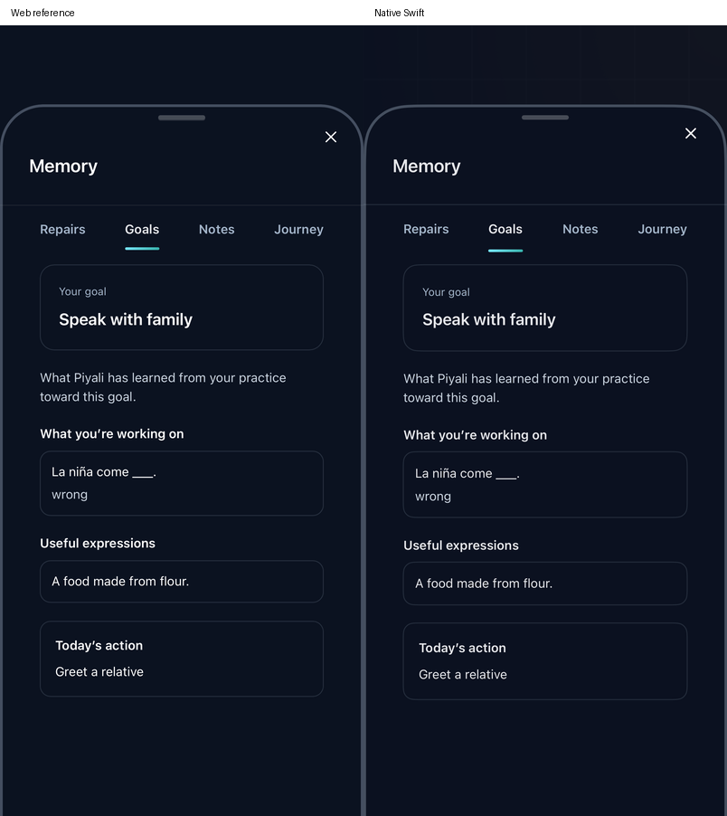

# Focused Goal missed-answer routing — 2026-11-05

This continues FUNC-06 and VERIFY-02 from native `a1ef93f` against read-only reference `b269524ddc578027c549616fc47f5954991d9f6f`. The whole-product parity goal remains open.

The source `captureCompanionMemory` returns early when its explicit account and target match the current Goal focus. It records a failed, prompted Goal evidence event using the focused modality, the actual source mode as domain, the submitted observation and expected answer. It does not create a repair note or complete the modality. Native ordinary capture previously ran even inside a focused Goal lesson.

Native typed Vocabulary/Grammar (including lesson-card/writing/speech submission), Reading comprehension and Story sentence misses now pass the mounted Goal lesson's validated, transient context into capture. `GoalMemoryFocus` is not saved in questions or learner snapshots. An active saved Goal or an old question's `goal-…` identifier alone never establishes current focus. Ordinary practice continues to save Repairs, including after restoration. The live context checks the active Goal, target, day and mode; service commits also reject account/session, support, pause/replacement and cancellation changes.

Goal evidence can contain an empty observation: the source Delight extractor sometimes returns an empty answer even for a submitted response. The native evidence reducer now accepts that failure and uses the original expected-answer fallback for its summary example. It never counts the fallback as successful production. Existing completion/award receipts and acknowledged mode progress remain separate. Blank or padded concepts follow the original summary normalization and cannot fall back to the daily objective or create a blank capability. Native outbox events retain their established stable UUIDs; the source callback uses `goal-slip:<milliseconds>:<sourceMode>` IDs.

A pending Goal slip also previously blocked `prepareGoal` before its cached daily-plan branch. Reopening an acknowledged, current blueprint now remains possible after the sync attempt while evidence is pending. `readyGoal` still excludes unacknowledged edits/new blueprints/upgrades and compensates for pending successful mode-completion writes. New plans, upgrades and earned completion keep their existing acknowledgment gates.

## Actual caller exceptions

The source SRS `FlashcardPractice` and `RealTimeTest` conversation capture calls omit `npub`. Its helper compares `goalFocus.npub === npub` before account resolution, so those callers do **not** enter the Goal return branch even with a valid focused activity. Their misses remain repair captures. This is a source limitation, not a reason to silently route every miss to Goals. The original-callback fixture includes both explicit-account conversation capture and the actual omitted-account case. Focused Phonics/Tutor have separate evidence/capture paths and still require wider journey verification.

The [original callback exporter](../scripts/export-goal-memory-capture.mjs) runs the complete source function with explicit focus/clock and a recording learning-evidence boundary. Ordinary-path cleaning is a stop boundary rather than source persistence. Summary expectations execute the original extracted `mergeEvidence`/`compactSummary`. Browser comparison additionally executes that same original capture callback and original summary policy before mounting the original Notes drawer. No source Firebase, provider or private account writes execute in those fixtures.

## Verification

The final focused Core run `/tmp/piyali-goal-memory-core-normalized-20261105.log` passes **62 tests (1.871 s)**. It covers twelve executions of the original complete capture callback, actual caller account-argument metadata, original Goal summary values (including blank/whitespace observations), transient restore behavior, typed/Reading/Story/conversation reducer routing and existing Goal/practice/Reading/Story/realtime and 198-case companion source-policy checks. It does not prove all those modes' full UI flows.

`/tmp/PiyaliGoalMemory3_20261105.xcresult` passes five native app checks and the native product journey (132.132 s), including the original capture/summary → source drawer comparison in light/dark (6.151 s). That run preceded restoring the actual omitted-account conversation exception; subsequent Core and simulator results below cover the final routing. Its passing typed Goal journey did not exercise conversation.

Failures are retained. The first focused Core attempt fails test compilation on missing dictionary brackets. `PiyaliGoalMemory20261105.xcresult` fails the new app setups because their public Goal fixture omitted source-required success criteria, and its UI attempt tapped the noninteractive course row. `PiyaliGoalMemory2_20261105.xcresult` passes typed Goal routing/reentry and eight pending-verdict boundaries, but its Reading fixture has three MC choices where the source requires four; the UI still taps the display row. Correcting those fixtures and using the product's actual **Start tasks** control produces the passing journey. These failures are not evidence of a passing suite, nor were production validators weakened to admit the fixtures.

`/tmp/PiyaliGoalMemoryFinal20261105.xcresult` passes the five app checks after the conversation caller correction, but its repeated UI journey fails at Start: the helper tapped while that button was still disabled for content loading. It is not an all-green bundle. The helper now waits for the enabled state.

Visual comparison also exposes a real paint mismatch: native `MemoryPaint.surface` used the dark elevated token `#111827` for base-surface cards. It now follows the source `--app-surface` (`#0b1220` dark, `#fdf9f2` light), including the shared Memory/Journey base-surface cards. The original elevated modal surfaces remain separate. The comparison asserts actual browser CSS against resolved native RGBA; wider Journey rendering is not newly approved by that color check.

`/tmp/PiyaliGoalMemoryPaint20261105.xcresult` passes five app checks (6.339 s) and the final native UI journey (168.059 s): real onboarding/setup/placement → Start tasks → focused lesson miss → Repairs empty/Goal capability visible → correct retry (+5 XP) → Home/Start tasks reopens the acknowledged Goal while evidence is pending → ordinary course miss creates a repair → relaunch retains both records without an active Goal focus. The native UI fixture never seeds answers or evidence.

A final source-contract review adds padded/blank-concept cases and corrects summary normalization/empty-target handling. `/tmp/PiyaliGoalMemoryVerified20261105.xcresult` then passes the final five app checks (5.914 s), including the original capture/summary/drawer and native comparison (4.606 s), actual typed/Reading grader routing, eight ownership boundaries, cached Goal reentry with pending evidence, correct-answer-only lesson XP, and the existing failed-completion-acknowledgment regression. The final 62-test Core run above covers the added normalization cases. The full UI journey uses the prior Paint bundle; its ordinary nonblank question/answer inputs and rendering are unchanged by that last normalization correction.

The [capture manifest](native/goal-memory-capture-b269524d/manifest.json) hashes twelve artifacts from those two bundles: two source/native viewport pairs, two original source event/summary records, two browser/native surface metrics, the native bucket and five actual native journey screenshots. Source/browser and native event fields/summaries agree after normalizing only opaque event IDs. Browser `--app-surface` and resolved native RGBA agree within half a channel value, at full opacity, in both themes. Visual inspection confirms the matching card/tab/capability/useful-language/action composition and corrected dark surfaces. Small text/vertical-rhythm differences (roughly 1–4 points) and different component backgrounds remain visible.

These are an actual native product journey and an original browser **capture → summary → drawer** handoff. They are not a complete browser exercise-input journey, all-format focused UI coverage, full surrounding product-shell parity, or physical speech/accessibility approval. Broader Goal/repair deck and Phonics/Tutor handoffs, calendar/account interruptions across every mode, private/cloud concurrent evidence, full viewport/RTL/large-text comparison and the other device/payment/release gates remain open.

| Light source/native | Dark source/native |
| --- | --- |
|  |  |

[Focused miss](native/goal-memory-capture-b269524d/goal-wrong-answer.png), [Goal capability](native/goal-memory-capture-b269524d/goal-evidence.png), [cached reentry](native/goal-memory-capture-b269524d/cached-goal-reentry.png), [ordinary repair](native/goal-memory-capture-b269524d/ordinary-repair.png), [restored without focus](native/goal-memory-capture-b269524d/restored-without-focus.png).

 No live model/cloud or physical voice request is part of this checkpoint. The isolated saved checkpoint supplies only an acknowledged Goal blueprint and course order; answers, evidence, rewards, navigation, retry and restoration use product code.
