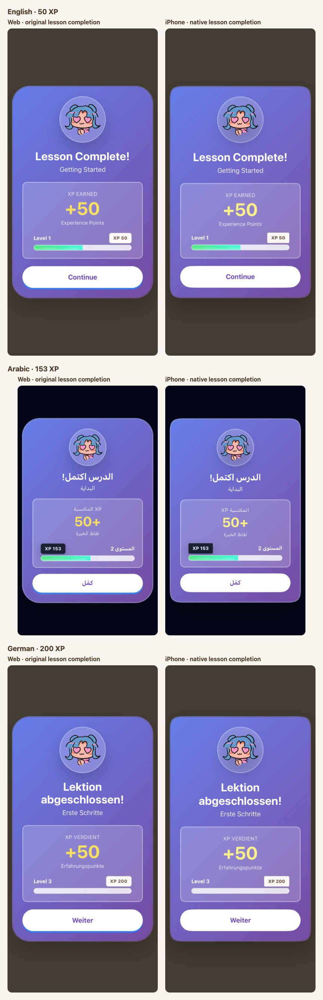

# Lesson-owned XP correction

The reference's ordinary curriculum lessons complete when their own `earnedXp` reaches `xpReward`. Shared language XP, legacy `lessonStartXp` and `xpEarned`, or one correct answer in every mode do not satisfy this gate. Completion then awards the separate authored lesson bonus. Final quizzes, games, the introduction, personal goals and repair retain their separate rules.

Native starts and scoped positive practice awards now carry durable lesson metadata. Reading and story rewards carry their actual run's lesson ID; standalone Tutor, cards and conversations do not. Firestore reads the active lesson before writing, credits only `in_progress` documents, and uses practice receipts to prevent retries from duplicating work. A completion already present in the shared lesson document prevents another native bonus. The canonical counter imports from web progress and language-lesson documents; sync rebasing reapplies practice performed during a request.

The current lesson screen has an explicit Start action, saved XP progress and automatic threshold completion. It still needs the source lesson detail/session layout, tabs, completion celebration and guided-task modal sequencing. Grammar and vocabulary now use their typed question rewards; other legacy exercise routes retain their old behavior until corrected. This counter correction does not establish full lesson parity.

Validation: core counter, web-import and in-flight rebase checks; iOS Firestore emulator checks for concurrent 6/5-XP practice, retry deduplication, unrelated Tutor XP, resumed 50-XP threshold and separate completion bonus; an already-web-completed lesson cannot award again. Existing introduction and final-quiz restore checks pass alongside these. Tests use a demo project and isolated identities.

## Course lesson completion card, November 23

The original course completion modal shows the lesson bonus separately from the language XP total. Its badge uses the highest available total for that course, displays the whole total as XP, and fills the green wave by the remainder within the current 100-XP level. The native card now takes the higher of the earned snapshot and the live XP for the same target language. Its display cannot borrow XP from another language or fall back when an older sync snapshot arrives.

The card uses the bundled source portrait, full purple gradient, framed 48-point shell, and the compact and roomy layouts from the original component. The progress badge follows the reading direction while the wave stays anchored on the left. German uses the source copy lookup. Continue and backdrop dismissal still acknowledge the existing completion, and VoiceOver users can dismiss it with the accessibility escape action. Presentation uses the already bundled original sparkle cue at the learner’s saved sound setting.

The read-only browser fixture mounts the unchanged course completion JSX with its original theme, portrait, XP header, and wave. Chrome measured the original 402×874 English iPhone viewport and the 375×667 Arabic viewport. It checked the full XP badge at 50, a live update to 153, and a newer award snapshot of 200 at a level boundary. Those tests isolate the dialog over a neutral product background. The complete browser Course Path and native return are covered in [the full product comparison](GAME_HANDOFFS.md#full-product-course-path-fallback-november-23).

The first native captures showed an oversized gradient and the Arabic plus sign on the wrong side. The final layout paints the card at the selected content height and follows the source’s visible sign order. Measuring the colored bounds along the center lines of the final captures found equal widths in all three pairs and a height difference of at most one point. The web’s automatic button focus ring, minor font rendering, and larger accessibility text and physical audio still need wider checks.

All four checks in `/tmp/PiyaliCourseCompletionCard-20261123.xcresult` passed. The ordinary lesson completed after its own 80-XP threshold, displayed +80 separately from XP 214 at Level 3, unlocked the next lesson, and retained completion after relaunch. The shared game-review check retained reward ordering and one receipt. The final `/tmp/PiyaliCourseCompletionSized-20261123.xcresult` passed the three source/native dialog cases and the full native introduction journey, including +50, the XP 50 badge, Continue, the scholarship prompt, and restoration of the completed course after relaunch.
