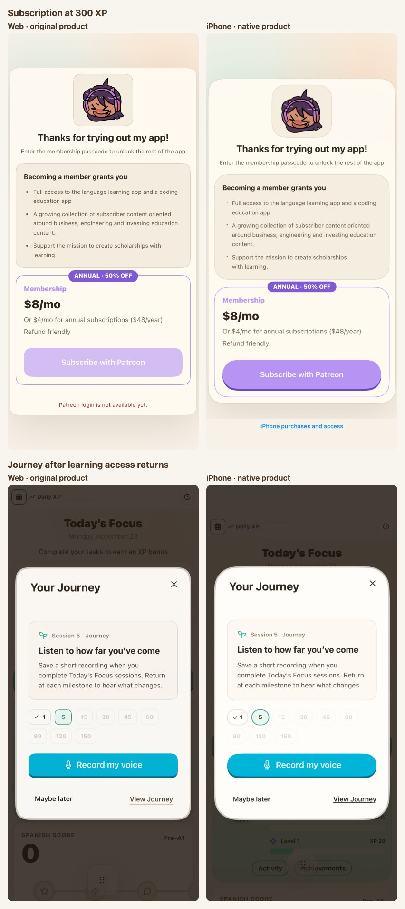
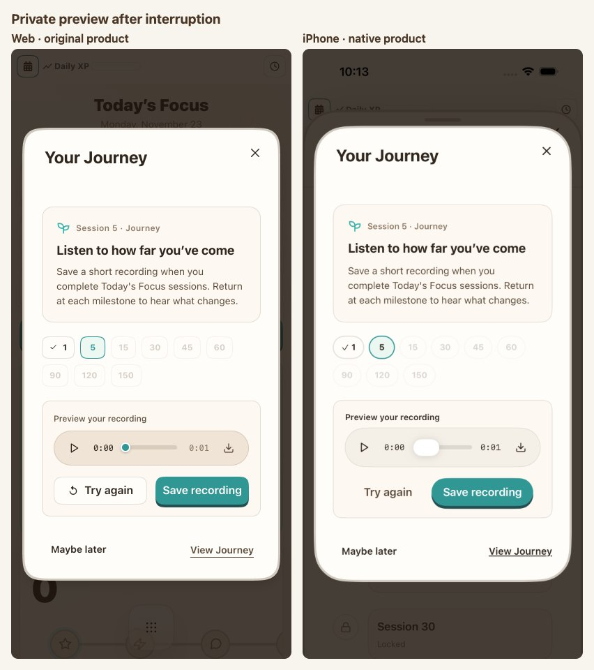

# Memory and Voice Journey checkpoint

The product Memory panel now uses the original bottom drawer and four tabs: Repairs, Goals when a goal exists, Notes, and Journey. It replaces the earlier generic notebook form. This is a scoped parity checkpoint; the whole app is still in progress.

Repairs retain the source's today/yesterday grouping, reinforced records, status/source/severity badges, answers, corrections and support-language explanation guards. The original enrichment and digest prompts/parsers run through the native policy interpreter. Digest caches belong to an account, practice language, support language and day. A repair arriving during generation schedules another pass. Localization updates preserve concurrent reinforcement, severity, unknown fields and Firestore timestamp values, without another XP grant.

Goals shows the saved goal, demonstrated capabilities, open capabilities, useful language and today's objective/rationale. Notes filters the current practice language, groups saved examples by CEFR level and retains the original example, explanation, lesson, module, date and result. Answered exercises now generate the original study note instead of storing a generic question/answer blob. Expand, Listen, Delete and language-only Clear all use normal product controls. Earlier manual native notes remain accessible separately. Study notes still use private snapshot synchronization; simultaneous edits remain last writer wins.

Journey follows the source's 1, 5, 15, 30, 45, 60, 90, 120 and 150 session milestones, expiry windows and earliest-recorded baseline. Only a fully completed daily plate counts, using the existing durable per-language/day receipt. The automatic prompt waits for a quiet 1.5 seconds after the existing modal chain, acknowledges its milestone and routes View Journey to the drawer. Dismissing the prompt leaves manual recording available.

Recording creates a private temporary draft, capped at 45 seconds. Preview and Record again precede explicit Save. iOS records AAC/M4A; the isolated test transport supplies a public WAV. Save uses a random AES-256-GCM key, authenticated to the account/language/milestone, wrapped through the learner's self NIP-44 signer. Firestore stores the encrypted envelope at `users/<npub>/voiceJourney/<language>/recordings/<milestone>` and only dates/session counts in the parent metadata. Duplicate and expired saves fail transactionally. Listen compares the current clip with the earliest recording; Delete removes both document and metadata. Existing local recordings from the earlier native build remain playable/exportable without automatic upload.

Owner-only recording rules were tested against unauthenticated, anonymous, public-demo and other-account access, then deployed only to the independent `piyali-ios` Firebase project. The reference web project was not changed.

## Verification

- The read-only exporter executes 55 actual source copy, prompt, parser, language-guard and Journey cases. Native milestone/baseline/pending/expiry checks cover counts 0–160, saved histories and legacy count/prompt values.
- A public interoperability vector is produced by the actual source encryption module and `nostr-tools`. Native tests open its AES-GCM payload, verify matching ciphertext, reject altered bindings/tags and unwrap its self NIP-44 key with the native identity. The vector's declared all-01 test secret is never a learner identity.
- Real Firestore SDK emulator transactions verify encrypted save/load/delete, duplicate/expired rejection, acknowledgment, unchanged counts, preserved foreign fields and concurrent repair localization/retry behavior.
- Product UI journeys cover repair/goal content, note accordion/delete/clear/relaunch, an answered exercise generating a note and restoring it, recording/preview/encrypted save/baseline comparison/delete/relaunch, and automatic prompting/acknowledgment/View Journey/relaunch. The existing guided daily-practice → reward sequence → Notes/relaunch journey also passes.
- Equivalent English/light and Arabic/dark screens render the actual source JSX in iPhone WebKit and native Swift. Only provider, account and recording I/O are public fixtures; source UI behavior is retained. Comparisons are reviewed visually rather than treated as pixel-equality assertions.

## Remaining work

Physical microphone, playback and route changes, device/signer interruption recovery, locale and text-size coverage, motion and sound timing, and overlapping modal interruptions remain open. The native audio slider and file exporter retain platform controls. The Chrome recording restore and root trial cutoff have the scoped checks below.

[Repairs, English](native/memory-repairs-en.png), [Goals](native/memory-goals-en.png), [Notes](native/memory-notes-en.png), [Journey](native/memory-journey-en.png), [recording](native/memory-record-en.png), [Arabic Notes](native/memory-notes-ar.png), [Arabic recording](native/memory-record-ar.png).

Product captures: [generated exercise note](native/memory-note-created-product.png), [automatic prompt](native/journey-prompt-product.png), [private preview](native/journey-preview-product.png), [baseline comparison](native/journey-compare-product.png).

## Flashcard entry into Notes — 2026-11-05

The [translation/notes checkpoint](READING_TRANSLATION_NOTES.md) covers an ordinary Flashcard-generated note reaching Notes through the real product menu, preserving example/summary/lesson/module/result and relaunch. Source Reading/Story instead capture missed answers in Repairs; no dedicated Create note action was found at `b269524d`. The later [exercise/capture checkpoint](EXERCISE_NOTES_CAPTURE.md) verifies note completion after advancing and shared Memory capture. Focused/repair-deck handoffs, broader interruption/locale checks and complete viewport/device coverage remain open.

## Pending exercise notes and native Memory capture — 2026-11-05

[Implementation, source inputs, final source/native frames, real product journey, exact attempts and limits](EXERCISE_NOTES_CAPTURE.md). Pending notes now retain the original context after Next; new identity-session, account, target/support and cancellation fences prevent late results from crossing ownership. Native shared capture follows the source crystal geometry/timing and vector icon, expires/restarts once per event and leaves a stable menu hit target. Local repair capture, actual wrong-feedback publication and saved exercise/SRS notes are covered; localization and quiet note restoration do not start a new animation. Final component comparison covers timed light/dark and controlled reduced-motion frames. This does not close the remaining focused/repair, concurrency, whole-shell, sound or physical-device work.

## Initial exercise repair inputs and stemless matching — November 5

[Source contracts, retained failures and hashed light/dark captures](PRACTICE_REPAIR_CAPTURE.md). Initial Vocabulary/Grammar repair capture now follows original snapshots/Delight extractor inputs across all 17 formats (36 source-executed cases); stemless matching saves its source fallback, comma-separated missed pairings, hint/fallback correction, module context and question level. Eight focused Core checks pass. The native onboarding/course/wrong-match → Memory → correct retry → Memory → relaunch journey passes (114.228 s) in `PiyaliPracticeRepairContext2_20261105.xcresult`, whose source test fails. After fixing a target-owned source preview store-mock collision, original/native drawer comparisons pass in `PiyaliPracticeRepairDrawersFinal20261105.xcresult` (5.244 s). These are scoped component comparisons plus a native product journey, not 17 full UI journeys, a full browser capture journey or overall parity completion. Several Delight repair fields are stale in the original source and intentionally remain visible as known limitations. Focused Goal slip routing, duplicate merges, other-mode contexts, tomorrow's repair-deck handoffs, full shell and live/device/service gates remain open.

## Goal slips, cached reentry and Memory surfaces — November 5

[Exact source contracts, retained failures, bundle scopes and twelve hashed captures](GOAL_MEMORY_CAPTURE.md). Mounted Goal lesson typed/speech, Reading and Story misses now enter Goal evidence without creating repairs or completing modes; ordinary/restored practice retains Repairs. Actual SRS/realtime omitted-account source exceptions remain explicit. Cached acknowledged Goal plans reopen while evidence is pending; new-plan/completion acknowledgment gates remain. Blank observations and concept normalization match the original summary, and dark Memory/Journey base surfaces use the actual source token. Final verification: 62 focused Core tests, five app checks (including eight pending-verdict ownership cases and original capture/summary/drawer comparisons) and the actual onboarding/Start tasks/Goal miss/Memory/retry/reentry/ordinary miss/relaunch journey (168.059 s). The final normalized app/source checks and the prior full UI run have their separate scopes in the record; no live service, physical voice, whole-product design or overall parity completion is claimed.

## Restoring a Chrome Voice Journey recording

The unchanged web `createJourneyRecorder` produced the 1.503-second test clip with Chrome's synthetic microphone, MediaRecorder and its preferred `audio/webm;codecs=opus` format. Both AVAudioPlayer and AVURLAsset rejected the original container on the iOS 26.4 simulator. The iPhone now reads the Chrome audio track and its packets across cluster boundaries into an in-memory CAF for native playback. Storage, decryption and export keep the original bytes. This covers the unlaced mono/stereo Opus SimpleBlocks emitted by that recorder. [Matroska elements](https://www.matroska.org/technical/elements.html) · [Opus frame durations](https://www.rfc-editor.org/rfc/rfc6716.html#section-3.1) · [Core Audio Format](https://developer.apple.com/library/archive/documentation/MusicAudio/Reference/CAFSpec/CAF_spec/CAF_spec.html)

The Firestore emulator test saved and restored the encrypted recording, checked the exact bytes, prepared it with AVAudioPlayer and checked its duration. The Memory → Journey simulator test opened the encrypted Chrome baseline beside a new iPhone recording, checked both playback sliders, deleted the new recording and verified the baseline survived relaunch. The tests passed in 0.8 and 92.2 seconds. Physical microphone, speaker and headphone behavior remain open.

## Journey at the 300 XP trial cutoff

The original root redirects to Subscription before it can render Journey once XP reaches 300 without verified access. iPhone keeps its learning views mounted to let already-earned results finish. The native Journey gate now observes the subscription separately from the mounted shell and rechecks access before it presents and acknowledges a milestone. If access expires while recording is open, the dialog closes and its normal dismissal clears the private draft.

The mounted iPhone test published a pending session-5 milestone at 299 XP, moved to 300 during the quiet period, waited past its deadline and checked the backing store. The baseline run presented a hidden modal and acknowledged the milestone while locked. The fixed run kept the milestone pending, then used the real signed restore path with a loopback membership issuer at 300 XP. The prompt became visible and its acknowledgment cleared the pending milestone. Simulated membership expiry closed Journey, and another verified restore did not repeat it. The existing simulator journey also passed for signup → automatic Journey → View Journey → relaunch. `/tmp/PiyaliJourneyTrialFixed-20261123.xcresult` passed both checks. The local issuer establishes native lifecycle behavior without a paid checkout or physical device.

The original web app at `b269524d` ran at `/` in an isolated mobile Chrome viewport with its own Firestore emulator. A disposable signup went through the actual onboarding and placement. The fixture set the trial balance first to 299 and then to 300. The original root redirected to Subscription and left the newly seeded milestone unacknowledged after the quiet window. Restoring the web fixture to 299 made the setup eligible again. The actual Journey modal appeared and its Firestore acknowledgment advanced from 0 to 5. The browser comparison uses restored free access. Native uses signed membership restoration at 300.

Both Journey captures use milestone 5 and a saved session-1 baseline. Subscription uses offline browser authorization and the native local issuer. Its call-to-action styling and the journey record control still render differently. The iPhone safe area shifts the underlying Focus content. The final capture bundle `/tmp/PiyaliJourneyTrialRestore-20261123.xcresult` passed the cutoff and membership test again and the 91.716-second native journey with the encrypted Chrome baseline, new preview and Save, comparison, Delete and relaunch.

## Interrupting a Voice Journey recording

At `b269524d`, an isolated Chrome session opened the original recording dialog from the main product. The actual browser recorder used Chrome's synthetic microphone. Switching to another tab set `document.hidden`, stopped the capture and produced a 9,038-byte WebM/Opus preview. The source displayed Save and the session-5 recording document was absent in the emulator. The six original browser recorder tests also passed, including the 45-second limit, late microphone permission, cancellation and oversized audio.

On iPhone, pressing Home ends an active capture and discards any still-pending permission request. An iOS audio interruption or a connected/disconnected route stops active capture. The recorder closes the file directly because iOS can omit the completion callback during an interruption. It releases its session, checks the finalized clip's actual duration and size, keeps valid audio in private preview memory, and deletes the temporary file. An invalid clip restores the Record control with the existing error. Starting another capture takes an explicit tap. [Apple's recorder completion behavior](https://developer.apple.com/documentation/avfaudio/avaudiorecorderdelegate/audiorecorderdidfinishrecording%28_%3Asuccessfully%3A%29)

The isolated simulator passed all three checks in `/tmp/PiyaliJourneyInterruptionFinal-20261123.xcresult`. They cover an interruption without a delegate callback, duplicate notification handling, invalid-file cleanup, permission returning after backgrounding, and a fresh recording after those failures. The product UI test opened Journey from Memory, pressed Home during an active fixture capture, returned to a seekable preview, saved it explicitly, compared it with the encrypted Chrome baseline, deleted it, and verified the baseline on relaunch. An earlier UI assertion had matched the saved baseline outside the active dialog. The final assertion checks only the preview inside the dialog.

The browser opened Journey over Focus, and iPhone opened it from the Memory drawer. The transport used synthetic sound in both cases. The slider thumb, Try again and Save styling, and the dialog corners still differ. Physical microphones, Bluetooth route changes and interruptions from calls remain open.
