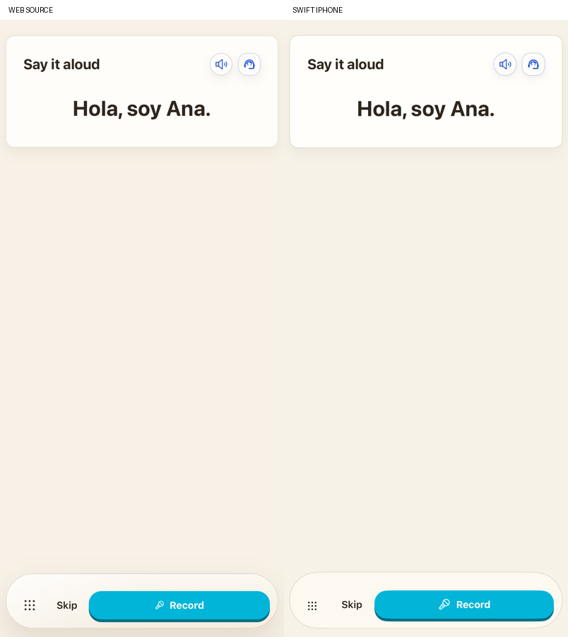
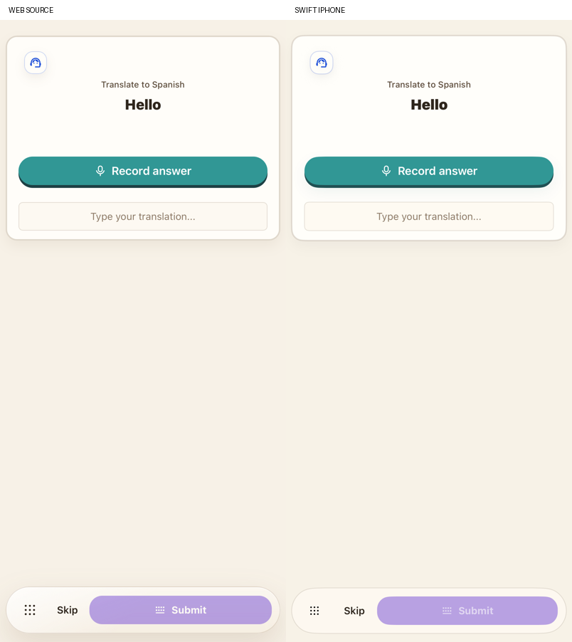
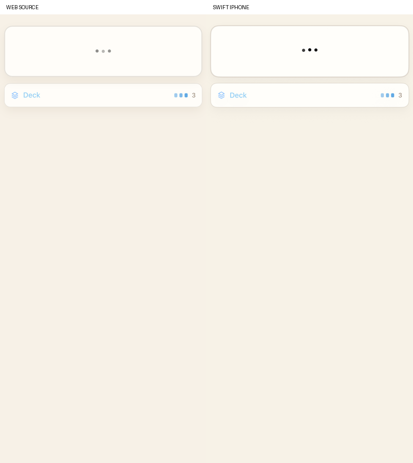

# Speaking and lesson flashcards

Speaking now uses the source’s dedicated sentence card, Listen/help controls and fixed cyan Record/Skip actions. There is no invented text field or manual Check action. Vocabulary’s repeat/translate/complete variants retain their original help visibility and target display normalization. Generated speaking questions can omit a prompt string, as the web contract permits. Completed transcripts automatically submit once through the original strict speech evaluation port, with the source hook’s confidence of 0.9 and no expected-answer transcription hint. This path does not use an LLM pronunciation judge.

Lesson flashcards now have the source front/answer card, Show answer, answer audio, inline recording and centered text input. Reveal and deck review award no XP. A wrong response hides inputs until explicit Try again, which clears the previous text, transcript and explanation; repeating the same wrong response remains a real retry. Correct semantic judgments award their original 4–7 XP and automatically collect the card. The invented manual Collect action is removed. Collected decks remain separate for Grammar and Vocabulary. The review uses the source modal, reversible cards, disabled navigation for one card and cyclic navigation for multiple cards. Returning from that modal preserves the pending generation and collected deck. Fresh generation receives the learner’s collected concepts, as the original prompt requires.

The Japanese, Korean, Hindi, Thai and Arabic beta keyboards share the previously restored source keyboard policy. Speaking help/explanation and flashcard explanation execute extracted original request builders, including the last submitted wrong answer. Account/language/question ownership, canceled submissions and private progress remain guarded by the native service controllers. Backgrounding or leaving stops recording and rejects canceled grades. Microphone denial offers the native Settings link.

Deck access now follows the source’s loading/empty branches. Active cards, including correct collected cards, do not contain a deck strip. While the next flashcard generates, its loading card appears above the collected deck. Generation belongs to the native question presentation and continues through deck review; leaving or backgrounding cancels that work. Closing review reveals the prepared question without starting a second generation. The web’s 3D backface rendering also differs from the native settled face, especially in WebKit snapshots.

The reference preview mounts the actual speaking JSX from both legacy parents and the actual LessonFlashcard/FlashcardDeckReview components. Only initial public question/result/recording state and provider callbacks are controlled. The source theme, copy, markup and shared action area remain in place. Separate extraction runs the original retry/deck callbacks (42 states), vocabulary normalization (20 cases) and assistance builders (112 requests across both modules and four language pairs). Generated outputs and original source hashes are retained in `reference/oral-*-manifest.json`. Production is native SwiftUI; the WebView exists only in comparison tests.

Exact runs, final captures and service results are recorded in [validation](VALIDATION.md). These checks cover the speaking/lesson-card correction, not complete product parity. Speaking targets and lesson-card answers now use the [original narration voice, locale and loading control](LESSON_AUDIO.md). Prepared/cached audio and sound effects, precise typography/shadow/feedback geometry, full 3D flip and recording motion, wider locale/device/accessibility and interruption recovery, and physical iPhone capture/playback remain. The reference web itself retains some older flashcard state on concept changes; the native question UUID resets the new question while preserving earned work. Quiz answers keep the existing immutable-after-grade contract.

The canonical collection now contains 120 pairs: 16 loading/empty/collected pairs use DeckPaint2 and 104 unaffected states use Final8. Six updated loading/deck product captures use DeckPlacement1, before the four-point strip-row calibration. Earlier Final8 deck-entry captures remain historical evidence of the corrected mismatch. The supplementary spoken-flashcard/Japanese input and introductory collection journeys use Flows7. Live provider outputs retain the separate Live1/Cleanup2 provenance.

