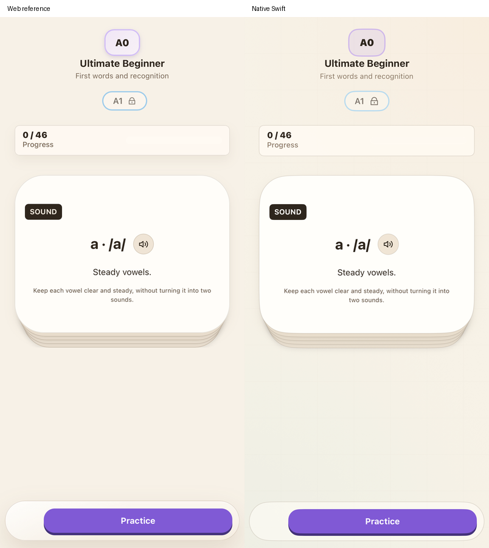
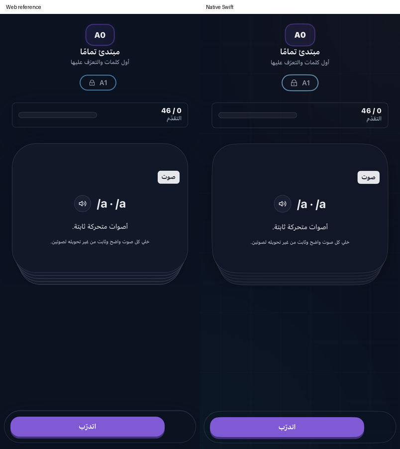
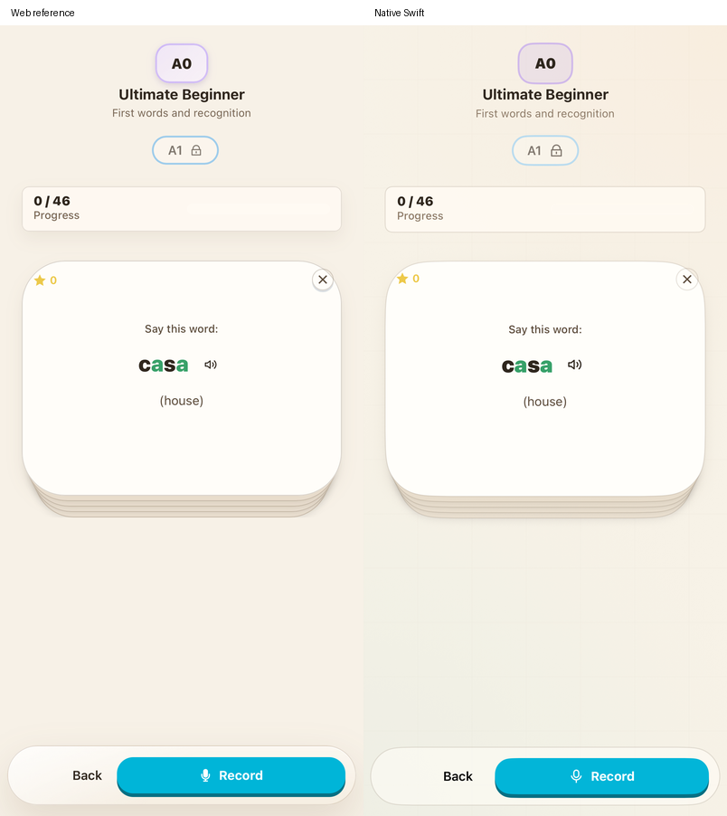
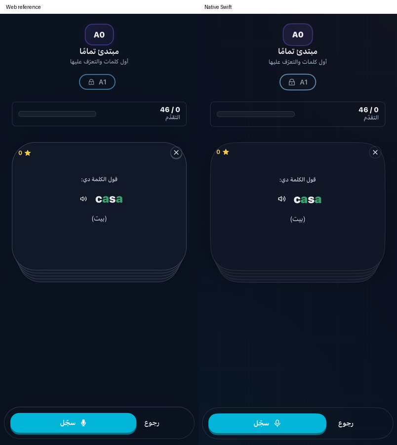
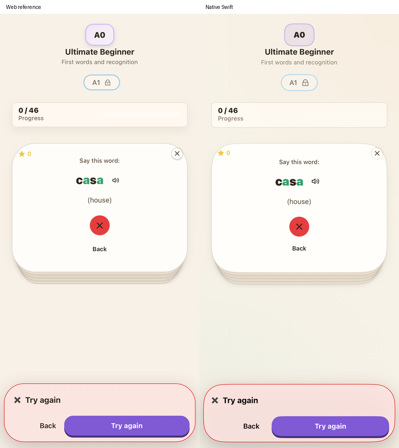
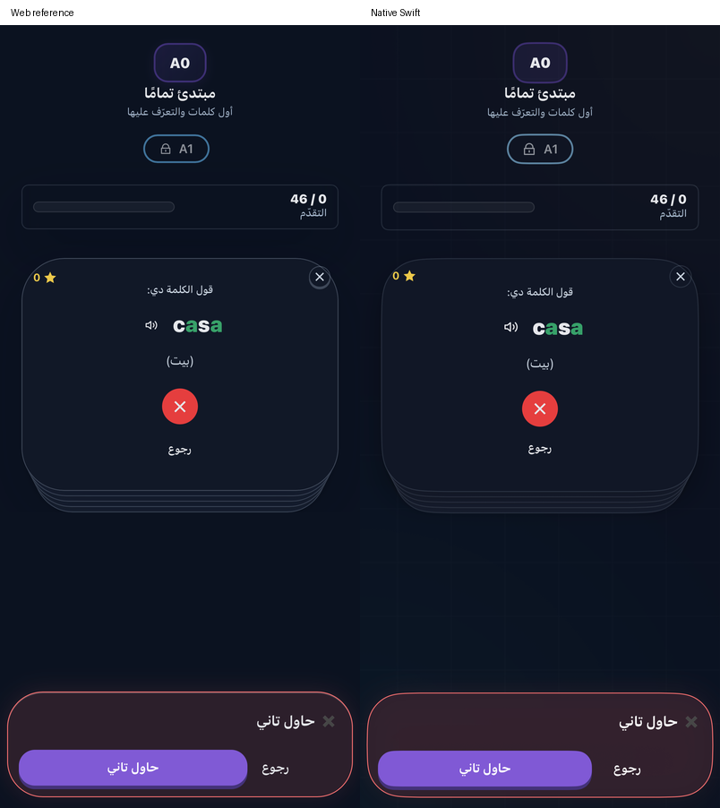
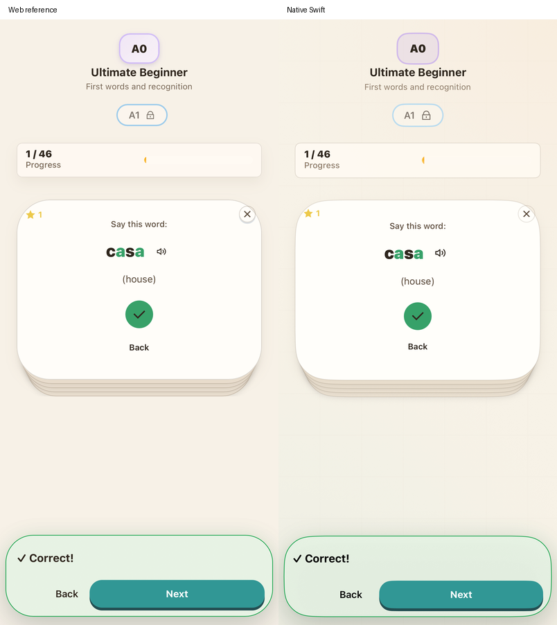
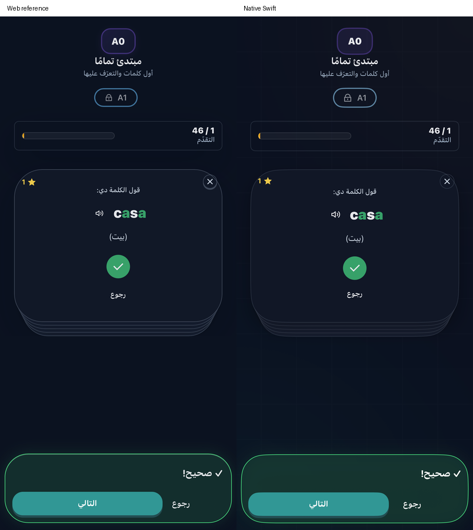

# Native phonics checkpoint

The main `/` Phonics mode now uses the original authored deck, stacked front/back cards, CEFR navigation, collected cards and fixed practice actions. This replaces the former list/form and fixed five-XP transcript-equality exercise. This checkpoint is part of the ongoing functional and design correction, not a claim of full app parity.

## Source contracts

The policy exporter reads pure declarations from `AlphabetBootcamp.jsx` and the original course, supplemental-deck, generation and narration helpers. It bundles the original localized copy, word highlighting, semantic judge, grade parser, course/partition rules, six-card continuation prompt/parser and Realtime narration session. React, stores, Firebase and provider calls do not execute in that bundle. Swift owns native rendering, transport, recording and persistence. The [source manifest](reference/companion-quest-source-manifest.json) records hashes and explicit environment/network-boundary adapters.

- Each pronunciation attempt uses the original AI judge. Recognizable phonetic equivalents can succeed; matching a transcription literally is not the grading rule. A successful attempt grants the source **1–2 XP**, including successful repeats. Each attempt records modeled Score evidence. Wrong ordinary/repair attempts retain the structured source card in memory; Goal misses follow the source exception.
- Attempts and Collect are separate. Ordinary attempts update canonical `alphabetPractice` attempts, correct count, current/last word and the ten-word history. Collect moves a card into the collection and records one daily Phonics activity without another reward or correct-count increment. Listening, opening and backing out grant nothing. Practicing a collected card can earn another attempt reward without another Collect.
- Goal and repair pronunciation use their focused artifacts and independent attempt receipts. They do not write ordinary Phonics records/activity. Goal's two required cards and repair's original/transfer roles must have saved successful outcomes before dependent completion. A failed save retains the verdict and retries without grading, rewarding or assessing again. New timestamped repair outcomes preserve the source latest-attempt behavior; old queued events retain their compatibility path.
- Course access derives from placement and the unlocked lesson/card/Tutor levels, then completed authored levels. Counts are shared across support languages; generated extras do not unlock authored levels. Selecting a level is local to the mounted course.
- New round uses the original prompt and strict localized/script/duplicate validator. All six generated cards save atomically under one receipt before they become playable. Restore requires a complete valid six-record batch. Retry reuses the pending batch, preserving earlier completion and unrelated record fields. Firebase Timestamp/Date values are converted recursively before source validation, including unknown nested fields.

## Native presentation and audio

The deck uses four offset backing layers, 48-point card corners, source labels/icons, highlighted word/meaning, sound/word Listen, success stars, a 500-ms flip, retry/Next/Back and collection Practice again. The completion portrait is the original character asset. English/light and Arabic/dark comparisons use the actual unmodified source component at a 402 × 874 viewport. The shared action dock now uses the source 40-point glass-fallback surface and feedback colors. Its host subscribes to the current published footer value, including a footer created during navigation mounting; reopened cards recreate cancelled sessions.

Phonics and flashcard Listen use receive-only native WebRTC with the original source narration instructions, locale/voice policy and exact-text message. The dedicated Piyali Cloudflare endpoint now accepts explicit narration sessions with disabled VAD and no input transcription, retaining its authenticated fixed-model limits. The web worker is untouched. Playback requires data-channel readiness and completes only after a successful response, output-buffer stop and the source jitter-buffer tail. Overlapping playback cancels its prior owner; stale callbacks, incomplete responses, background navigation and startup/deadline errors are fenced. Recording honors the saved silence pause and exposes a native input meter. Physical microphone quality and audible routes remain unverified.

## Evidence and reproduction

The complete Core baseline passes **270 tests**. A final affected selection passes **20 tests**, including the added recursive Date conversion regression and **106 source-executed phonics cases**, plus flashcard, companion and Goal regressions. The final combined native/component/Firestore selection passes **13 tests**. Native controller tests cover miss/retry/repeat, separate Collect, modeled evidence/memory, stale-language rejection and failed focused-save retry. Narration tests cover receive-only requests, readiness, response/buffer/drain completion and cancellation. Speech regressions cover readiness, late final transcription and cancellation.

Real Firestore SDK checks pass ordinary wrong/right/repeat/Collect receipts, atomic supplemental restore with preserved correct counts, focused repeated 1–2-XP attempts followed by its own mode completion, and incremental achievement evidence before Collect. The ordinary/Goal flashcard persistence regression also passes. They preserve unrelated membership/profile fields and make no ordinary phonics writes for focused practice.

The two final native product-menu UI tests pass. Phonics exercises onboarding → wrong answer → retry → repeat → Collect → two relaunches with the saved next card/action dock restored; the flashcard menu/rating/relaunch regression also passes. The source preview replaces only provider/capture/store boundaries with public fixtures; it mounts the original component and invokes its real Practice/Record/retry handlers. Native snapshots render the production view/controller and shared action surface. The comparison compositor converts tagged native Display P3 captures to sRGB before pairing them with the untagged source captures; it does not retouch their content or geometry. These comparisons exclude the global product header and do not prove full authenticated web-to-native parity.

| English/light | Arabic/dark |
|---|---|
|  |  |
|  |  |
|  |  |
|  |  |

Regenerate policy with `node scripts/export-companion-quest.mjs` and source icon assets with `node scripts/export-flashcard-icons.mjs`. Start the separate read-only preview with `node scripts/start-reference-preview.mjs`; opt in to the native component comparisons with `TEST_RUNNER_PIYALI_REFERENCE_PREVIEW_TESTS=1`. Export xcresult attachments and run `scripts/compose-phonics-reference.py <attachments-directory>` with Pillow for the labeled pairs. The real native provider run passes **two tests**: original pronunciation grading and six-card generation with receive-only narration, followed by the existing conversation connection regression. Both audio paths return actual RTP audio and positive receiver amplitude; narration waits for successful generation, stopped output and drain. Disposable authentication is removed afterward; there are no learner-progress writes. These checks do not measure physical audible quality.

The dedicated worker narration contract has **22 passing backend tests** (two unrelated opt-in rules tests are skipped), a successful package dry run, and deployed version `8c73a006-6acc-4c69-8482-57be5efc4de7`.

Provider/narration verification is opt-in through `python3 scripts/test-live-api.py --only phonics`; its private App Check token stays in the runner environment. The phonics selection also checks the existing conversation SDP/data/audio path.

## Remaining work

The source prepared-connection pool/cache, recorded replay, exact glass blur/glow/motion and source sounds are not complete. The global background and some typography/spacing still differ. Wider language/level/completion/generated-deck layouts, focused/repair/guided full journeys, real recording quality and physical playback/routes need checks. Tutor, Notes/memory/diary, account/payment panels and the other app-wide gaps remain in [the parity audit](PARITY_AUDIT.md).
