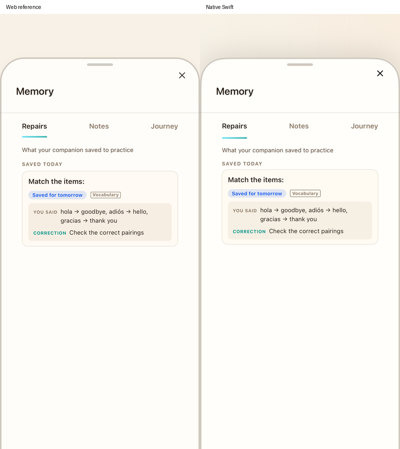
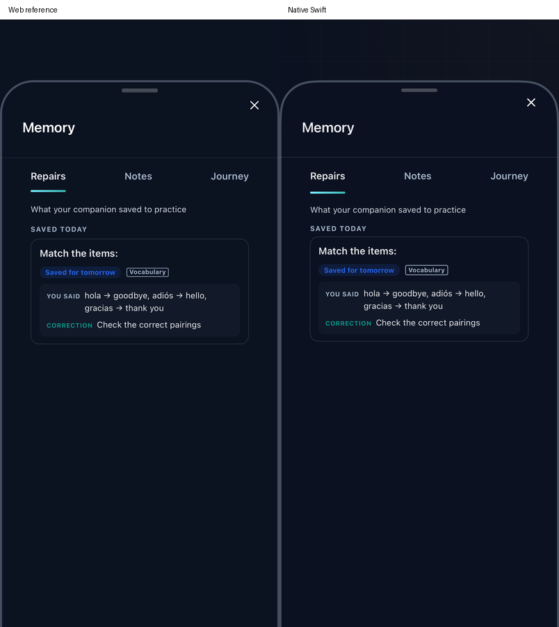

# Exercise repair capture — 2026-11-05

This continues FUNC-06 and VERIFY-02 from native `dc7ac53` against read-only reference `b269524ddc578027c549616fc47f5954991d9f6f`. It covers initial Vocabulary/Grammar mistake content, not every repair/focused-practice lifecycle or the overall parity goal.

A stemless matching question previously saved no repair: native captured its empty displayed question, and `captureMemory` discarded the empty concept. Native now captures the source fallback **“Match the items:”**, comma-separated submitted pairings, **“Check the correct pairings”** when no hint exists, and the module source context. It retains the question's CEFR level rather than the learner's current level or lesson level.

`PracticeRun.repairMemoryContext` now follows the actual standard wrong-answer snapshots and `extractDelightMemoryItem` plus capture arguments. Repair inputs remain distinct from displayed prompts, grading serialization and Create note context. Standard fill stores the source hint, matching stores its hint/fallback, multiple-answer choices use commas, and speech/word-bank/lesson-flashcard inputs retain their source semantics. Delight uses its original concept/answer/expected/context rules. Assessment, retry receipts, earned XP and collection boundaries remain in the existing reducer.

The [exporter](../scripts/export-practice-repair-contexts.mjs) executes the original source snapshot expressions, actual capture argument objects and pure Delight extractor with public question/response state. Its [manifest](reference/practice-repair-contexts-manifest.json) hashes the three source components. The 36 valid cases cover all 17 formats in both modules plus stemless matching in both modules. An attempted empty-fill fixture was rejected by the native question contract and removed; it does not represent a valid generated question in this checkpoint.

Sorting captures share the existing insertion-order metadata with note creation. JavaScript integer-key enumeration precedes string keys. Older native runs without this metadata still use deterministic sorted order; missing historical insertion order cannot be recovered.

## Source defects retained and open scope

The current Delight repair extractor reads legacy fields for several formats: dialogue expects `correctIndex` while current questions use `answerIndex`; morphology expects `assembled`/`answer` while the current interaction uses `pieceIndices`/`answerWord`; mystery expects `guess` while its input uses `text`; listening expects `pairs` while current questions use `options`/`audioText`/`answerIndex`. Consequently some source repairs save empty submitted answers/corrections or generic listening concepts. Natural/weird uses `isNatural`, including its false-like fallback. Native now follows these actual source values; this is not evidence that the resulting repair content is complete or educationally correct. Enrichment may later provide different text.

Focused Goal slip diversion/evidence and cached reentry now have [scoped evidence](GOAL_MEMORY_CAPTURE.md). Same-day duplicate merge behavior, wider focused handoffs, reading/story/other modes' repair context, tomorrow's repair-deck handoff, account/language/day interruptions, wider private/cloud merges and full shell design remain separate work. Changing initial capture inputs did not fix duplicate merges in that checkpoint. The later [shared duplicate correction](MEMORY_DUPLICATE_CAPTURE.md) reconciles retained corrections/answers, localized summaries, support normalization and note order; broader shared initial/enrichment/evidence behavior remains open. No live model, cloud or physical-device claim follows from public offline fixtures.

## Verification evidence

The focused Core run `/tmp/piyali-repair-context-core-final-20261105.log` passes eight tests (0.028 s), including the 36 original-source context comparisons and stemless capture → private restore → correct retry → once-only XP. Existing note ordering/restoration and practice reward/quiz tests also pass. This is reducer/input evidence, not 17-format product-journey coverage.

The first simulator attempt `/tmp/PiyaliPracticeRepairContext20261105.xcresult` fails: the source renderer does not find the submitted record before readiness expires, and the new native `match-no-stem` fixture was not recognized by the existing offline judge alias. These are not counted as passing visual or end-to-end evidence. The judge alias was corrected and source readiness diagnostics added for the follow-up run. No production grade/reward path was replaced to obtain a pass.

The follow-up `/tmp/PiyaliPracticeRepairContext2_20261105.xcresult` passes the **actual native product journey (114.228 s)**: create account/onboard/placement → course → stemless matching → wrong pairs → Memory → correct drag/swap retry (+6 XP) → Memory still retains the missed answer → terminate/relaunch → Memory still retains it. It does not seed Memory records. The source comparison in that same bundle fails; the bundle is not all green.

`/tmp/PiyaliPracticeRepairDrawers20261105.xcresult` also fails source readiness (35.906 s). Its captured runtime error identifies the cause: the shared practice-question preview replaced `useNotesStore` inside `NotesDrawer` with an action-only mock, so `notes.filter` threw before React mounted. The target-owned preview now exempts NotesDrawer from that mock. It also has a standalone original-drawer entry and loads the same two source font styles as `main.jsx`. No reference source file changed.

`/tmp/PiyaliPracticeRepairDrawersFinal20261105.xcresult` then passes (5.244 s), with source/native light and dark drawer pairs, DOM assertions for the captured concept/answer/correction, and the actual native captured record as an attachment. The original source drawer receives that public record; source-handler input equivalence is established separately by the 36 Core cases. **This is not a complete browser matching → capture → drawer journey.** The native journey above is a product UI journey. Empty enrichment responses are an explicit isolated provider boundary, preventing a model rewrite from concealing the submitted content; these do not establish enrichment quality or live service behavior.

The [capture manifest](native/practice-repair-capture-b269524d/manifest.json) hashes seven artifacts, pins the result bundles and states the limits. Visual inspection confirms the same content, card/tabs/status/chip/answer composition in both themes. Small native text/vertical rhythm differences (roughly 1–4 points), rasterization and different component backgrounds remain visible. The standalone pairs omit the surrounding product shell; the four separate native captures retain it. Full shell/RTL/accessibility design approval remains open.

| Light source/native | Dark source/native |
| --- | --- |
|  |  |

[Wrong submission](native/practice-repair-capture-b269524d/wrong-submission.png), [captured repair](native/practice-repair-capture-b269524d/captured-repair.png), [after correct retry](native/practice-repair-capture-b269524d/retained-after-retry.png), [after relaunch](native/practice-repair-capture-b269524d/restored-after-relaunch.png).
