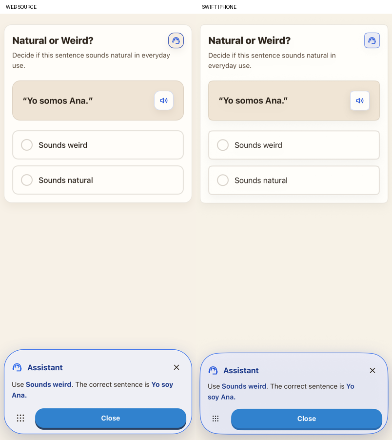
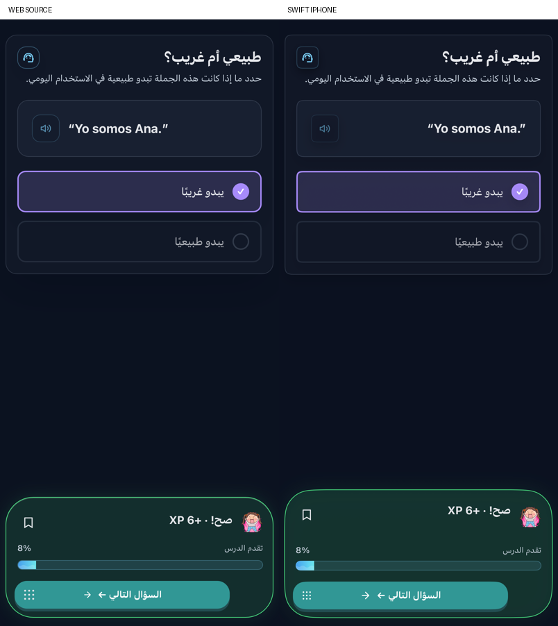

# Question actions and lesson entry

Ordinary curriculum entry now starts the first authored activity with a fresh question, matching `handleStartLesson` in the reference `App.jsx`. Existing lesson-owned earned XP survives leaving and reopening; an answered question is not revived as the new activity. The extra native lesson title, persistent XP header and module pills were removed because the actual source does not render those controls. The native Back button remains available. Getting Started and final quizzes retain their own saved-session behavior.

The typed question engines now share the source fixed action-area sequence: disabled Check until the response is ready, Skip, retry feedback, a separate wrong-answer explanation, correct feedback with its portrait/note control, lesson percentage after a correct answer, and Next. Help has its own blue action area and Close controls. Closing preserves an in-flight/cached answer; changing the account, language, question or owned response rejects stale delivery. Asking for help records assistance without grading or awarding XP; a wrong-answer explanation does not itself mark the run assisted. Quizzes hide help, notes and explanation. Preparation hides the previous question while its replacement loads. A failed replacement keeps that saved data intact but hides its stale answer controls; Retry requests fresh generation, and the service rejects grading the old question until preparation succeeds.

`NaturalOrWeirdQuestion` now uses the original card, sentence/audio button, circular choice indicators, source copy and colors. The other typed formats share the corrected footer but still need individual body/layout comparisons. Shared footer publication now refreshes when the theme changes. The source action portal inherits the active language direction while the menu stays physically left; the lesson wave fills from the left in both languages. Native Arabic keeps that same source behavior, including the source menu/action overlap in narrow RTL layouts.

## Source prompt boundary

`scripts/export-practice-assistance.mjs` extracts the actual assistant and explanation callback construction from `DelightQuestionLab.jsx`, before the provider branches. Its bundle includes the original language/direct-answer policy and localized exercise copy. JavaScriptCore executes it with canonical JSON inputs. This preserves the exact help/explanation prompts for all nine advanced exercise formats, including the concrete morphology solution prefix on provider failure. The 144 fixtures cover both initial and populated responses, four language pairs and both operations. Dictionary keys are sorted at the adapter boundary; arrays preserve offered-choice order. Source hashes and adapters are recorded in `reference/practice-assistance-manifest.json`.

The native helper streams through Firebase AI when Gemini is selected and uses the existing Responses service otherwise. Standard legacy formats currently use a direct-answer prompt with their actual question/response/bank context; porting their individual source prompt builders remains open. Provider failures use the source localized error or the available morphology solution. Tests distinguish scoped local provider fixtures from actual live service verification.

## Verification and limits

The source preview executes the real NaturalOrWeird, ChoiceCard, QuestionAssistantButton, FeedbackRail, QuestionActionArea, ActivityActionRow and menu components at 402 × 874. Six states (unanswered, selected, wrong, explanation, assistant and correct) are compared in English/light and Arabic/dark. Each comparison creates fresh WebKit storage and asserts the requested source theme. Native snapshots mount the actual question view and shared footer with a fixed public sentence/portrait; they omit the global web/native navigation bars. Help/explanation sample text is controlled and does not establish provider correctness. Small typography, card-radius and feedback-height differences remain; these are component comparisons, not proof of full-page parity.

The complete product journey uses real landing creation/onboarding/placement/path/preview controls with isolated offline questions. It checks streamed help, Close/reopen without another request, a wrong answer and explanation, correct six-XP feedback, 8% lesson progress, Next, Back/reopen with fresh unanswered content, and 15% retained progress after another correct answer. Separate controller tests cover cancellation, response races, cache behavior, quiz exclusions and morphology failure. The existing 80-XP completion and final-quiz regression journeys now follow the product's queued task/scholarship/reward dialogs before interacting with the path.

See `VALIDATION.md` for final run results and `native/question-*` for retained comparisons and product captures. Full product parity, remaining question-body layouts/prompts, wider locale/device/keyboard accessibility, generation failures and background/resume behavior, audio interaction parity and physical iPhone checks remain open. No reference repository files are changed.

## Retained examples

[Actual product help](native/question-product-help-stream.png), [fresh entry with retained XP](native/question-product-fresh-entry.png) and [the separate 80-XP completion reward](native/question-product-complete-80xp.png) come from Final9. The full comparison set and source geometry use the later Visual11 centering correction.
