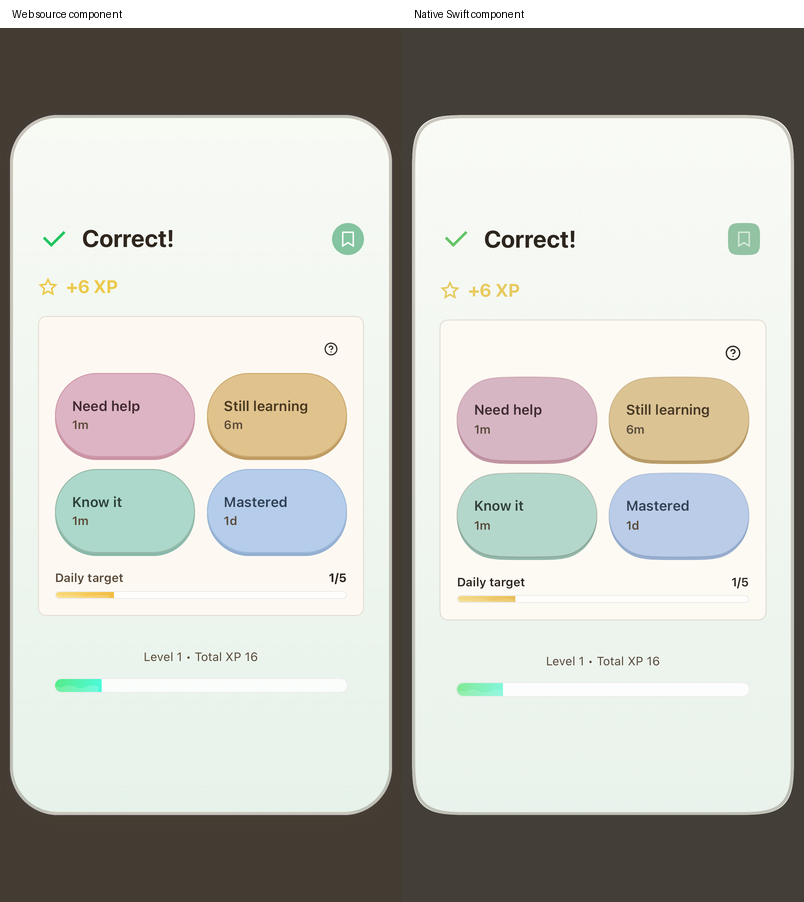
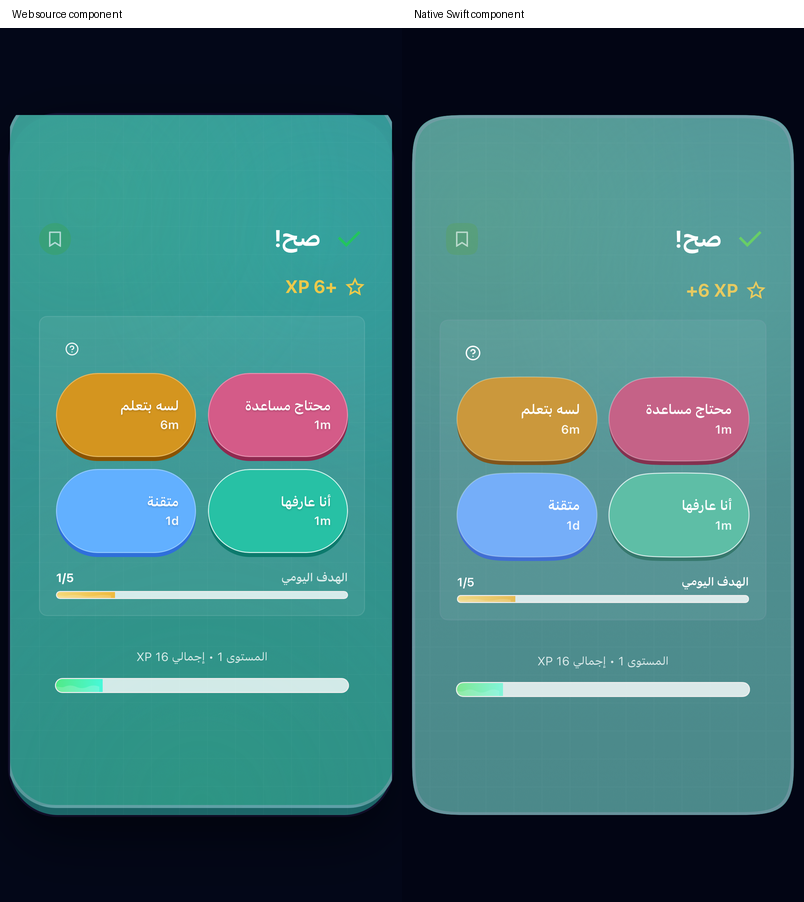

# Reading translations and Flashcard notes — 2026-11-05

Reference: read-only `b269524ddc578027c549616fc47f5954991d9f6f`; native work continues on `codex/functional-design-parity`. This is a scoped FUNC-01/FUNC-06/DES-06 checkpoint. The overall handoff remains open.

`History.jsx:translateLectureLines` issues one stream request. Complete aligned lines remain available; a normally incomplete or empty result removes translations and returns to prose. A thrown request removes translations but leaves the sentence stack visible with an enabled **Translate** retry. Both failures are silent. Native now preserves those distinct states, exposes its own translation loading flag, allows review while translation is pending, and merges a successful translation into the latest run so an intervening completion receipt/reward is retained. Cancelled requests cannot clear a replacement request, including a replacement in the same run. Normal empty passage streams now also reach the source's two-attempt backend budget, rather than being reclassified as thrown streams.

The source callback contains a matching `viewLecture.support` fallback. The current main-route generation paths initialize `support: ""`; History starts with an empty in-memory lecture list and has no restore/import path using its otherwise-unused `normalizeLectureTexts`. The pure resolver compares that conditional fallback, but no new persisted support field was invented in the native main flow. Thirteen source-executed translation outcomes include conditional support cases; native service comparisons select reachable main-flow cases. The passage-generation outcome fixture now has twelve cases, adding normal empty streams with successful/failed backend requests.

The [source component captures](reference/reading-translation-b269524d/manifest.json) use the original passage JSX and translation callback, source theme/CSS and system fonts at 402×874 with public passage/chunk fixtures. They show a first translated line, thrown failure, and successful retry. The source control measures 32 px high, 14 px semibold, squircle radius 100 and a 4 px edge. Native follows its teal/purple states and retains a 44-point hit area. Translated text follows the source's 14 px italic/21 px line box and white/opacity styling, original `#38b2ac` paragraph surface/edge, sentence highlights, borders and four-pixel shadows. **The source's translated text has poor contrast in light mode; reproducing it is a known product defect, not accessibility approval.** These source crops exclude the shell/footer; the native screenshots are complete simulator viewports. This is not a matched full-product viewport certification.

Reading and Story have no reachable dedicated **Create note** action at this reference: their missed-answer handlers call `captureCompanionMemory` for Repairs. The global Memory drawer remains available. Flashcard does have **Create note**, using the shared `noteGeneration.js` helper. Native now distinguishes a request/JSON exception's catch fallback from a normal response containing no JSON, uses the source Gemini-first/Responses request order for notes, preserves translated labels where present and replaces blank English native labels with the source's actual missing-key labels (`flashcard_create_note`, `flashcard_note_saved`, `flashcard_note_error`), and renders the loading/saved bookmark states. A pending note retains its captured answer/context after rating/closing the card; account/target/support changes fence its result. Creating a note adds no XP or scheduler review. The source helper returns a truthy raw key before the component's English fallback can run; its untranslated English accessibility labels are another known source defect. Arabic retains its actual translations.

Verification and final capture records are listed below. All simulator work pins isolated QA device `CE8248B6-7171-4FD4-97DE-89E499107F82`; the regular simulator/profile and separate Firebase/Cloudflare configuration are untouched. Public offline provider/speech fixtures establish native product behavior, not real microphone/audio quality or live model latency.

Remaining: matched complete source/native Reading/Story viewports, wider locales/themes/text sizes, source global Memory capture animation and sounds, focused deck completion, exercise-note completion after advancing while its request is pending, remaining Story generation/fallback differences, physical voice/accessibility, and the other handoff integration/release rows. No complete feature or whole-product parity claim follows from this checkpoint.

## Verification and retained attempts

- Focused Swift package selection: **29 tests passed** (10.017 s), including the thirteen executed translation outcomes and 118 Flashcard source-policy cases. The normal-empty passage outcome expansion is also exercised at the native provider/backend boundary.
- `/tmp/PiyaliReadingTranslationService20261105.xcresult`: all four selected native checks pass, including source generation failure budgets. `/tmp/PiyaliTranslationNotesFinal20261105.xcresult`: four native checks and three UI journeys pass; the latter include incomplete translation (62.104 s), thrown translation (62.552 s), and ordinary Flashcard note → Memory/relaunch (71.641 s). This precedes the later source-label correction and paragraph paint calibration.
- `/tmp/PiyaliNotesSourceFinal20261105.xcresult`: eight non-comparison Flashcard app checks pass, including request failure/no duplicate/no XP, pending note completion after rating with captured answer, and changed-language rejection. The final-label ordinary Flashcard note → Memory/relaunch UI journey passes again (71.873 s). Its source comparison fails the harness's no-op note store; that containing bundle is **not** all green.
- `/tmp/PiyaliNoteAndTranslationPaintFinal20261105.xcresult`: the final Reading paragraph/retry/review/relaunch journey passes (65.375 s). The containing source comparison fails its hard-coded English selector on Arabic. `/tmp/PiyaliNoteLocalesFinal20261105.xcresult` corrects that selector and passes all eight original source/native initial, wrong, correct and saved-note component states (15.381 s). `/tmp/PiyaliNoteOpacityFinal20261105.xcresult` repeats those eight states after correcting SwiftUI's additional disabled dimming (15.975 s); final pairs/metrics use this last run. The full Flashcard product journey predates only that paint-only button-style change.
- `/tmp/PiyaliStudyNoteLive20261105.xcresult`: live correct/incorrect grading, reveal, difficulty and original study-note prompt pass through separate native services (17.394 s), without learner progress writes. `/tmp/PiyaliReadingTranslationLiveFinal20261105.xcresult`: configured Gemini and Responses both pass generation/translation (22.819 s); usable draft snapshots are 12/375, translation-line snapshots 2/9, and no restart is observed. Both disposable authenticated identities are deleted by the guarded cleanup helper.

Earlier `/tmp/PiyaliReadingTranslationNotes20261105.xcresult` passes its three Reading journeys but fails the blank native saved-note label. `/tmp/PiyaliTranslationNoteComparisons20261105.xcresult` passes pending-note ownership and Reading retry/relaunch, but fails the assumed English fallback selector. These failures exposed the missing-key source behavior. The later note-store and Arabic-selector harness failures above remain recorded rather than being counted as passing suites. No complete regression suite or physical-device run was performed for this checkpoint.

The final [capture manifest](native/reading-translation-notes-b269524d/manifest.json) pins hashes and individual result bundles. Source saved buttons measure 32×32, white on `#38a169`; native preserves that visual size/color/opacity with a larger hit target. The component pairs still differ in fine geometry, gradient/rasterization, mixed RTL XP ordering and WebKit's circular fallback versus the native intended superellipse. Passing callback/state checks do not certify pixel parity or the full modal viewport.

| English/light saved note | Arabic/dark saved note |
| --- | --- |
|  |  |

[Native note in Memory](native/reading-translation-notes-b269524d/flashcard-note-memory.png), [native recovered translation](native/reading-translation-notes-b269524d/reading-recovered.png), [native thrown outcome](native/reading-translation-notes-b269524d/reading-thrown.png), [native incomplete outcome](native/reading-translation-notes-b269524d/reading-incomplete.png). Source passage crops: [arriving](reference/reading-translation-b269524d/arriving-en-light.jpg), [thrown](reference/reading-translation-b269524d/thrown-en-light.jpg), [recovered](reference/reading-translation-b269524d/recovered-en-light.jpg). These have different surrounding viewport contexts, as scoped above.
