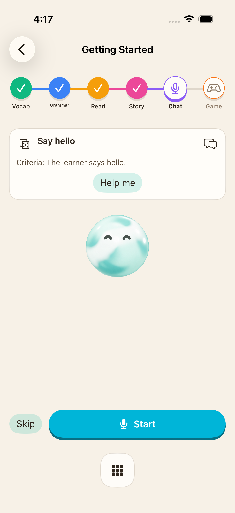

# Curriculum realtime correction

Path lessons now mount a native voice goal activity instead of the former generic text-question form. This is distinct from the free Conversation course and the tutor agenda. Its goal, judge, tutorial seed, language instructions and effort/pronunciation reward policies come from the actual `RealTimeTest.jsx` source. The policy exporter extracts only named pure functions and the judge template, validates lexical captures, and supplies explicit JSON refs. The manifest records the source hash and captures. React effects, transport, account credentials and web storage are excluded.

The activity prepares a concrete goal from the authored lesson. The introductory goal is the original localized “Say hello” task. Start explicitly requests microphone access; entry does not record or initiate a greeting. Instructions constrain the target language, short replies, adult beginner tone and current goal. Misses earn no XP; a met goal earns the source's rounded 4–7 XP, once per goal, attributed to the active curriculum lesson. Next/Skip hand off to the session. The original 30-second inactivity timeout is applied; the source's stale “15 seconds” message is corrected to 30.

Native controls include Start, mute, pause/resume, end, new goal, starter phrase with playback, transcript/history and note saving. Pause/reconnect supplies the source's bounded resume context and does not greet again. Completed turns are saved before judging, so a judge outage does not erase the conversation. Judging is serialized; duplicate turn IDs, completed goals, replaced goals, account/target/support changes and navigation cannot apply another reward. Goal/transcript snapshots are bounded and sync through the existing private native state; XP uses the transactional outbox.

Verified so far:

- Source instruction, judge, tutorial localization, all effort/pronunciation reward combinations, resume and stale/duplicate fences in core tests.
- Simulator signup → onboarding → preview → inline vocabulary/grammar → relaunch at Reading → Stories → realtime greeting goal without opening the microphone → Game skip → one +50 completion → first curriculum node unlocked → relaunch persistence. A real hit-testing failure caused by the floating menu was reproduced and corrected.
- An opt-in native service test generated the source goal, rejected a greeting for a coffee-order goal, accepted a polite coffee request, and received actual PCM audio using the source lesson instructions. This uses synthetic text input and an isolated test identity; it does not verify microphone capture, speaker routing or physical-device behavior. Run `python3 scripts/test-live-api.py --only realtime` with the local App Check setup.

Remaining differences include the voice provider/transport (native Firebase Gemini versus the web's default OpenAI realtime transport), assessment/context integration for other engines, advanced settings and cross-device draft compatibility, message translation/audio replay/morpheme tools, dynamic orb/voice glow and complete visual parity. Physical audio and pause/interruption behavior still require actual audio interaction. This checkpoint does not establish full realtime or app parity.

Checkpoint validation: the broader core suite ran 175 checks successfully; a later 15-check affected subset covered the updated transcript/decoder and introduction policies. The latest simulator run passed all three selected journeys: authored introductory adventure (71.5s), inline sequence/resume (54.8s), and the ordinary 80-XP lesson/bonus/unlock/relaunch (102.9s). A separate answer retry/resume check passed. These are scoped checks, not an all-product parity certification. A later simulator journey also reopened and replayed the completed introduction without a second +50 bonus. Grammar/vocabulary and realtime now receive the original curriculum context; see [context checkpoint](CURRICULUM_CONTEXT.md).

Native simulator capture of the introductory goal and controls (full visual parity remains open):

Grammar/vocabulary and curriculum realtime now save source difficulty quotes and apply them to progress; see [the assessment checkpoint](QUESTION_WORTH.md).
