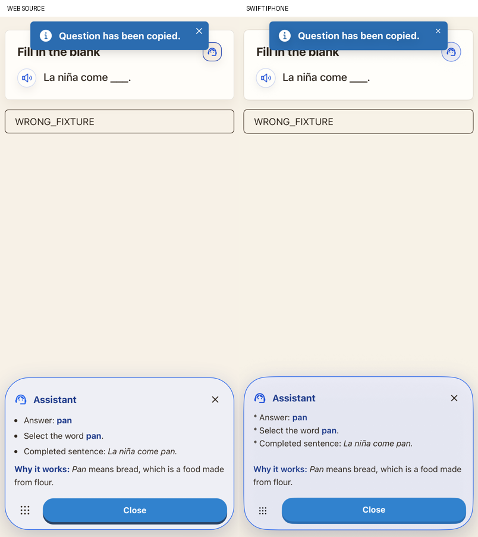
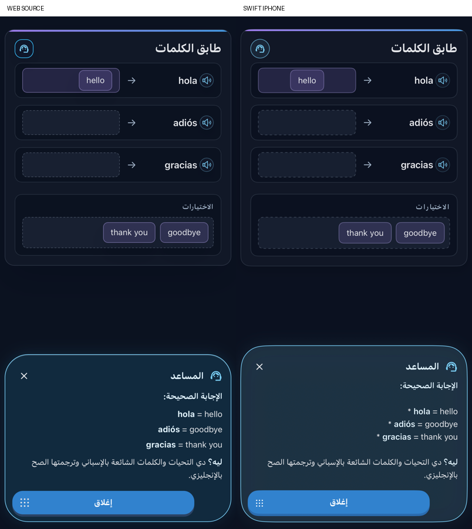

# Original standard exercise assistance

Fill, Multiple Choice, Multiple Answer and Match now execute their original Grammar/Vocabulary assistance construction. The generic native request is removed. Together with advanced, word-bank, speaking and flashcard policies, the 17 main lesson formats now use their source assistance builders.

Fill and choice help retain the original Copy All bundle: trimmed question, optional localized hint and permitted translation. The learner’s current Show Translations setting and the source’s same-language guard control that bundle. Generation now reads that same setting. Native writes it to the clipboard and shows the original localized 1.2-second notice, including cached-help reopen/close. Matching uses its distinct localized instruction, left column, available words and hint; it does not copy to the clipboard. Parent requests retain the original exercise material, learner verbosity, language policy, answer-first instruction and concise response limits.

Explanations execute the original submitted-question snapshots and localized templates. Fill supplies its original hint, choice supplies its answer, multiple selections and match mappings retain source comma formatting. Wrong attempts now save an optional structured response so edits cannot change the submitted explanation context. That response survives Codable save/restore. Earlier saved runs without it retain their existing last-wrong-answer string. Account/language/question ownership and canceled-request fences remain in place, and a new submission clears the previous explanation. Help and copying award no XP.

Feedback visibility follows the source effects: nonempty changed Fill/choice responses hide the wrong rail; Vocabulary matching also hides it after a changed nonempty mapping. Grammar matching has no such reset and preserves the wrong rail/explanation until the next submission. The native implementation now retains that distinction. Keeping a submitted snapshot does not force a hidden rail to stay visible.

`scripts/export-standard-assistance.mjs` extracts actual Copy All/translation-visibility/toast functions, matching callbacks, submitted snapshots and parent request-building statements before provider I/O. The policy runs natively through JavaScriptCore and the assistance views remain SwiftUI. The exporter executes 240 cases across both modules, six layouts and five language pairs, with empty/populated hint/translation context, both verbosity settings and same-language translation suppression. It verifies all 8,349 current source strings against the bundled app copy, records source file hashes and derives the actual edit-feedback reset effects. Native clipboard/provider I/O stays outside that pure policy.

Exact Core, controller, product, visual and live-service results are recorded in [validation](VALIDATION.md). Full product parity remains in progress: source TTS/voices/effects, exact motion/typography/feedback geometry, broader locale/device/accessibility and interruption recovery, plus the other feature audit items still need work. Clipboard-notice presentation is separately compared; the four live assistance requests do not verify physical microphone or audio behavior.

Four final paired views and source geometry use Content5, with actual Live1 exercise-specific replies in three cases and an appropriate public Arabic Fill hint. Final4 retains the final controller/preference checks. Nine product captures use Help2, before the banner calibration and preference wiring; the final controller checks cover that wiring. The source toast is held open only in the comparison adapter.

