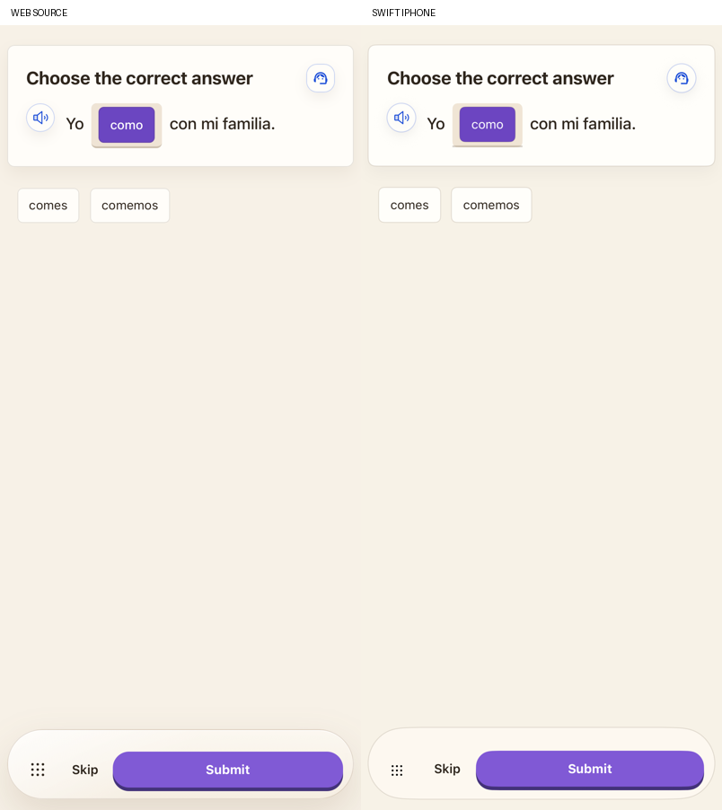
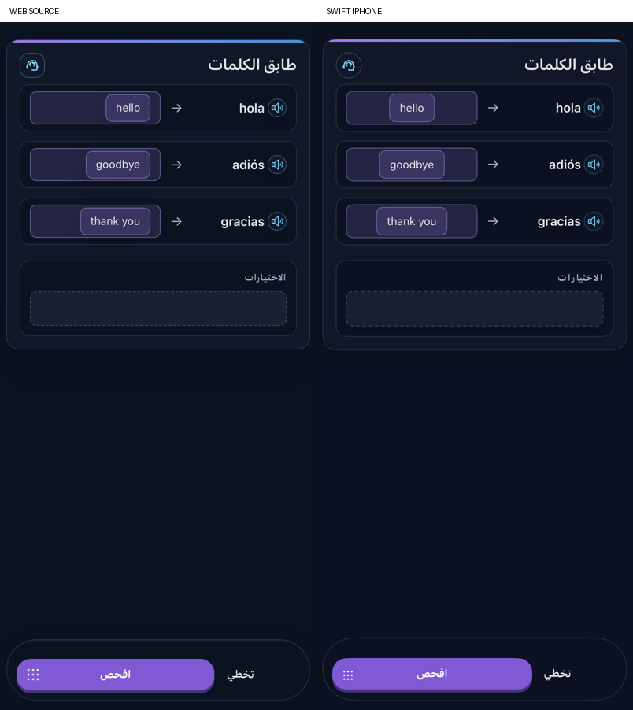

# Standard question bodies

Fill, Multiple Choice, Multiple Answer and Match now have their own native source bodies. Translation, listening repetition, speech and lesson flashcards still need their individual source presentation and input work. This checkpoint does not complete the full product parity goal.

| Format | Restored source behavior |
|---|---|
| Fill | Original title, leading audio and header assistance; single-line answer outside the card, transparent field and original placeholder and beta-keyboard access through the fixed action row. |
| Multiple Choice | Original radio cards, or a live inline sentence slot and movable choice bank, selected by the original deterministic policy. |
| Multiple Answer | Original teal checkbox cards, or one drop slot per sentence blank. Drag mode is used only when the blank and answer counts agree; every slot must be filled before submission. |
| Match | Original accent/header, individual word audio, left words/arrows/drop zones and separate bank. Tap places into the first empty slot; placed tiles return to the bank. Native drag supports replacement, slot swaps, return and bank reorder. |

Inline sentence slots use TextKit attachments to reserve space for real SwiftUI controls. The controls sit inside the actual wrapping sentence and remain native drag/drop and accessibility targets. This does not use a production WebView. Transfer items reuse the private question UUID/item-index type; wrong-question, out-of-range, multi-item and locked drops are rejected.

`StandardPracticeInteraction` preserves bank order, slot positions and the original selected answer in the saved response. Legacy runs with only `indices` or `pairs` derive their corresponding slots and bank. A malformed saved partition falls back to that recovery. This keeps holes and moved/reordered tiles distinct from grading indices. It feeds the same semantic judges, XP policy, history and lesson progression as other practice. Selection and movement grant no XP. Correct native runs remain locked to prevent repeat awards; source-specific vocabulary tap-return and grammar drag-return behavior are retained.

The original UTF-16 hash chooses button/slot variants. Grammar additionally rejects drag when there are fewer blanks than answers; both modules require exact blank/answer counts for multi-answer slots. The export executes the actual callback bodies with inert React setters. It covers 70 movement cases, 126 selector cases and 64 generated-choice repairs from both modules. The parser repairs missing offered references before selecting a layout. Exact offered spelling/case is preferred; non-Latin diacritics and symbols remain distinct instead of collapsing through the web helper’s ASCII comparison. Exact references retain the fast path; other responses still use the original semantic prompts. A missing explicit fill answer now retains the original hint for repair memory. The native Core checks also cover response encoding, legacy recovery and complete-slot readiness. The source MC vocabulary tap-return leaves its selected answer reference intact until another pick; dragging the tile back clears it. The native model retains that original distinction.

The read-only preview extracts each actual JSX branch and its header/inline renderer helpers from `GrammarBook.jsx` and `Vocabulary.jsx`. Provider and persistence callbacks are inert in controlled comparison states; the real callbacks are tested separately through their exported contracts. Each comparison uses fresh WebKit storage, asserts its requested theme and captures source geometry. Public controlled content fixes the question and bank order. The original parent stack supplies spacing around the extracted branches. Global navigation bars are outside these component comparisons.

Exact runs, superseded comparisons and retained captures are recorded in `VALIDATION.md`. Remaining work includes the other four standard bodies, source help/explanation prompts on legacy formats, source TTS/voices and sound effects, active audio indicators, source-compatible post-grade editing without repeat awards, all target-language/keyboard and interruption states, precise font/corner/menu geometry, wider accessibility/device checks and physical iPhone testing.

The shared action surface preserves the legacy empty-feedback gap and 44-point action row for these four formats while keeping other activities’ defaults. Source “Next question” copy is retained. Correct fill input clears visually while its submitted response remains in private history and note data. Original feedback-reset rules distinguish a changed answer from a moved bank or emptied response.

The native request boundary also corrects the malformed Vocabulary MC/MA `choices` JSON examples in the original prompt. The recipe bundle and reference source remain unchanged. An actual provider run exposed the invalid example being copied into generated output; strict parsing rejected it and the existing fallback recovered. The corrected request then passes four fresh live choice generations without parse-failure attachments.

Final component evidence covers 96 source/native pairs: both modules, six variants, four response states and English/light or Arabic/dark. For example:

Seven retained product captures use the isolated real onboarding/course journeys. Six use Journey4 before the final visual spacing/input/footer corrections; `standard-product-ma-inline.png` uses the later Grades7 run. These demonstrate actual gestures, retries and earned XP separately from the final component comparisons. See `VALIDATION.md` for run provenance and remaining differences.
