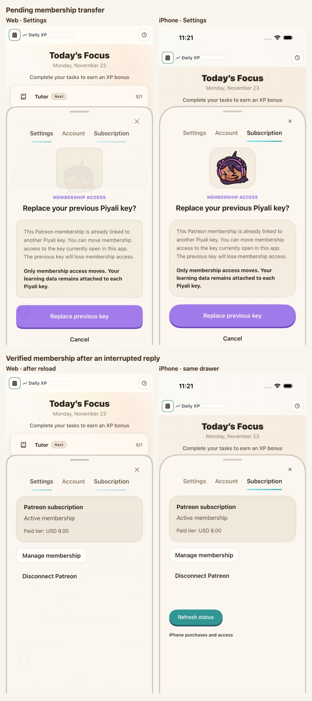

# Native subscription parity

The native root paywall and Settings subscription tab use the actual main product's `SubscriptionGate`, `SubscriptionSettingsPanel` and `PatreonKeyReplacementGate` copy, artwork and state policy. They replace the earlier generic subscription list. The larger functional/design parity goal remains open.

## Presentation and access

The ordinary offer keeps the source character 31 (`32.webp`, exported as `story-portrait-31.webp`), benefits, single Patreon membership card, annual recommendation, currency clarification and exact ten-language copy. Separate presentations cover checking/disabled controls, waiting for checkout, unavailable membership, legacy passcode migration, key replacement/expiry, embedded offers, active/stale memberships, payment issues, inactive memberships and disconnect confirmation. The source's global gray palette and neutral/ghost buttons apply even where a component names Chakra's original gray tokens. RTL action rows wrap in source order.

`export-subscription-policy.mjs` extracts the actual source membership/access/recovery/feedback functions. Its fixture matrix has 1,053 cases, including source Intl USD formatting in all ten languages. A legacy `subscriptionPasscodeVerified` value imports only the source migration hint; it never grants paid access. The root retains the existing 300 account-XP trial and earned-completion/scholarship sequence. Settings shows a verified Apple membership separately when no Patreon account is linked, so an existing Apple subscriber is not presented another web offer as the default.

Native iPhone purchase/restore/management, subscription terms, privacy and the requested real `/subscribe` web link are available under “iPhone purchases and access.” StoreKit uses product-localized prices and account-bound verified transactions. The existing storefront configuration governs external-payment actions; the simulator debug build enables them. App Store product/release setup remains required.

## Native API and browser handoff

`SubscriptionService` now retains the complete server status payload, rather than only its authorization Boolean. Status requests coalesce; a manual forced refresh queued behind a cached read still performs one fresh check. Each account gets its own in-memory URLSession/cookies; switching keys cancels outstanding work and fences late status, browser return and purchase errors. A provider outage preserves the last status for display without extending its existing short authorization expiry.

The existing web APIs receive a fresh signed kind-27235 challenge for each link, restore, replacement or disconnect action. Templates are checked for the exact requested action, nonce, content, kind and expiry before signing. These private API proofs are not published to Nostr. The returned authorization URL must be an HTTPS Patreon authorization URL with identity scope, state and the configured web callback; a loopback exception exists only for isolated debug tests. Private keys stay on the iPhone.

Authorization and checkout open in the system Safari controller. Closing it rechecks the signed key status. Safari owns its cookies: if a newly paid membership is still represented by Safari's pending checkout session, “I've subscribed — check again” starts a fresh signed Patreon verification. Its callback can link the paid membership to the same native key; ordinary signed restore then unlocks it. No browser redirect, return URL or local hint grants membership. See [Apple's Safari controller](https://developer.apple.com/documentation/safariservices/sfsafariviewcontroller) and [Patreon's OAuth contract](https://docs.patreon.com/).

## Membership freshness

Manual “Refresh status,” the native purchase tools refresh, “I’ve subscribed — check again,” and the native subscription return URL request the source `POST /api/patreon/refresh-status` path. Passive foreground checks use `GET /api/patreon/status`. Both send `X-Piyali-Npub` and the private URLSession’s exact `__session=auth-session.…` cookie. Without that native session, a fresh signed key restore first reestablishes the key’s server mapping; a forced provider check follows only if the server returns an authenticated session. Safari’s OAuth/recovery cookies are not treated as native authentication.

While the app is active, the 30-second monitor renews a known 15-minute web grant within its final minute. Cookie checks avoid additional remote-signer prompts. Local keys may recover their mapping after cookie expiry; a remote key without a native session requires an explicit action. Backgrounding stops renewal. Provider failures retain only the original grant expiry and back off for 60 seconds; a rate-limit response honors its retry interval and can revoke access, but cannot create or prolong a grant. Disconnect/replacement/cancellation invalidate in-flight reads and queued refreshes so a late response cannot restore removed access.

The isolated clock checks advance through four 14-minute renewal cycles (56 simulated minutes), then expire in the background. They also exercise outage/rate-limit backoff, actual Foundation HTTP cookie/header handling, a forced payment-issue response that differs from the cached active status, disconnect races, and an encrypted local NIP-46 signer with exactly one initial signature. These are controlled-clock/local-provider checks, not a real 56-minute paid session.

## Verification boundaries

[VALIDATION.md](VALIDATION.md) records exact passing runs. Paired examples: [offer](native/subscription-offer-en.png), [loading](native/subscription-checking-en.png), [Arabic key replacement](native/subscription-replacement-ar.png), [active membership](native/subscription-active-en.png) and [Arabic payment issue](native/subscription-payment-ar.png). Actual native captures include [the root trial gate](native/subscription-product-trial.png), [iPhone purchases/web link](native/subscription-product-purchases.png), [Settings checkout](native/subscription-product-awaiting.png), [active status](native/subscription-product-active.png), [disconnect confirmation](native/subscription-product-disconnect.png) [foreground resume](native/subscription-product-resume.png) and [relaunch](native/subscription-product-relaunch.png). Component comparisons mount the unmodified React components with public state snapshots and blocked external I/O, alongside SwiftUI at 402×874 in English/light and Arabic/dark. Actual product tests separately exercise Settings, the system browser, account status changes, confirmation/cancellation, relaunch, and the earned trial boundary. Financial product tests use an inert loopback issuer and never connect Patreon or take payment.

The opt-in `LiveSubscriptionTests` uses a disposable native key for real signed restore and link-start APIs. It verifies that the unlinked key is denied paid access and that the service returns a valid Patreon authorization URL. It never mounts Safari, logs into Patreon, purchases, links a membership, moves access or disconnects a real account. The unused OAuth state expires on the existing service.

Real paid Patreon checkout/reverification, OAuth cancellation/error classification, expired/inactive-session disconnect, real Safari recovery cancellation, actual membership transfer and physical-device interruption remain unverified. The local recovery-cancellation checkpoint below addresses the confirmed false-success path, but does not establish a live Patreon recovery. The remaining refresh boundary is an inactive/expired membership without a native auth cookie, which needs browser reconnection before a forced provider refresh. Exact gradient/shadow/squircle/typography calibration, remaining locale/device layouts, native-only control localization and release signing/App Store products also remain open. The reference repository and Piyali Firebase/Cloudflare deployment are unchanged by this checkpoint.

## Recovery cancellation and Safari cookie — 2026-11-05

The current server `handleCancelReplacement` returns `{ok:true}` even when the `oauth-recovery` cookie is absent; only that cookie identifies the pending recovery to cancel. The web recovery page sends the cookie with its Cancel action. Its signed key-status restore reports a still-pending recovery. Source SHA-256: `functions/patreon.js` `57bc2e5df4015775b5ef4d7e81c401ac1effe4a156adcb2b9b349d7271e39935`; `src/App.jsx` `9e6447368ce10a647025f76daf1b730fb20073590c586f8a3bed8a6d4f2ab948`.

When the native session lacks the recovery cookie, Cancel opens `/subscribe?patreon=replace_required` in the system Safari controller. The web recovery screen requires a signed-in web session. On November 19, a fresh mobile browser at this URL rendered the public landing page with no Cancel action. A native-only learner still needs a recovery path that works without a browser key. Native keeps the replacement state and performs a signed key-status restore on browser return. Closing the browser without cancelling therefore leaves the recovery visible. If a recovery cookie is present in the native session, native can post directly, but still verifies key status before clearing the prompt. A browser return, HTTP 200, or local hint does not grant subscription access. The extra browser confirmation is a native adaptation required by the separate cookie stores.

The baseline `/tmp/PiyaliRecoveryCancelBaseline20261105.xcresult` failed: the app posted without a cookie, dismissed the prompt and did not open Safari. The corrected `/tmp/PiyaliRecoveryBrowser20261105.xcresult` passed 15 isolated subscription-state tests and a 47.3-second Settings → Safari → Settings journey. The journey first closed the recovery page without submitting, observed the still-pending native state, then submitted the browser form, verified that its request carried the recovery cookie, and observed the signed restore clear the prompt. The loopback server provides a synthetic recovery cookie and HTML form; this does not exercise the deployed Piyali page, actual OAuth, Patreon, a paid account, or physical hardware. The direct-cookie test also confirms that HTTP 200 alone leaves the prompt in place if signed status still reports a pending recovery.

## Settings refresh with an expired membership and no native session

A signed key restore can confirm a linked, expired Patreon membership without issuing a session cookie. An explicit Settings refresh now opens the signed Patreon reconnection flow in this state when the storefront permits it. On return, Piyali restores the key status. If the account is still inactive, Settings shows its membership, payment and reconnect controls. If the restore supplies an active session, Piyali uses that cookie to finish the requested provider refresh. Passive refreshes continue without opening Safari.

The simulator journey `SubscriptionJourneyTests/testExpiredMembershipRefreshReturnsFromSafariToConfirmedStatus` passed in 45.4 seconds with a loopback provider. It checked both Safari returns, including receipt of the authenticated refresh after renewal. A real paid membership, a production Safari callback and release-storefront behavior still require verification.

## Direct web checkout from iPhone purchase tools, November 19

A clean mobile browser at `https://piyali.app/subscribe` shows the public landing screen. The web app’s checkout action sends the learner to `https://subscribe.piyali.app/`. The iPhone purchase tools link now uses that same checkout, and the signed Connect flow still links membership to the current key.

The iPhone simulator opened the checkout in the system browser from Settings → Subscription → iPhone purchases and access. The loopback server received `/checkout`, and returning to Piyali restored the purchase tools screen. The public Patreon destination and the normal iPhone handoff were checked separately. Real purchases and paid-account verification remain open.

## Signed verification after Safari return, November 19

At reference revision `b269524d`, Patreon sends its result to `/patreon-return`. Chrome mounted the original return component at 402×874. Cancellation and error show “Patreon connection incomplete,” and the final page carries each specific result. The source shows different headings for checkout-required and connected. The original subscription gate used its localized Patreon connection error after a cancelled return.

The native Safari integration receives a dismissal event and verifies the result with a fresh signed key-status request. It cancels older status reads, and callbacks are tied to the specific presented browser so a stale dismissal cannot close a newer one. If the server returns an unlinked account with no checkout or replacement state, Piyali shows the source retry copy, keeps Connect available and offers an explicit checkout action. Awaiting checkout follows an explicit checkout action or verified server state. Paid access comes from signed status or a verified StoreKit entitlement.

The [cancelled web panel and unconfirmed iPhone return](native/subscription-safari-return-20261119.jpg) show the source offer and the added checkout action for the native return. The iPhone screenshot is inside the full Settings drawer. The staged UI journey closed Safari with no linked state, showed the original retry message and both available actions, then selected checkout and waited for a signed active membership response. `/tmp/PiyaliPatreonBrowserReturn-5cdd2d3f-f838-47b5-a732-1810ffd08b9c.xcresult` passed 16 state checks and three Settings/Safari journeys, including renewed expired membership and recovery cancellation with a cookie. The four subscription source-policy and XP tests also passed.

The existing confirmed checkout → active → payment issue → disconnect → relaunch journey also passed in `/tmp/PiyaliPatreonBrowserReturn-929d4fe7-d103-44b4-8b55-ba301b0ecb31.xcresult`. These journeys use a loopback issuer. The production callback reason, paid checkout and reverification, and native-only recovery cancellation without a web key remain open.

## Disconnect with an expired or missing session, November 19

The unmodified reference handler kept an inactive membership linked after signed key-status verification and issued no session. A signed disconnect without the session received `not_authenticated`. With the original session and a fresh matching signature, the same inactive account disconnected and returned `{ok:true,billingChanged:false}`. Both original disconnect tests passed. Chrome also exercised the original Settings panel’s inactive status, confirmation, Cancel and rejected disconnect.

Native Disconnect reads signed status when its session is missing. When the server explicitly rejects a stale session, iOS discards that cookie, restores signed status and retries once with the restored session and a fresh disconnect proof. An ambiguous response or changed link is settled by checking signed status. An explicit successful response or signed confirmation of an unlinked key clears the local link. This action manages the Piyali key link. Patreon continues to manage billing.

The [web and iPhone comparison](native/subscription-disconnect-20261119.jpg) shows the inactive membership and confirmation, with reconnection feedback in the native drawer. The loopback iPhone journey preserved the inactive link, offered Reconnect and sent the disconnect only after a later explicit confirmation and authenticated restore. A separate Foundation HTTP test verified cookie replacement after a session rejection and inspected both signed actions. The normal checkout, payment issue, disconnect and relaunch journey also passed. `/tmp/PiyaliPatreonDisconnect-d22d393a-5ed8-4833-9536-c62616c4256f.xcresult` passed all 17 state checks and both product journeys.

The production web contract still requires a valid session for an inactive member’s unlink. Live verification with an inactive Patreon account and a native-only path for inactive accounts without an obtainable session remain open.

## Membership transfer after an interrupted reply, November 23

The original web Settings drawer showed the transfer prompt for a signed recovery and sent one signed replacement. With the reply interrupted after the simulated commit, the original drawer showed its replacement error. Reloading the main route and reopening Settings showed the active membership after a fresh signed status check. The browser fixture checked the proof signature, action, key and one-use challenge. An independent check exercised the original Patreon handler with an in-memory database and provider fixture. It verified that the transfer removed the old mapping and that a fresh signed status check recovered the active membership and session for the new key.

On iPhone, the Settings transfer now checks the current key's signed status after an ambiguous reply. If the server confirms active membership, the drawer shows that membership immediately. If the status still says the recovery is pending, the drawer retains the transfer prompt and its error. The app sends one transfer per deliberate confirmation. The transfer and the status read both verify that the same account and operation are current.

The baseline simulator journey reproduced the stuck transfer prompt. The corrected Settings journey interrupted the HTTP response after commit, showed the active tier in the same drawer, and verified that relaunch recovered the membership with one transfer request in total. The separate Safari cancellation journey also passed with its fixture recovery cookie. The browser and simulator fixtures use disposable keys and synthetic memberships.

The state check also tested an incomplete acknowledgment and the server rejection used when a proof has already been consumed. An incomplete reply followed by a signed pending result kept access locked. A later signed active result confirmed the transfer even after the rejection response. The final run passed 18 state checks and the real Settings transfer journey in `/tmp/PiyaliTransferRecoveryFinal-20261123.xcresult`. The Safari cancellation passed in the previous `/tmp/PiyaliTransferInterruptedVerified-20261123.xcresult` run.

The web portrait was still fading in when the pending state was captured. The iPhone comparison shows its system status area, native refresh, and purchase controls.

The original handler also verified the remaining cancellation dependency. A cookie-free Cancel returned HTTP 200 and the next signed status check still found the pending transfer. A signed status check for a pending transfer issues no recovery cookie. Native-only immediate cancellation requires a change to the subscription service contract. The reference repository and the dedicated Piyali backend are unchanged.
