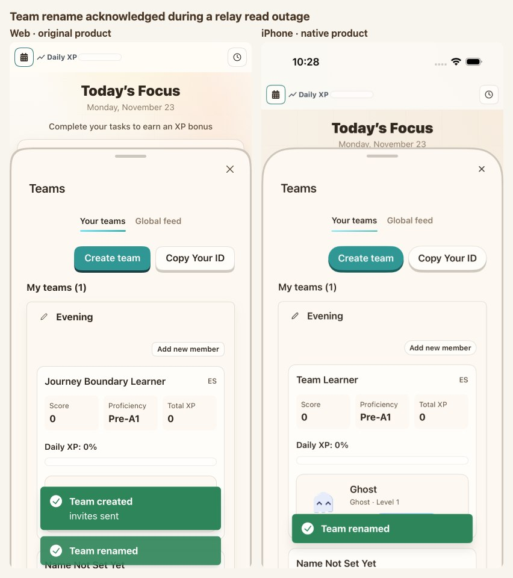

# Teams creation acknowledgment before fresh reads — 2026-11-06

Reference: read-only `RobotsBuildingEducation/nosabos` **`b269524ddc578027c549616fc47f5954991d9f6f`**. Native base: `2309b4c14ee39c96bfdef0ae6b8f6cc4ec84dd7c`. This advances FUNC-10 / DES-08. Complete functional and design parity remains **In progress**.

## Source behavior and native change

The actual `TeamCreation.handleSubmit` captures submitted values, awaits creation, emits success feedback, clears/closes its form and passes an accepted-member team record to `TeamsDrawer.handleTeamCreated`. The drawer selects Teams and refreshes. `TeamView` immediately inserts that record, renders the creator's current row and marks peer progress loading before a fresh roster reply. A stale empty roster cannot hide the just-created team; the source merges that record before its member batch. These are acknowledged writes, not speculative cards shown before creation succeeds.

Native previously closed its form, waited for a new roster read and held its global working state until that read completed. Native creation now returns its signed, mirrored acknowledgment record without a second relay read. The controller inserts the card and creator row, releases creation controls and refreshes in the background. Its account/session guards reject late UI updates after drawer close or account replacement. The native access layer retains the new record in a stale fresh read so its ordinary member batch still runs. Existing teams deduplicate by creator and ID. Signed service records continue authorizing public management; mirror/display fields do not replace that authority. Rejected mirror writes retain the existing signed rollback and never return a successful card receipt.

The pending source form displays `Creating` with a 16-point half-ring, 0.45-second linear spinner and 0.6 composite opacity. Its fields, Invite/removal and Close remain usable while the submit button is busy. Native follows those controls for the shared create/add form. An acknowledgment event closes the current creation form and selects Teams. Submitted names/member arrays are captured before I/O. Native still fences drawer/account cancellation; these task/session guards are native adaptations rather than a claim that the source cancels every queued promise. Other concurrent management actions and busy rename presentation remain outside this checkpoint.

## Source defect and explicit native boundary

The original mounted component successfully removes a just-created card, but its parent retains `justCreatedTeam`. Returning from Global feed to Teams and resolving an empty fresh roster reinserts that deleted card. The source probe records this defect in both languages; it does not treat it as a native acceptance target. Native retires its transient creation placeholder after explicit acknowledged deletion, preserving its existing deletion/relaunch behavior. This is an explicit native lifecycle difference. Neither source nor native backend/rules is changed to manufacture agreement.

## Verification and retained diagnostics

Two unchanged original submit/effect callback cases cover successful and failed writes, captured submitted values, close-before-created ordering and immediate creator/member-loading state. Fourteen actual mounted-browser phases cover English/light and Arabic/dark pending controls, acknowledgment before roster reply, stale empty roster, member settlement, failed-write form retention and the deleted-card source defect. Public I/O is controlled; this is not an authenticated production source App, production Nostr/Firebase outage test or proof of all creation variants.

The paired native fixture uses the actual controller acknowledgment event and live SwiftUI form state with held access I/O. It checks that both native text fields remain enabled while creating. Its post-acknowledgment frames wait for the ordinary source notice to expire; actual native product frames retain immediate feedback and the three-second card-appearance check. Component comparisons and full native journeys retain separate scopes.

A first browser diagnostic expected a new fixture field while the preview still served its cached older JSX. Direct inspection showed `__createdSelf` undefined; restarting only the owned preview loaded the current fixture. The later intermediate comparison also exposed two differences despite passing assertions: native opacity dimmed text separately from its background, and the source fixture omitted completed onboarding. The source therefore applied its legacy default Score 1, while the native fresh baseline displayed 0. Both renderers now use completed-onboarding/no-practice inputs, which the actual source maps to 0. Production progression code is unchanged. Native button compositing now matches CSS group opacity. Two pre-correction pairs are retained; they are not final parity evidence.

The final `/tmp/piyali-teams-created-final-20261106.xcresult` passes **49 XCTest cases, zero failures/skips**. **47 app cases pass in 78.343 s**: 21 controller checks, four mirror contracts, three private-team contracts, the rejected-mirror rollback contract, nine signed-loopback Nostr checks, six startup checks and three source/native comparison methods. Both complete native journeys pass in **239.347 s** (Arabic 111.058 s; English 128.289 s). The opt-in production relay test is explicitly excluded; no production relay result or unrelated Core rerun is claimed.

The new real SDK case verifies returned creator/accepted-member fields against the actual stored mirror and signed event, with no intervening relay read. Its subsequent load deduplicates the group; deletion followed by an empty read stays empty. The existing rules-backed case proves a rejected mirror write produces a signed deletion rollback and no successful receipt. Controller cases cover immediate creator display and released controls through a held/older empty read, deduplication, failed writes and late closed receipts.

The Arabic native journey performs signup/onboarding/setup → actual Settings language change → create, then holds fresh relay reads immediately after the creation acknowledgment. Within three seconds the named card and creator row appear, the form closes, creation controls are enabled and peer progress remains absent. It then releases the read, verifies signed peer progress, terminates/relaunches into a held member batch, changes an unsigned mirror title before a signed response, settles fresh signed XP and deletes/relaunches empty. The English create/queued-ID/edit/add/relaunch/delete/feed journey also passes. Events stay on the loopback relay; no unsolicited kind-1 post is sent.

The final comparison retains **eight new source/native creation pairs** (creating, roster-held, members-held and settled in English/light and Arabic/dark), plus **36 regression pairs** for initial stages, streamed rosters and invitation badges. New pending/acknowledged/settled samples and twelve native product phases were visually inspected. The final native busy label now composites like the source; both equivalent onboarded creator rows display Score 0. Small preexisting card-shadow, glyph/raster and spinner-phase differences remain; these samples do not establish full-shell or animation equivalence.

The [206-artifact manifest](native/teams-created-b269524d/manifest.json) hashes ten implementation/test/harness inputs and six read-only source files. It retains original PNG/geometry, 44 final normalized pairs, twelve native product frames/contact sheet, two pre-correction pairs, source callback/browser results, passing intermediate/final summaries, the cache diagnostic observation, commands and matching installed/build executable/debug-library hashes. See [creating](native/teams-created-b269524d/pair-creating-en.png), [Arabic creating](native/teams-created-b269524d/pair-creating-ar.png), [acknowledged card while roster is held](native/teams-created-b269524d/pair-roster-held-en.png), [actual immediate native acknowledgment](native/teams-created-b269524d/ui-native-acknowledged-creation-before-held-roster-reply.png) and [native product phases](native/teams-created-b269524d/native-product-contact.png).

Every simulator operation targets isolated QA `CE8248B6-7171-4FD4-97DE-89E499107F82`; regular simulator `5CEE88FE-AE9D-4982-88BE-3FB739281A80` and its learner remain untouched. Existing local emulators/Vite are preserved. The owned preview is stopped and only its three unrelated generated manifests are restored to starting bytes. Source remains clean/read-only. [Commands](native/teams-created-b269524d/commands.txt) retain explicit opt-ins, selections and result paths. Attachments are exported only from terminal bundles; Swift files are not edited during live Swift/test builds.

## Remaining scope

This does not complete Teams or the overall goal. Creation-placeholder continuity across drawer close/reopen still needs reconciliation with the source's persistent parent state; process relaunch uses existing verified caches. The public service's serialized read/mutation conductor still affects action latency during held member queries. Broader creation-input/self/legacy/size variants and imported profile-name precedence, concurrent actions/invitations, cold public progress caches, production outage/reconnect/grants and full motion/RTL/accessibility/device coverage remain open. Source create utility also starts a best-effort progress publication; native retains its existing debounced publisher, and exact publication-count/timing equivalence is not established here. Other handoff requirements, including payment/recovery, real-device audio and release gates, remain open. Separate Firebase/Cloudflare services are preserved. No deployment, merge or publication is included.

## Drawer reentry with a delayed roster

Closing and reopening the original drawer exposed two distinct first screens. With startup still pending, the created team and creator row appear immediately. With a completed empty preload, the empty list briefly wins. Once the fresh read returns, both show the created team even if the returned list is empty. The original browser comparison exercised both cases, then resolved the member details.

The native drawer now retains the acknowledged creation across dismissal in the signed team service, scoped to the identity session. A completed preload takes precedence on reopen. Reimporting the same key starts a fresh session, and a signed deletion retires the card. The real SDK check covers pending preload, session replacement and deletion. The Arabic product journey covers completed preload, an outstanding relay read, restored member progress, deletion and relaunch. It passed in 118.5 seconds. The first UI attempt hit the creation notice over the menu button; the final test waits for the menu to become hittable before reopening it. Management actions queued behind slow member reads remain open.

## Rename acknowledged while relay reads are unavailable

At `b269524d`, a disposable signup opened Teams from the original web main route, created Weekend, and renamed it to Evening. A loopback relay verified the signature, acknowledged the rename and then rejected subsequent queries. The source closed the editor, kept Evening visible and wrote Evening to its Firestore mirror. After the relay resumed answering, reopening Teams showed the same name. The browser used a separate local Firestore emulator and relay.

iOS now completes the public rename after the signed acknowledgment and the Firestore mirror attempt. It updates the visible card immediately and keeps the source's warning if the mirror cannot confirm. Ordinary progress and profile reads no longer hold the roster mutation lock. Those reads renew only member data for the verified roster, and late replies leave the team title alone. A failed optional query preserves last-known data for members still in the signed roster. A new signer session fences off pending reads and writes even when the public key stays the same.

`/tmp/PiyaliTeamsRenameReconnectFinal-20261123.xcresult` passed all 11 selected native checks. The signed test held a member read for four seconds and confirmed that the rename returned before it. The product journey went from onboarding to Enter Teams, saved the rename during rejected relay reads, checked the Firestore mirror, restored the read side, added a member, relaunched with Evening still present, deleted the team and reopened the empty drawer and Feed. The first test fixture accidentally triggered the outage again on later events for the renamed team. The final fixture interrupts reads once after the rename.

The captures use disposable accounts. The browser still shows an earlier creation notice because its scripted flow reached Rename faster. Button shapes and the tray safe area differ. The relay and Firestore failures were controlled locally. Production relay reconnect, mutation recovery for add/delete/leave, and wider drawer design checks remain open.
