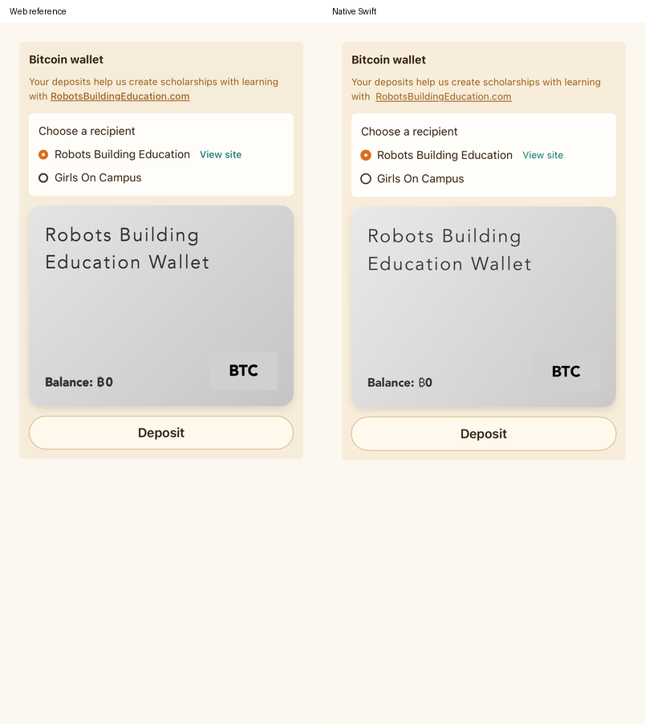
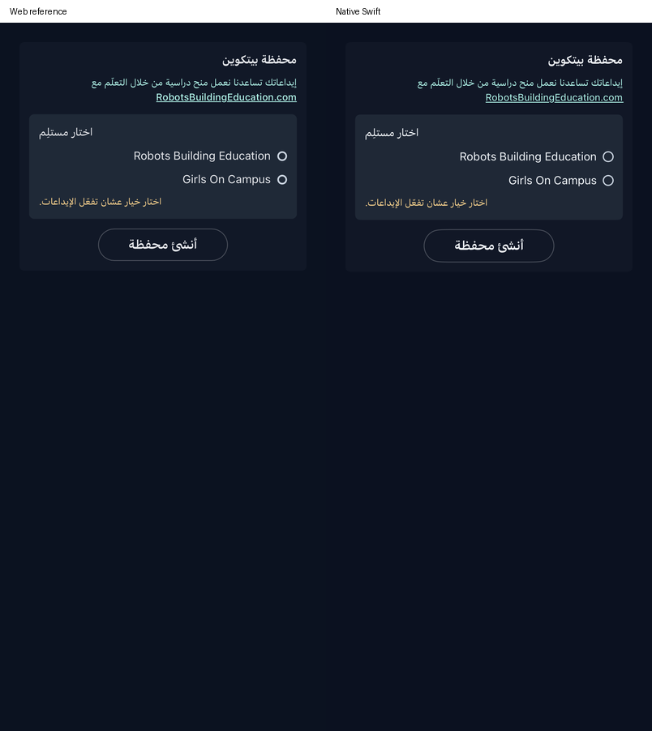

# Wallet screen correction

This checkpoint ports the main product's `IdentityDrawer.jsx` → Account → `BitcoinWalletSection` into the native Account accordion. It does not establish full product or payment parity. The reference repository is read-only.

## Source behavior now represented

- The wallet expands inside Settings → Account. The source scholarship note, two recipient names/sites, missing-recipient notice and selection state replace the generic initial form. The exact ten-language wallet dictionaries, nine-language public-feed dictionary, recipient keys and URLs are exported from the source by `scripts/export-wallet-ui.mjs`; inline support copy uses the existing source Settings export.
- Selection saves the original root `identity` field through the existing account-scoped settings outbox. Successful wallet creation/restoration saves `createdWallet`. Canonical reads, acknowledgment, offline encoding/rebase and mixed settings patches preserve these fields without including payment proofs, XP or paid grants in the patch.
- Empty, unfunded, invoice and funded states use the original wallet content, source card name, silver/pink gradients, balance/BTC treatment, recipient selection and outline controls. The funded card uses Times New Roman on iPhone because the source's undeclared `IBM Plex Mono` family falls back to the browser serif face. Gradient decoration does not receive touches, including outside its clipped visual area. Gradient position animates over six seconds; the native easing and snapshot phase can differ.
- The main Deposit action requests **100 sats**, and is disabled until a recipient is chosen. The invoice QR contains the raw BOLT11 invoice. Copy address, Cash App and Generate New Address use the source content/actions. The latter reuses an outstanding saved quote instead of discarding payment recovery data.
- Funded wallets open a native Public transactions drawer. It reads verified kind-9321 receipts from the source relays over a 30-day window, deduplicates IDs, filters the exact source note, sorts newest first and resolves latest signed profile metadata. It never imports/redeems the feed's proofs. Invalid signatures and malformed/non-positive proofs are rejected. Receipt parsing is compared with the original drawer and installed NDK on ten signed/tampered examples.
- Newly signed native nutzap receipts now carry the source `Robots Building Education` note and the NDK `alt` tag. This allows the source drawer to verify/display them. Saved pending outboxes retain their original events; the implementation does not rewrite a previously submitted receipt.

## Preserved native payment safeguards and adaptations

The existing Keychain wallet, separate receiving keys, per-account journal/leases, encrypted Nostr configuration, saved blinded batches, DLEQ checks, mint-fee approval and lost-response/relay-ack recovery remain in place. Browser restoration remains an explicit action and retains existing receiving keys and proofs.

Payment tools and recovery is a secondary native sheet containing the previous custom-amount deposit, invoice sharing/opening, expired-quote archive/check, manual receive/send, fee preview and recovery controls. The later [scholarship correction](SCHOLARSHIPS.md) adds the once-per-account source prompt, completion/review/quest sequencing and automatic source support. Modern wallets without a saved preference adopt one sat per newly earned XP activity with zero additional fees. Explicit stops and manual fee/recipient approvals remain authoritative. Source-managed recipient changes retain submitted operations and update future intents. The prompt writes `tutorialBitcoinModalShown` after dismissal and shares this Account wallet’s recipient and payment recovery.

Metadata unavailability keeps valid public receipts with shortened key names. The native receipt reader adds a local date/100-row bound even if a relay ignores the requested filter. The side drawer keeps its physical right placement for Arabic, with its content following RTL. Real invoice/payment/funded account verification, physical iPhone wallet behavior and the full public-drawer design/error/lifecycle matrix remain unverified. Tests use disposable keys, a local issuer/relay or inert preview data; no real funds move.

## Verification

The passing runs and precise counts are recorded in [VALIDATION.md](VALIDATION.md). The service suite covers encrypted browser restoration, quote/archive/restart recovery, fees, separate receiving keys, duplicate and cross-device redemption, remote signing, lost mint/swap responses and stable publication retries. The canonical Firestore SDK check saves/retries both wallet fields and checks the unchanged XP, entitlement and foreign timestamp values.

`WalletPlayTests` enters through named signup or the real key login, completes onboarding, opens the product menu and Account accordion, then verifies explicit restore or create/recipient selection, optional-tools access, relaunch and absence of unsolicited invoices. Publication assertions inspect only the loopback relay. Regular simulator installation preserves saved learner profiles/preferences before launching the tested binary.

The eight component comparisons below mount the **actual source component** at iPhone width using an inert wallet store and blocked external I/O. The native side is the actual native presentation with inert callbacks. They cover English/light and Arabic/dark for empty, unfunded, invoice and funded states. The preview invoice is deliberately a non-payable string; these images establish layout/content, not payment validity. Actual product journey captures are separate.





## Remaining scope

The full Account accordion geometry, all ten languages/device sizes, complete public transaction drawer presentation and live relay availability, receiving-setup availability for both source recipients, interrupted account/signer changes during payments, physical audio/key authentication and real payment/release checks still require work. QR generators can produce different module patterns/quiet zones for the same invoice. Native icon glyphs, fonts, easing, line wrapping and transient feedback may still differ. Source-localized payment error/maintenance copy has not replaced the retained English recovery tools.

Reproduce the scoped native selection with the read-only reference preview on port 5181 and the existing Firestore contract emulator on port 8180:

```sh
TEST_RUNNER_PIYALI_OFFLINE_TESTS=1 \
TEST_RUNNER_PIYALI_TEST_IDENTITY_SCOPE=$(uuidgen) \
TEST_RUNNER_PIYALI_REFERENCE_PREVIEW_TESTS=1 \
TEST_RUNNER_PIYALI_FIRESTORE_EMULATOR_TESTS=1 \
scripts/test-ios.sh \
  -only-testing:PiyaliTests/WalletPanelTests \
  -only-testing:PiyaliTests/WalletServiceTests \
  -only-testing:PiyaliTests/FirestoreContractTests/testWalletRecipientAndCreatedFlagRetriesPreserveForeignProgressAndEntitlement \
  -only-testing:PiyaliUITests/WalletPlayTests
```

The wrapper selects the separate Piyali Parity QA device. The optional default-recipient public-network lookup is skipped unless explicitly enabled; it is not evidence that either recipient has working live payment setup. `swift test --filter SettingsSourcePolicyTests` covers the canonical wallet-field settings/rebase changes without a simulator.
