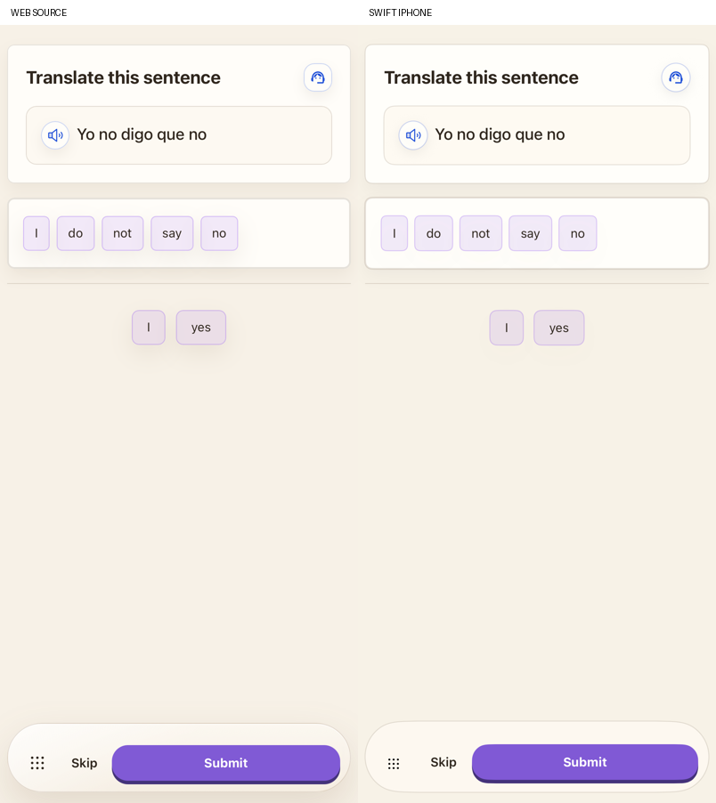
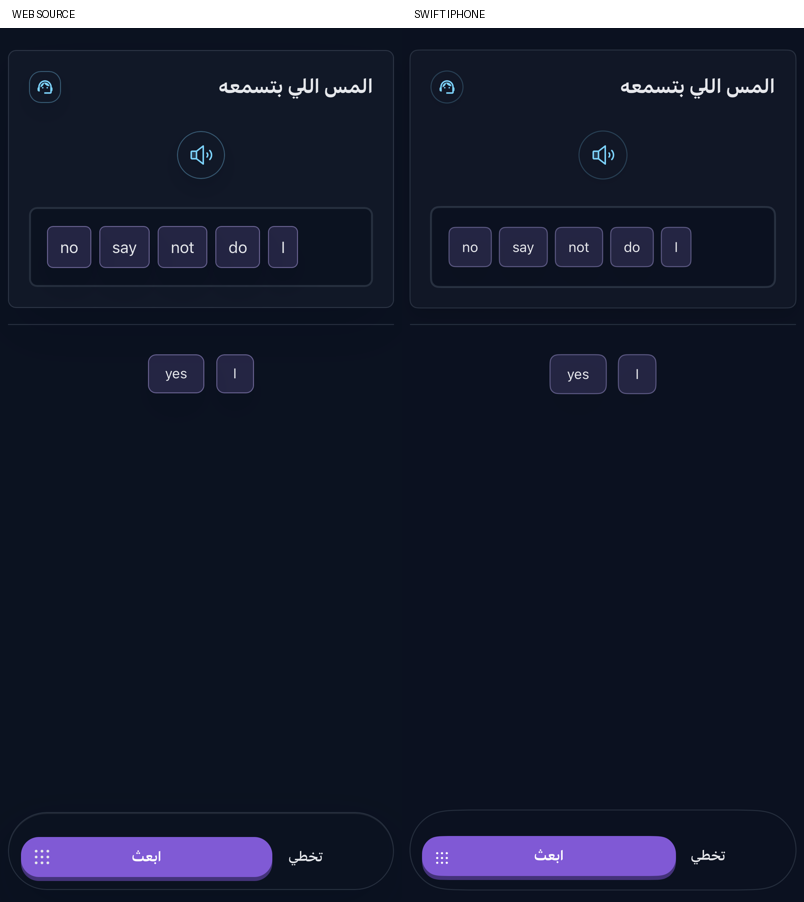

# Translation and repetition exercises

Translate Sentence and Repeat What You Hear now use their original question bodies. The native translation card contains the source sentence/audio bubble; repetition uses a centered audio control and keeps the sentence hidden in all three repeat modes. The invented transcript toggle is removed. Original headings, instructions, answer/bank surfaces, divider, chip treatment, feedback borders and fixed Submit/Skip/Next actions are retained.

The original source components share bank/ordered-selection callbacks. Taps remove a word from its bank position and append it to the answer; tapping a selected word returns it to the end of the bank. Native drag supports insertion, return and reorder in both areas. Duplicate spellings keep separate token positions. Correct runs lock changes and award once through the existing lesson controller; wrong-answer feedback remains visible during editing. Native quiz answers remain fixed after grading through the existing quiz contract. Private saved responses retain bank order separately from ordered answer indices. Earlier saved responses recover the available bank from unused positions.

Both translation directions and all three repeat modes retain their source/answer languages. Target listening uses the reference answer sentence, as the original generator does, rather than speaking the hidden support-language generation field. Missing generated distractors use the original four-choice fallback pool, excluding normalized answer words. These fallbacks are applied at fresh parsing; saved learner runs are not rewritten. The source fallback uses Spanish or English pools, including its existing English default for other languages.

Help now executes each original child callback and its Grammar/Vocabulary parent request builder. Wrong-answer explanations use the original parent templates, including their existing default template for translation. They describe the last submitted attempt while tiles are edited, retain their cache until another attempt, and reject responses from another account, language, question or canceled request. Opening help and moving tiles do not award XP. Exact reference words retain a grading fast path; distinct accents, non-Latin marks and symbols use the original semantic judge instead of being conflated by normalization. Valid alternatives can still be accepted by that judge. Other legacy formats still need their original help/explanation construction.

The read-only preview mounts the actual TranslateSentence/RepeatWhatYouHear components. Only their initial bank/selection and reset effect are replaced with controlled public states; provider callbacks are inert. The separately exported original handlers cover 84 movement cases, 48 fallback-bank cases and 80 assistance requests across both modules and four language pairs. Source file hashes and adapter details are in `reference/word-bank-*-manifest.json`. The preview keeps actual JSX, theme, copy, DnD controls and action dock. Production uses SwiftUI, not a WebView.

English/light and Arabic/dark comparisons include idle, wrong, assembled and locked states. The capture adapter also supplies the parent explanation/note callbacks so those feedback controls match the actual lesson. RTL answer words retain the original reversed sequence grouped at the physical left; the available bank stays centered. The final run results and image provenance are recorded in `VALIDATION.md`.

Speaking and lesson-flashcard bodies now have their own [correction checkpoint](ORAL_EXERCISES.md). Remaining work includes source question TTS/voices/effects and active-audio motion, other legacy assistance prompts, broader locale/device/accessibility/interruptions and physical iPhone checks. Small font, shadow-strength, stroke, menu and feedback geometry differences remain. These exercise checks do not establish full product parity.

All component and product captures use Final6. The following exact-reference grading correction is verified by Live7 and the 28 Unicode verdicts; no view or gesture code changes after Final6. Live provider outputs use only the fixed public exercise content.
