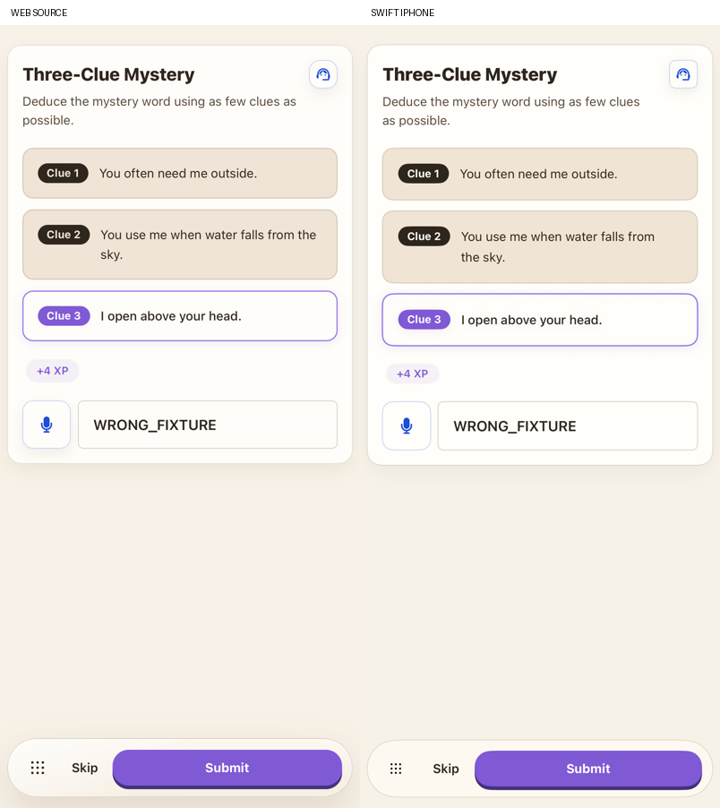
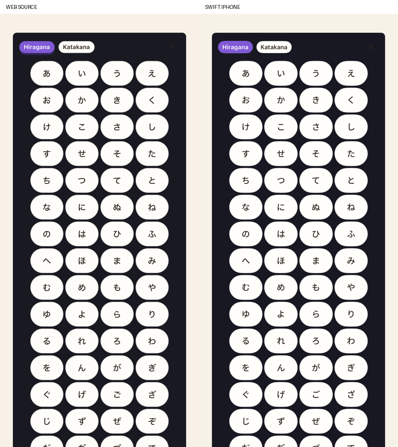

# Native writing exercises

Sentence Shapeshifter, Three-Clue Mystery and Three-Word Challenge now use their original source bodies inside the shared lesson action area. The earlier generic advanced text form is removed for these formats. Production uses SwiftUI, the original source content/prompt policies and the existing native Realtime speech transport.

| Exercise | Behavior |
|---|---|
| Sentence Shapeshifter | Source sentence with audio, downward constraint cue, automatically focused single-line answer, microphone, Enter submission, retry and correct locking. |
| Three-Clue Mystery | Original progressive clue cards, latest-clue emphasis, bounded reveal and potential reward of 10/7/4 XP. Revealing a clue grants no XP. Typed and spoken answers use the same original semantic judge. |
| Three-Word Challenge | Three original cue chips, typed or spoken original sentence, Enter submission, retry and correct locking. Generated examples do not limit the production semantic judge to exact matches. |

The five beta targets (Japanese, Russian, Greek, Polish and Irish) use the original virtual keyboard arrays and translated labels. Japanese switches Hiragana/Katakana; the other four switch case. Keys append to the end, Space appends a space and Backspace applies the original UTF-16 last-unit deletion. The native String boundary displays a replacement character if the source leaves an unpaired surrogate. Closing and reopening resets the keyboard mode, as the source unmounts it. Locked keys ignore text changes; the keyboard's internal mode and close controls remain available.

Speech starts only after microphone permission and the Realtime data channel are ready. The same original transcription session policy used by native Review drives recording, silence finalization, stopping and error handling. The expected answer is not injected as an ASR hint. A completed transcript updates the saved answer and submits it once through the normal semantic grading, reward and progress pipeline. Account, language, question and access ownership fence late capture/grade callbacks. Leaving, backgrounding, switching questions or submitting manually cancels outstanding capture/submission.

`export-writing-exercises.mjs` runs the original keyboard layout/label functions, beta key handler and clue display/reveal calculations. Its fixtures contain 70 key states, 60 clue states and 10 layouts. The keyboard also uses 312 border-box key widths measured from the actual source in iOS WebKit, so the source wrapping is preserved despite small native glyph-width differences. Both source support directions/themes agree. `reference/writing-keyboard-widths.json` records the capture provenance and source/style hashes; the exporter refuses stale measurements after those sources change. The measurements do not change the displayed Unicode characters. All thirteen generated resource/fixture/manifest/icon files reproduce byte for byte. The manifest records source file hashes. Five original microphone/keyboard icons are template assets with notices included in the app.

The read-only reference preview extracts the actual three source components, speech button, keyboard and helpers. Twenty-four body states cover untouched, typed, invalid and locked responses in English/light and Arabic/dark. Twenty keyboard states cover every beta target and both modes in those support languages/themes. Each reference uses fresh WebKit storage and checks the requested theme. Component captures deliberately blur the source field and disable only native automatic focus; the actual product journeys keep normal focus behavior. These component captures do not include the global navigation bars.

Explicit Debug/offline/UUID-scoped question, provider and speech fixtures support repeatable product journeys through actual account creation, language selection, first-run setup, placement, course path and preview. They still use the real response, submission, persistence, reward and next-question code. None run in the installed regular simulator or with the live API flag. The live check separately authenticates a disposable identity with Firebase/App Check and sends the original three semantic prompts through the actual provider, without learner-progress or relay publication.

Exact final runs and their limits are recorded in `VALIDATION.md`. This checkpoint does not finish full product parity. Standard exercise bodies, beta keyboard integration on other surfaces, precise text-field overflow/font/corner geometry, source-style transient speech error toasts (currently inline), source question TTS/voices and selection/submission sounds, wider accessibility/device/locale and target-RTL cue layouts and physical iPhone microphone behavior remain open.

## Retained comparisons and journeys

The 44 paired component captures in `native/writing-*` use the final visual run listed in `VALIDATION.md`. These include the source and native implementations at the same 402 × 874 point viewport.

The six `native/writing-product-*` captures document Journey6's real product paths before the final field/key/badge and shadow-only visual adjustments: [spoken clue answer](native/writing-product-clue-speech.png), [progressive reveals](native/writing-product-clue-reveal.png), [Japanese input](native/writing-product-ja-keyboard.png), [Russian input](native/writing-product-ru-keyboard.png), [transformation submission](native/writing-product-shapeshifter.png) and [three-cue sentence submission](native/writing-product-three-word.png).
